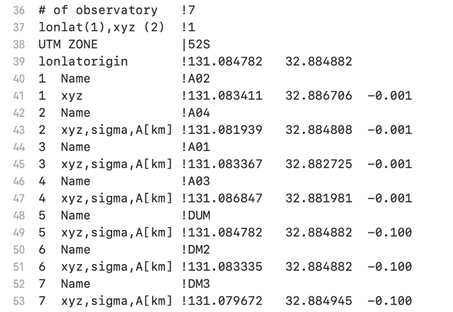
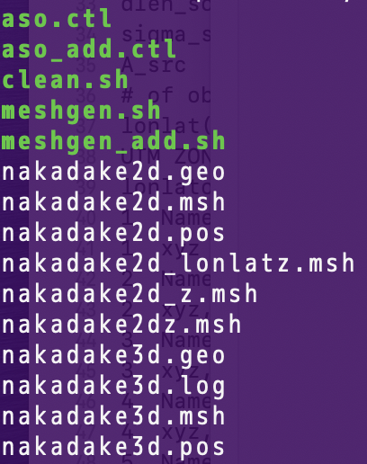
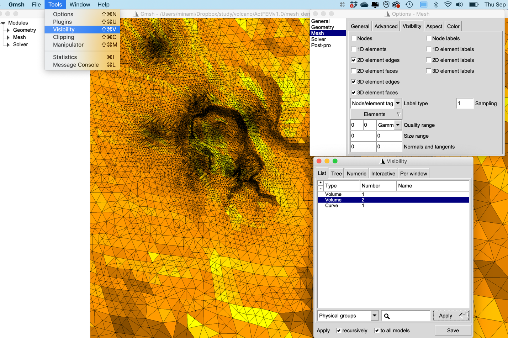
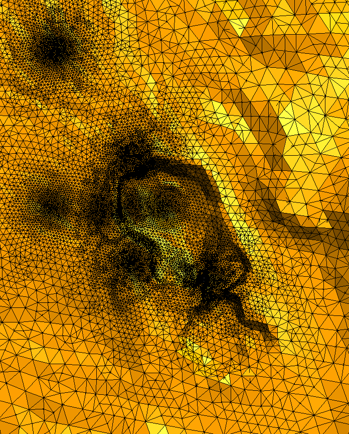
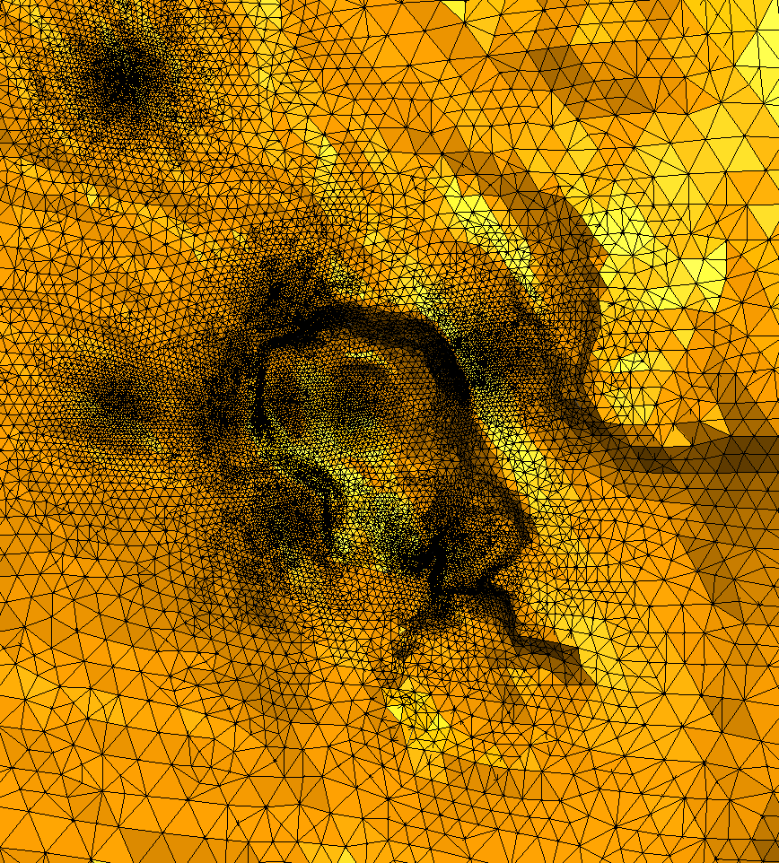
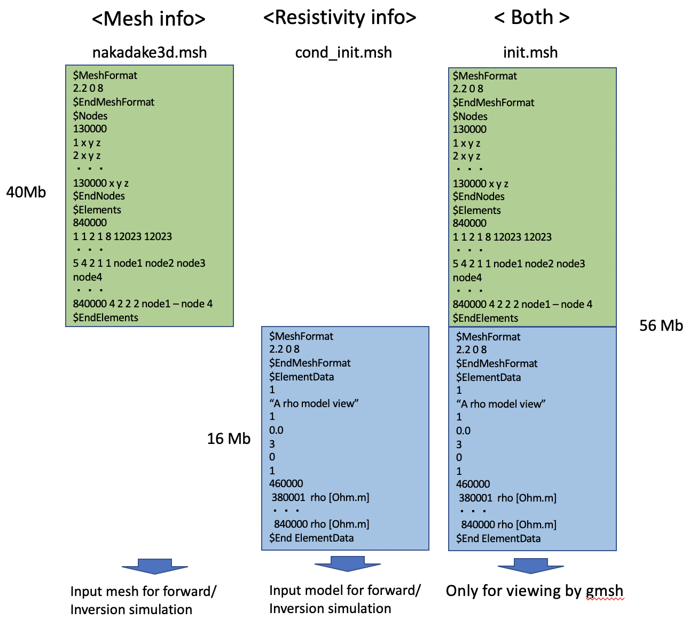
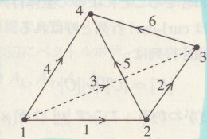

**Manual of ActFEM ver. 1.0**

ACTIVE forward-inversion simulation code using FEM

As of May 22nd, 2025

**Takuto Minami**

Faculty of Science, Kobe University

**tminami@port.kobe-u.ac.jp**

**Contents**

1.  [**Required environment**](#Required_environment)

2.  [**Run the sample**](#Run_the_sample)

3.  [**Source folder**](\l)

4.  [**Coordinate system**](\l)

5.  [**Governing equation and discretization**](#Governing_equation_and_discretization)

6.  [**File formats**](#File_formats)

7.  [**Mesh generation tutorial**](#Mesh_generation_tutorial)

8.  [**Generation of resistivity model for forward/inversion**](#Generation_of_resistivity_model)

[**Version note**](#Version_notes)

[**References**](#References)

[**Appendix A: Derivation of the discretized form of governing equation**](#AppendixA)

**Appendix B: Scaling of the governing equation for simulation**

**1.** **Required environment**

Intel compiler and MPI and openMP

**2.** **Run the sample for forward modeling**

In the ActFEMv1.0/fwd/ folder,

\$ source /opt/intel/bin/compilervars.sh intel64

\$ ./run_nakaya.sh

can generate the results.

The results will be stored in

ActFEMv1.0/fwd/results_fwd

- fwd.log log text of the forward calculation

- A01-S1.dat to A04_S1.dat are the output files for observation sites of A01 to A04

> Contents of A01-S1.dat should be:

1.000000 0.1205361E-01 -179.9929 0.2335692E-01 1.011077 0.2993918E-01 179.0991 2.878707 -177.4849 2.358679 179.8709 (First Line )

3.000000 0.1208040E-01 179.8626 0.2375266E-01 1.917512 0.2979597E-01 177.4902 2.952343 -173.3413 2.355996 179.6630 (Second Line)

Each line consist of the following outputs

Frequency (Hz), \[amp(nT), phase (deg)\] of bx, \[amp,phase\]of by, \[ \] of bz, \[amp(mV/km), phase (deg)\] of ex, \[ \] of ey

**3. Source folder**

ActFEMv1.0/src/solver_mpi/

**4.** **Coordinate system**

X : East

Y : North

Z : Upward

**5.** **Governing equation and discretization**

See Minami et al. (2018) for details. The induction equation in terms of the vector magnetic potential A,

$$\nabla \times \left( \nabla \times \mathbf{A} \right) + i\omega\mu\widehat{\sigma}\mathbf{A =}\mu\mathbf{i}_{s}$$

Is solved by the edge-based finite element method. $\widehat{\sigma} = \sigma + i\omega\epsilon$, where $\epsilon$ is the electric permittivity.$\omega$ is the angular frequency, $\mu$ is the magnetic permeability, $\mathbf{i}_{s}$ is the source electric current density. Note that the equation is easily converted to the induction equation in terms of the electric field $\mathbf{E}$**,** by using the relationship of $\mathbf{E =}i\omega\mathbf{A}$,

$$\nabla \times \nabla \times \mathbf{E +}i\omega\mu\widehat{\sigma}\mathbf{E =}i\omega\mu\mathbf{i}_{s}.$$

The magnetic field is obtained by $\mathbf{B} = \nabla \times \mathbf{A}$, after the equation is solved with respect to $\mathbf{A}$.

**6.** **File formats**

6.1 control files

Control file “nakaya.ctl” controls the forward calculation (green is explanation)

\## lines starting with "##" work as lines for comments ! 2020.09.28

\## this file is forward control file

\##-----10!-------20!

itopofile 0 or 1 !1 (0:地形ファイルを使わずメッシュ生成、1:地形ファイルを使う。)

\# of topofile !1 (使う地形ファイルの数。以下、狭い領域のファイルから、広い領域のファイルの順で、入力する。)

topofile !../topo/topo127_134_29_36.xyz (地形ファイル名)

lon lat shift !0.0 0.0 (lon latの実際の値からのshift値)

mesh file !../mesh_aso_A04/nakadake3d.msh (3-D mesh file used in the fwd calc.)

2d triangle z file !../mesh_aso_A04/nakadake2dz.msh (2-D mesh with topography info)

local line file !../mesh_aso_A04/lineinfo.dat ( line information file)

output folder !./result_fwd/

header2d (a50) !nakadake2d

header3d (a50) !nakadake3d

\# of frequency !2 (number of frequency for calculation)

Frequency \[Hz\] !1.d0 (fisrt frequency)

Frequency \[Hz\] !3.d0 (second frequency )

\##Frequency \[Hz\] !7.d0 (commented out line starting with “##”)

\##Frequency \[Hz\] !11.d0 (commented out line starting with “##”)

\##Frequency \[Hz\] !21.d0 (commented out line starting with “##”)

\##Frequency \[Hz\] !41.d0 (commented out line starting with “##”)

\##Frequency \[Hz\] !61.d0 (commented out line starting with “##”)

\##Frequency \[Hz\] !99.d0 (commented out line starting with “##”)

west bound !-1.7 (mesh parameter, not used in forward calc.)

east bound !1.7 (mesh parameter, not used in forward calc.)

south bound !-1.5 (mesh parameter, not used in forward calc.)

north bound !1.5 (mesh parameter, not used in forward calc.)

lenout \[km\] !50.0 (mesh parameter, not used in forward calc.)

upz in \[km\] (\>0) !1.3 (mesh parameter, not used in forward calc.)

downz in \[km\](\<0) !-1.1 (mesh parameter, not used in forward calc.)

zmax \[km\] !50.0 (mesh parameter, not used in forward calc.)

zmin \[km\] !-50.0 (mesh parameter, not used in forward calc.)

sizein \[km\] !0.15 (mesh parameter, not used in forward calc.)

sizebo \[km\] !10.0 (mesh parameter, not used in forward calc.)

sigma_obs \[km\] !0.4 (mesh parameter, not used in forward calc.)

A_obs \[km\] !0.01 (mesh parameter, not used in forward calc.)

dlen_source \[km\] !0.1 (mesh parameter, not used in forward calc.)

sigma_src \[km\] !0.3 (mesh parameter, not used in forward calc.)

A_src \[km\] !0.005 (mesh parameter, not used in forward calc.)

\# of observatory !4 (# of observation sites for calculation of magnetic/electric field)

lonlat(1),xyz (2) !1 (1 for lon lat input, 2 for xyz input)

UTM ZONE \|52S (UTM zone when lonlat input)

lonlatorigin !131.084782 32.884882 (lon lat origin of mesh)

1 Name !A02 (Site name 1)

1 xyz !131.083411 32.886706 -0.001 (Lon lat alt, alt is from ground surface)

2 Name !A04 (Site 2)

2 xyz,sigma,A\[km\] !131.081939 32.884808 -0.001 (Lon lat alt, alt is from ground surface)

3 Name !A01 (Site 3)

3 xyz,sigma,A\[km\] !131.083367 32.882725 -0.001 (Lon lat alt, alt is from ground surface)

4 Name !A03 (Site 4)

4 xyz,sigma,A\[km\] !131.086847 32.881981 -0.001 (Lon lat alt, alt is from ground surface)

ixyflg 0:no,1:surfv!0 (surface map flag)

\# of sources !1 (number of electric dipole sources)

Source Name !S1 (name of the first source)

source start point !131.0784333 32.8908028 -0.001 (dipole starting point)

source end point !131.0814639 32.8912333 -0.001 (dipole ending point)

Elcetric current\[A\]! 1.0 (value of electric current through the electric dipole)

sigma_air \[S/m\] !1.e-8 (electric conductivity of the air)

condflag 0:home,1: !0 (subsurface conductivity flag, 0: homogeneous earth, 1 for file input)

nvolume !1 (when flag is 0,number of volume is specified here)

cond !0.01 (conductivity of the first volume under the ground surface)

**7.** **Mesh generation tutorial**

The mesh generation for FEM modelling is one of toughest works for forward/inversion preparation. Here, simple tutorial help the users to utilize the mesh generation codes in ActFEM forward/inversion. Please start the tutorial in the folder, ActFEMv1.0/mesh_demo_Aso/.

In ActFEM/mesh_demo_Aso/, users can two different 3-D mesh files using meshgen.sh and meshgen_add.sh, where the only difference is the adopted control file, aso.ctl and aso_add.ctl. In ActFEM/mesh_demo_Aso/, you can just perform the following

\$ ./meshgen.sh

or

\$./meshgen_add.sh

Note that all the output file names by meshgen.sh and meshgen_add.sh are the same. Please conduct

\$ ./clean.sh

in ActFEM/mesh_demo_Aso/, if you want to delete all the output files generated by meshgen.sh or meshgen_add.sh. The difference between the two scripts, i.e. the difference in two control files, is the number of receiver sites, where, only in aso_add.ctl, receiver B02 is added, which results in the total number of receivers of 8 in aso_add.ctl rather than 7 in aso.ctl. The difference is shown in the following figure:

Receivers set for mesh refinement in aso.ctl (Left), and in aso_add.ctl (Right). B02 is added in aso_add.ctl.

When you succeeded in running meshgen.sh or meshgen_add.sh and generating 3-D mesh for ActFEM forward/inversion simulation, you can get the following files:

See meshgen.sh to check when each output files are generated. The final output 3-D tetrahedral mesh is nakadake3d.msh. You can check the detail of the generated 3-D tetrahedral mesh by gmsh GUI (Graphical User Interface). “Tools \> Visibility \> Selection of Volume 2 \> Apply“ shows you the ground surface of the generated 3-D mesh.

Then please check the following two pictures of ground surface of generated 3-D meshes. You can find the refined region corresponding to B02 in the 3-D mesh generated by meshgen_add.sh (i.e. aso_add.ctl). As the modification from aso.ctl to aso_add.ctl, the users can modify the resulting 3-D mesh.

 

Nakadake3d.msh generated by meshgen.sh (Left) and that generated by meshgen_add.sh (Right)

**8.** **Generation of resistivity model for forward/inversion**

For forward/inversion using ActFEM, users should prepare resistivity model for a given 3-D tetrahedral mesh. Here, simple tutorial help the users to build a resistivity model for a 3-D mesh generated in the previous section. Then please conduct meshgen.sh or meshgen_add.sh in ActFEMv1.0/mesh_demo_Aso/ before trying the tutorials here. (See Section 7 for details.)

To try tutorials here, first move to the folder ActFEMv1.0/mesh_demo_rec2tet/, where the resistivity model is constructed based on ActFEMv1.0/mesh_demo_Aso/nakadake3d.msh. In ActFEMv1.0/mesh_demo_rec2tet/, run

\$./condmesh.sh

If you succeeded in running condmesh.sh, you can obtain the following files:

cond_init.ctl is not an output file but the control file for running condmesh.sh. cond_init.msh is the file you can use in the forward / inversion in ActFEM. Generated cond_init.msh is the file used in the initial model in Minami et al. (2018, EPS) based on Kanda et al. (2018, JpGU).Note that you cannot view the cond_init.msh simply by \$gmsh cond_init.msh, because cond_init.msh doesn’t include the 3-D mesh information. init.msh is the file combining the mesh_demo_rec2tet/cond_init.msh and mesh_demo_Aso/nakadake3d.msh. The structure difference between cond_init.msh and init.msh are as follows:

Figure Structure of nakadake3d.msh, cond_init.msh, and init.msh

Then you can see the generated resistivity model by

\$ gmsh init.msh

and set some viewer parameters as shown in the picture below.

Figure View of init.msh by gmsh GUI. If users want to inverse the color scale, namely if you want to make high resistivity in cold color, click Map tab in Option Panel, and press “i”.

In the script condmesh.sh, ActFEMv1.0/src/src_mesh/gridmdl2mesh.exe is used to generate cond_init.msh. The schematic for what condmesh.sh does is in the following figure. Then please change cond_init.ctl for modification of output resistivity file.

Figure Outline of condmesh.sh

**Version Notes**

**Version 1.0**

Latest date for update is Sep 30, 2021. Forward and inversion simulation can be available.

**References**

Minami, T., Utsugi, M., Utada, H., Kagiyama, T., & Inoue, H. (2018). Temporal variation in the resistivity structure of the first Nakadake crater, Aso volcano, Japan, during the magmatic eruptions from November 2014 to May 2015, as inferred by the ACTIVE electromagnetic monitoring system. *Earth, Planets and Space*, *70*(1), 1-10.

**Appendix A: Derivation of the discretized form of governing equation**

Given the governing equation,

$$\nabla \times \nabla \times \mathbf{A} + i\omega\mu\sigma\mathbf{A} = \mu\mathbf{i}_{s},$$

in the finite element method with the Galerkin method, we numerically solve

$$\int_{\Omega}^{}{\mathbf{w} \cdot \left( \nabla \times \nabla \times \mathbf{A} + i\omega\mu\sigma\mathbf{A} - \mu\mathbf{i}_{s} \right)dV} = 0,\  \cdot \cdot \cdot \cdot (1)$$

where $w$ is arbitrary test function, where the edge-basis function is adopted for $\mathbf{w}$ in the Galerkin method, and $\Omega$ is the computational domain.

By using the relationship $\nabla \cdot \left( \mathbf{A} \times \mathbf{B} \right) = \mathbf{B} \cdot \left( \nabla \times \mathbf{A} \right) - \mathbf{A} \cdot (\nabla \times \mathbf{B})$, the first term in the left hand side of Eq. (1) is reduced to

$$\int_{\Omega}^{}{\mathbf{w} \cdot (\nabla \times \nabla \times A)dV} = \int_{\Omega}^{}{\left\{ \nabla \cdot \left( (\nabla \times A) \times w \right) + (\nabla \times w) \cdot (\nabla \times A) \right\} dV}$$

$$= \int_{\Omega}^{}{\left\{ \nabla \cdot \left( \left( \nabla \times \mathbf{A} \right) \times w \right) + (\nabla \times w) \cdot (\nabla \times A) \right\} dV}$$

$$= \int_{\partial\Omega}^{}{\left( \left( \nabla \times \mathbf{A} \right) \times \mathbf{w} \right) \cdot \mathbf{n}dS} + \int_{\Omega}^{}{\left\{ \left( \nabla \times \mathbf{w} \right) \cdot \left( \nabla \times \mathbf{A} \right) \right\} dV}$$

$$= \int_{\partial\Omega}^{}{\left( \mathbf{B} \times \mathbf{w} \right) \cdot \mathbf{n}dS} + \int_{\Omega}^{}{\left\{ \left( \nabla \times \mathbf{w} \right) \cdot \left( \nabla \times \mathbf{A} \right) \right\} dV} \cdot \cdot \cdot (2)$$

Where $\mathbf{B} = \nabla \times \mathbf{A}$ represents the magnetic field and $\partial\Omega$ indicates the boundary surface of the computational domain, and $\mathbf{n}$ is a outward unit vector normal to the surface $\partial\Omega$. Taking into account that at $\partial\Omega$,we can take

$$\mathbf{n} \cdot (B \times w) = w \cdot \left( \mathbf{n} \times \mathbf{B} \right) = 0,$$

where $\nabla \cdot \left( \mathbf{n} \times \mathbf{B} \right) = B \cdot \left( \nabla \times \mathbf{n} \right) - n \cdot (\nabla \times B) = - n \cdot \left( \mu\mathbf{j} \right) = 0$ indicates there are no electric current penetrating the boundary surface. Then, Eq. (2) reduces to

$$\int_{\Omega}^{}{\mathbf{w} \cdot \left( \nabla \times \nabla \times \mathbf{A} \right)dV = \int_{\Omega}^{}{\left\{ \left( \nabla \times \mathbf{w} \right) \cdot \left( \nabla \times \mathbf{A} \right) \right\} dV}} \cdot \cdot \cdot (3)$$

Substituting Eq. (3) into Eq. (1), we obtain

$$\int_{\Omega}^{}{\left\{ \left( \nabla \times \mathbf{w} \right) \cdot \left( \nabla \times \mathbf{A} \right) \right\} dV} + \int_{\Omega}^{}{i\omega\mu\sigma\mathbf{w} \cdot \mathbf{A}dV} = \mu\int_{\Omega}^{}{\mathbf{w} \cdot \mathbf{i}_{s}dV}. \cdot \cdot \cdot (4)$$

In the finite element method, we divide the numerical domain into finite number of the tetrahedrons and calculate the volume integral for each tetrahedral element. In the remaining, we think only an volume integral for e-th element, $\Omega_{e}$, then Eq. (4) is rewritten for e-th element as

$$\int_{\Omega_{e}}^{}{\left\{ \left( \nabla \times \mathbf{w}_{i} \right) \cdot \left( \nabla \times \mathbf{A}_{e} \right) \right\} dV} + \int_{\Omega_{e}}^{}{i\omega\mu\sigma\mathbf{w}_{\mathbf{i}} \cdot \mathbf{A}_{e}dV} = \mu\int_{\Omega_{e}}^{}{\mathbf{w}_{\mathbf{i}} \cdot \mathbf{i}_{s_{e}}dV} \cdot \cdot \cdot (5)$$

where $w_{i}\ (i = 1, \cdot \cdot \cdot ,6)$ is the edge-basis function for each edge of the e-th tetrahedron. We represent the vector potential in the e-th element as

$$\mathbf{A}_{\mathbf{e}}\mathbf{=}\sum_{j = 1}^{\mathbf{6}}{\mathbf{w}_{j}{\lbrack Al\rbrack}_{j}}\mathbf{\cdot \cdot \cdot \cdot (6)}$$

wehre

$$\mathbf{w}_{j} = \mathbf{w}_{kl} = \lambda_{k}\nabla\lambda_{l} - \lambda_{l}\nabla\lambda_{k}.$$

$\lambda_{k}$ is the nodal basis function. The relationship between j and k,l are shown in the following figure and table.

| i, j (edge id) | k   | l   | m   | n   |
|----------------|-----|-----|-----|-----|
| 1              | 1   | 2   | 3   | 4   |
| 2              | 2   | 3   | 1   | 4   |
| 3              | 1   | 3   | 4   | 2   |
| 4              | 1   | 4   | 2   | 3   |
| 5              | 2   | 4   | 3   | 1   |
| 6              | 3   | 4   | 1   | 2   |

Table A1

Using Eq. (6), Eq. (5) can be reduced to

$$\sum_{j = 1}^{\mathbf{6}}{\int_{\Omega_{e}}^{}{\left\{ \left( \nabla \times \mathbf{w}_{i} \right) \cdot \left( \nabla \times \mathbf{w}_{j} \right) \right\} dV}\lbrack Al\rbrack_{j}} + \sum_{j = 1}^{\mathbf{6}}{\int_{\Omega_{e}}^{}{i\omega\mu\sigma\mathbf{w}_{\mathbf{i}} \cdot \mathbf{w}_{j}dV}\lbrack Al\rbrack_{j}} = \mu\int_{\Omega_{e}}^{}{\mathbf{w}_{\mathbf{i}} \cdot \mathbf{i}_{s_{e}}dV},\  \cdot \cdot \cdot (7)$$

which is rewritten in the matrix form as,

$\left\{ \left\lbrack M_{e} \right\rbrack + i\omega\mu\sigma_{e}\left\lbrack N_{e} \right\rbrack \right\}\left\lbrack \mathbf{Al}_{e} \right\rbrack = \mathbf{s}_{e}$ $\cdot \cdot \cdot (8)$

$$\left\lbrack \mathbf{Al}_{e} \right\rbrack = \left\lbrack {Al}_{1}\ {Al}_{2}\ {Al}_{3}\ {Al}_{4}\ {Al}_{5}\ {Al}_{6} \right\rbrack^{T} \cdot \cdot \cdot (9)$$

$$\left\lbrack M_{e} \right\rbrack_{ij} = \int_{\Omega_{e}}^{}{\left\{ \left( \nabla \times \mathbf{w}_{i} \right) \cdot \left( \nabla \times \mathbf{w}_{j} \right) \right\} dV} = \frac{1}{3v}\mathbf{x}_{mn} \cdot \frac{1}{3v}\mathbf{x}_{m^{'}n^{'}} \times v = \frac{1}{9v}\mathbf{x}_{mn} \cdot \mathbf{x}_{m^{'}n^{'}} \cdot \cdot \cdot (10)$$

$$\left\lbrack N_{e} \right\rbrack_{ij} = \int_{\Omega_{e}}^{}{\mathbf{w}_{i} \cdot \mathbf{w}_{j}dV} = \int_{\Omega_{e}}^{}{\left( \lambda_{k}\nabla\lambda_{l} - \lambda_{l}\nabla\lambda_{k} \right) \cdot \left( \lambda_{k^{'}}\nabla\lambda_{l^{'}} - \lambda_{l^{'}}\nabla\lambda_{k^{'}} \right)dV}$$

$$= \int_{\Omega_{e}}^{}{\left( \lambda_{k}\lambda_{k^{'}}\nabla\lambda_{l} \cdot \nabla\lambda_{l^{'}} - \lambda_{k}\lambda_{l^{'}}\nabla\lambda_{l} \cdot \nabla\lambda_{k^{'}} - \lambda_{l}\lambda_{k^{'}}\nabla\lambda_{k} \cdot \nabla\lambda_{l^{'}} + \lambda_{l}\lambda_{l^{'}}\nabla\lambda_{k} \cdot \nabla\lambda_{k^{'}} \right)dV}$$

$$= \nabla\lambda_{l} \cdot \nabla\lambda_{l^{'}}\int_{\Omega_{e}}^{}{\lambda_{k}\lambda_{k^{'}}dV} - \nabla\lambda_{l} \cdot \nabla\lambda_{k^{'}}\int_{\Omega_{e}}^{}{\lambda_{k}\lambda_{l^{'}}dV}$$

$$- \nabla\lambda_{k} \cdot \nabla\lambda_{l^{'}}\int_{\Omega_{e}}^{}{\lambda_{l}\lambda_{k^{'}}dV} + \nabla\lambda_{k} \cdot \nabla\lambda_{k^{'}}\int_{\Omega_{e}}^{}{\lambda_{l}\lambda_{l^{'}}dV} \cdot \cdot \cdot (11)$$

$$s_{i}^{e} = \mu\int_{\Omega_{e}}^{}{\mathbf{w}_{\mathbf{i}} \cdot \mathbf{i}_{s_{e}}dV} = \mu I_{s}\left( \frac{\mathbf{w}_{i}^{e}\left( r_{p1} \right) + \mathbf{w}_{i}^{e}\left( r_{p2} \right)}{2} \right) \cdot \overrightarrow{p_{1}p_{2}}\ \ (12)$$

$$= \frac{\mu I_{s}\left( \lambda_{k}\left( p_{1} \right)\nabla\lambda_{l} - \lambda_{l}\left( p_{1} \right)\nabla\lambda_{k} + \lambda_{k}\left( p_{2} \right)\nabla\lambda_{l} - \lambda_{l}\left( p_{2} \right)\nabla\lambda_{k} \right)}{2} \cdot \overrightarrow{p_{1}p_{2}}$$

$$= \frac{\mu I_{s}\left( (\lambda_{k}\left( p_{1} \right) + \lambda_{k}\left( p_{2} \right))\nabla\lambda_{l} - \left( \lambda_{l}\left( p_{1} \right) + \lambda_{l}\left( p_{2} \right) \right)\nabla\lambda_{k} \right)}{2} \cdot \overrightarrow{p_{1}p_{2}}\ \ $$

In derivation of Eq. (12), the straight electric current defined by a Heaviside function penetrates the tetrahedron as shown below.

In the derivation of Eq. (9), we used the relationship of

$$\nabla \times \mathbf{w}_{j} = 2\nabla\lambda_{k} \times \nabla\lambda_{l} = \frac{1}{3v}\mathbf{x}_{mn}\  \cdot \cdot \cdot (13),$$

Correspondence between (k,l) and (m,n) are listed in Table A1.

In the calculation of Eq. (11), we can use the relationships:

$$\nabla\lambda_{k} = \frac{1}{6v}\mathbf{x}_{\ln} \times \mathbf{x}_{mn} \cdot \cdot \cdot (14)$$

$$\int_{\Omega_{e}}^{}{\lambda_{k}\lambda_{l}dV} = \left\{ \begin{matrix}
6v\frac{1!1!}{(1 + 1 + 3)!} = \frac{v}{20}\ (k \neq l) \\
6v\frac{2!}{(2 + 3)!} = \frac{v}{10}\ \ \ \ \ \ \ \ (k = l)
\end{matrix} \right.\  \cdot \cdot \cdot (15)$$

Note the theorem for integral of nodal basis function for a tetrahedron:

$$\int_{\Omega_{e}}^{}{\lambda_{1}^{k}\lambda_{2}^{l}\lambda_{3}^{m}\lambda_{4}^{n}dV} = 6v\frac{k!l!m!n!}{(k + l + m + n + 3)!}\ \  \cdot \cdot \cdot (16)$$

**  
**

**Appendix B: Scaling of the governing equation for ActFEM calculation**

In solving discretized form combining Eq. (7) and (12),

$$\sum_{j = 1}^{\mathbf{6}}{\int_{\Omega_{e}}^{}{\left\{ \left( \nabla \times \mathbf{w}_{i} \right) \cdot \left( \nabla \times \mathbf{w}_{j} \right) \right\} dV}\lbrack Al\rbrack_{j}} + \sum_{j = 1}^{\mathbf{6}}{\int_{\Omega_{e}}^{}{i\omega\mu\sigma\mathbf{w}_{\mathbf{i}} \cdot \mathbf{w}_{j}dV}\lbrack Al\rbrack_{j}} = \mu I_{s}\left( \frac{\mathbf{w}_{i}^{e}\left( r_{p1} \right) + \mathbf{w}_{i}^{e}\left( r_{p2} \right)}{2} \right) \cdot \overrightarrow{p_{1}p_{2}}\  \cdot \cdot \cdot (17)$$

a scaling is implemented in ActFEM. Scaling length $L$, set to be 1000m in ActFEM, is used. Consider to rewrite Eq. (17) by using $\nabla = \frac{1}{L}\nabla^{'},\ \mathbf{w =}\frac{1}{L}\mathbf{w}^{\mathbf{'}}\mathbf{,\ }dV = L^{3}dV^{'},\ \ \overrightarrow{p_{1}p_{2}} = L\overrightarrow{p_{1}p_{2}'},\ \ Al\left\lbrack s \cdot V\text{/}m \cdot m \right\rbrack = \int A \cdot d\mathbf{l} = \frac{1}{L}Al^{'},\ where\ Al^{'}\ \left\lbrack s \cdot mV\text{/}km \cdot km \right\rbrack,\ and\ \mathbf{E} = i\omega\mathbf{A}$. These replacements correspond to the fact that $\mathbf{w}$ **and** $\mathbf{\nabla}$ **are constructed as** $\mathbf{w}$**’ and** $\mathbf{\nabla}$**’ with the coordinate system in the unit of km.**

$$\sum_{j = 1}^{\mathbf{6}}{\int_{\Omega_{e}}^{}{\left\{ \left( \frac{1}{L}\nabla' \times \frac{1}{L}\mathbf{w}_{i}^{\mathbf{'}} \right) \cdot \left( \frac{1}{L}\nabla^{'} \times \frac{1}{L}\mathbf{w}_{j}^{\mathbf{'}} \right) \right\} L^{3}dV^{'}}\frac{1}{L}\ \left\lbrack Al^{'} \right\rbrack_{j}} + \sum_{j = 1}^{\mathbf{6}}{\int_{\Omega_{e}}^{}{i\omega\mu\sigma\frac{1}{L}\mathbf{w}_{\mathbf{i}}^{\mathbf{'}} \cdot \frac{1}{L}{\mathbf{w}^{\mathbf{'}}}_{j}L^{3}dV'}\frac{1}{L}\left\lbrack Al^{'} \right\rbrack_{j}} = \mu I_{s}\frac{1}{L}\left( \frac{w'\left( r_{p1} \right) + w'\left( r_{p2} \right)}{2} \right) \cdot L\overrightarrow{p_{1}p_{2}'}$$

$$\mathbf{\Longleftrightarrow}\sum_{j = 1}^{\mathbf{6}}{\int_{\Omega_{e}}^{}{\left\{ \left( \nabla^{'} \times \mathbf{w}_{i}^{\mathbf{'}} \right) \cdot \left( \nabla^{'} \times \mathbf{w}_{j}^{\mathbf{'}} \right) \right\} dV^{'}}\left\lbrack Al^{'} \right\rbrack_{j}} + \sum_{j = 1}^{\mathbf{6}}{\int_{\Omega_{e}}^{}{L^{2}i\omega\mu\sigma\mathbf{w}_{\mathbf{i}}^{\mathbf{'}} \cdot {\mathbf{w}^{\mathbf{'}}}_{j}dV^{'}}\left\lbrack Al^{'} \right\rbrack_{j}} = \mu I_{s}L^{2}\left( \frac{w^{'\left( r_{p1} \right)} + w^{'\left( r_{p2} \right)}}{2} \right) \cdot \overrightarrow{p_{1}p_{2}'}$$

Note here that the source current $I_{s}$ is not scaled , namely in the unit of \[A\]
