<script type="text/javascript" async src="https://cdnjs.cloudflare.com/ajax/libs/mathjax/2.7.7/MathJax.js?config=TeX-MML-AM_CHTML">
</script>
<script type='text/x-mathjax-config'>
	MathJax.Hub.Config({
		tex2jax: {
			inlineMath: [['$', '$']],
			displayMath: [ ['$$','$$'],["\\[","\\]"] ]
		}
	});
</script>

# Manual of ActFEM v1.4
## ACTIVE forward-inversion simulation code using FEM

#### As of May 30, 2026

Takuto MINAMI
tminami@port.kobe-u.ac.jp
(Faculty of Science, Kobe University)

### Contents

1. [Required environment](#Required_environment)
2. [Coordinate system](#Coordinate_system)
3. [Run samples for forward modeling](#Run_the_sample)
4. [Run samples for inversions](#Run_samples_for_inversions)
5. [Source folder tree](#Source_folder_tree)
6. [Governing equation and discretization](#Governing_equation_and_discretization)
7. [File formats](#File_formats)
8. [Mesh generation tutorial](#Mesh_generation_tutorial)
9. [Generation of resistivity model for forward/inversion](#Generation_of_resistivity_model)
10. [Version notes](#Version_notes)
11. [References](#References)

- [Appendix A: Derivation of the discretized form of governing equation](#AppendixA)
- [Appendix B: Scaling of the governing equation for ActFEM calculation](#AppendixB)


## 1 Required environment <a id="Required_environment"></a>
ActFEM requires Intel compiler (ifx or ifort, mpiifx or mpiifort) for openMP and intel MPI. There are serial modes only with openMP for forward modeling code. As for inversions, on the other hand, ActFEM has only hybrid (OpenMP and MPI) parallel codes for inversions. The required environments are as follows:

### Forward / inversion modelling
- Intel compiler (Linear systems are solved by PARDISO in intel MKL library)
- gmsh
  - on Mac → `brew install gmsh`
  - on Ubuntu → `sudo apt install gmsh`

### Viewer
- GMT6
  - on Mac → `brew install gmt`
  - on Ubuntu → `sudo apt install gmt`
- Gnuplot
  - on Mac → `brew install gnuplot`
  - on Ubuntu → `sudo apt install gnuplot`

gfortran can be used for mesh generation (src/src_mesh) and post processing data (src/src_post).

## 2 Coordinate system <a id="Coordinate_system"></a>
In ActFEM, the following coordinate system is used:

- X : East
- Y : North
- Z : Upward

## 3 Run samples for forward modeling <a id="Run_the_sample"></a>
There is a forward sample folder, ActFEM/Fwd_test. Users can check how ActFEM calculates forward simulations: Active and MT.

### 3.1 Step 1: Mesh generation (no topography)
```bash
$ cd ActFEM/Fwd_test/mesh_flat
$ chmod +x meshgen.sh
$ ./meshgen.sh
```
meshgen.sh first compile the source in ActFEM/src/src_mesh with gfortran and run the program with gmsh. If you successfully installed gmsh, you can see the following output in the terminal.

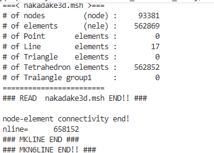

Then please check the mesh by gmsh viewer:
```bash
$ gmsh nakadake3d.msh
```

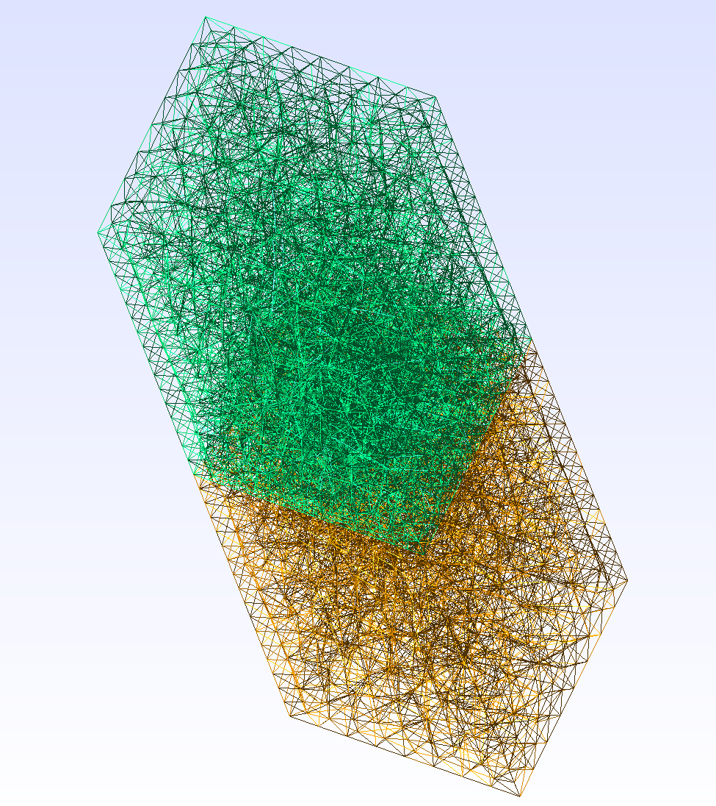 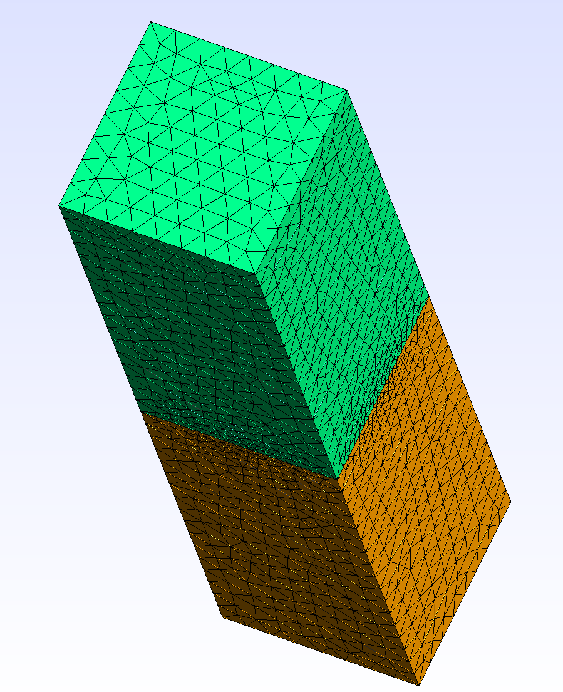 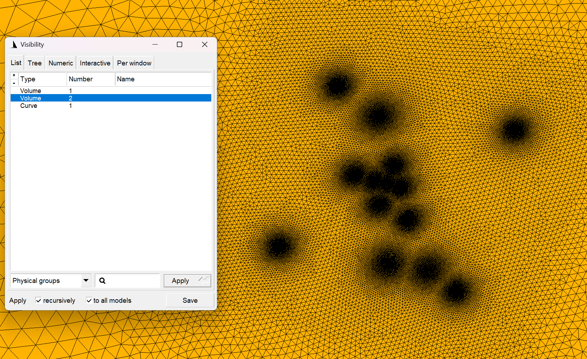

Figure. Tools > Options > Mesh > check 3D element faces shows the center panel. “Tools > Visibility > select Volume 2 > apply” shows only land elements, where you can check high resolution area for site locations.

### 3.2 Step 2: Prepare analytical solution for ACTIVE
For evaluatng forward calucualtions, you can prepare analytical solution before forward modelling.
```bash
$ cd ActFEM/Fwd_test/active_ana/
$ chmod +x run.sh
$ run.sh
```
As default, run.sh run with ifx to compile source programs in src/ana. If run.sh successfully finish, you can see:

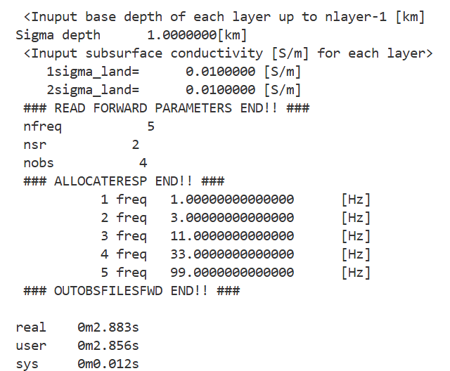

### 3.3 Step 3: Active forward modelling
After generating mesh, you can run forward modelling for ACTIVE and MT.
```bash
$ cd ActFEM/Fwd_test/active
$ chmod +x run.sh
$ ./run.sh
```
If the active forward modelling finishes successfully, you can see:

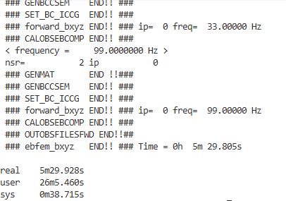

### 3.4 Step 4: Compare the active forward results with analytical solution
After you finish active modeling, you can check the accuracy of forward simulation with analytical solution in Fwd_test/active_ana/result.

In Fwd_test/active/
```bash
$ chmod +x compana.sh
$ ./compana.sh
```
If the following panels appear, both active modelling and analytical solution calculations succeeded.

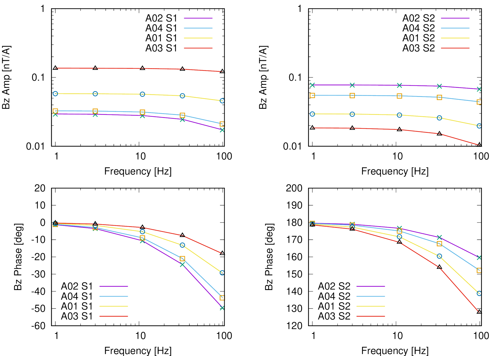

Figure. The symbols are the calculated ACTIVE response in Fwd_test/active/, while the lines are the analytical solutions calculated in Fwd_test/active_ana/. (Top: amplitude [nT/A]; Bottom: phase [deg])

### 3.5 Step 5: MT forward calculation (without MPI) with homogeneous resistivity
For MT calculations, there are serial (openMP) mode and Hybrid (openMP + MPI) mode. First, you can check serial model.
```bash
$ cd ActFEM/Fwd_test/MTfwd_test
$ chmod +x run.sh
$ ./run_homo.sh
```
If the calculation is successful, you can see the output:

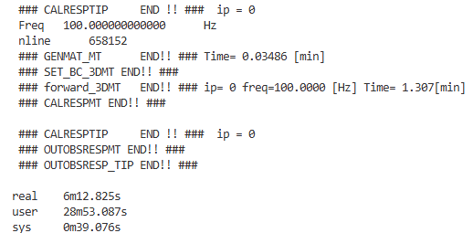

### 3.6 Step 6: Check the results of MT forward calculation accuracy
After finishing the calculations, please see how MT simulation finished.
```bash
$ chmod +x plot_rho.sh
$ ./plot_rho.sh
```

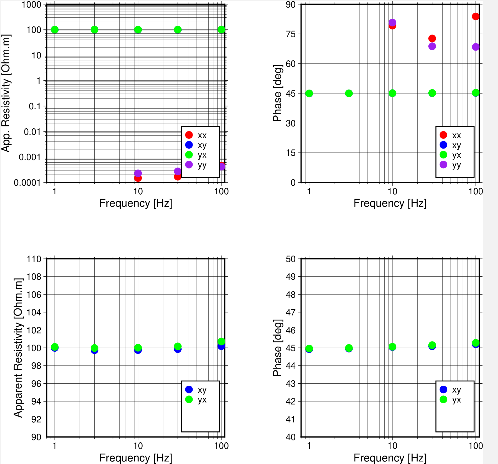

As seen in the panels, MT simulation with ActFEM succeeded in generating 100 Ohm.m apparent resistivity and 45 degrees phase over the frequency ranging from 1 to 100 Hz with less than 1% numerical error.

### 3.7 Step 7: MT forward calculation (without MPI) with lateral inhomogeneous structure
MT forward calculation can calculate tipper as well. You can check how it works with laterally inhomogeneous structure. First it is need to generate the inhomogeneous structure. In ActFEM/Fwd_test/MTfwd_test/
```bash
$ chmod +x change_model2cond.sh
$ ./change_model2cond.sh
```
The output is like the following, resulting in **cond_lateral.msh**.

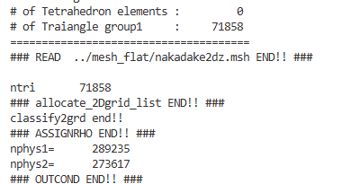

To check the generated resistivity structure, type the below command:
```bash
$ chmod +x view_slcie.sh
$ view_slcie.sh
```

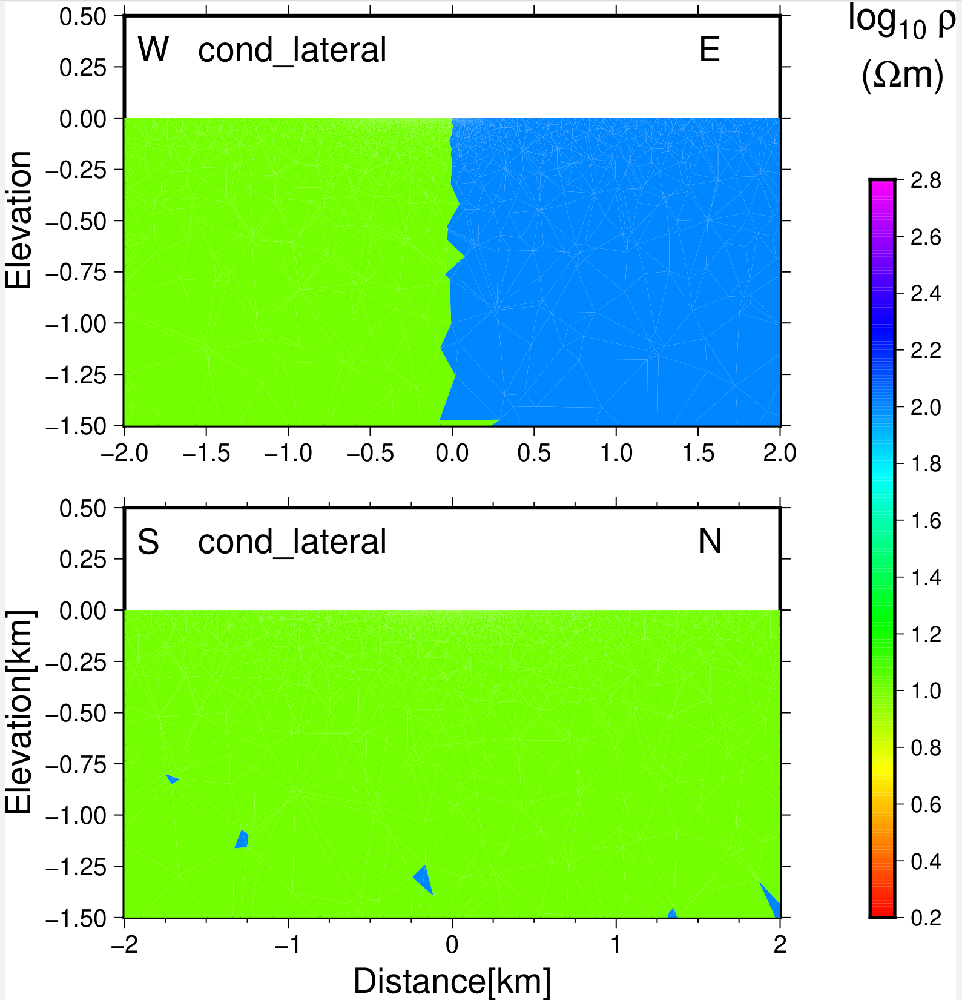

As seen in the WE and SN cross sections, the generated resistivity structure is lateral jump in resistivity at x=0 from 10 Ohm.m on the western side to 100 Ohm.m on the eastern side.

Then run the MT forward calculation with this structure by
```bash
$ chmod +x run_lateral.sh
$ ./run_lateral.sh
```
After finishing the calculation, you can see the tipper by
```bash
$ chmod +x plot_tip.sh
$ ./plot_tip.sh
```

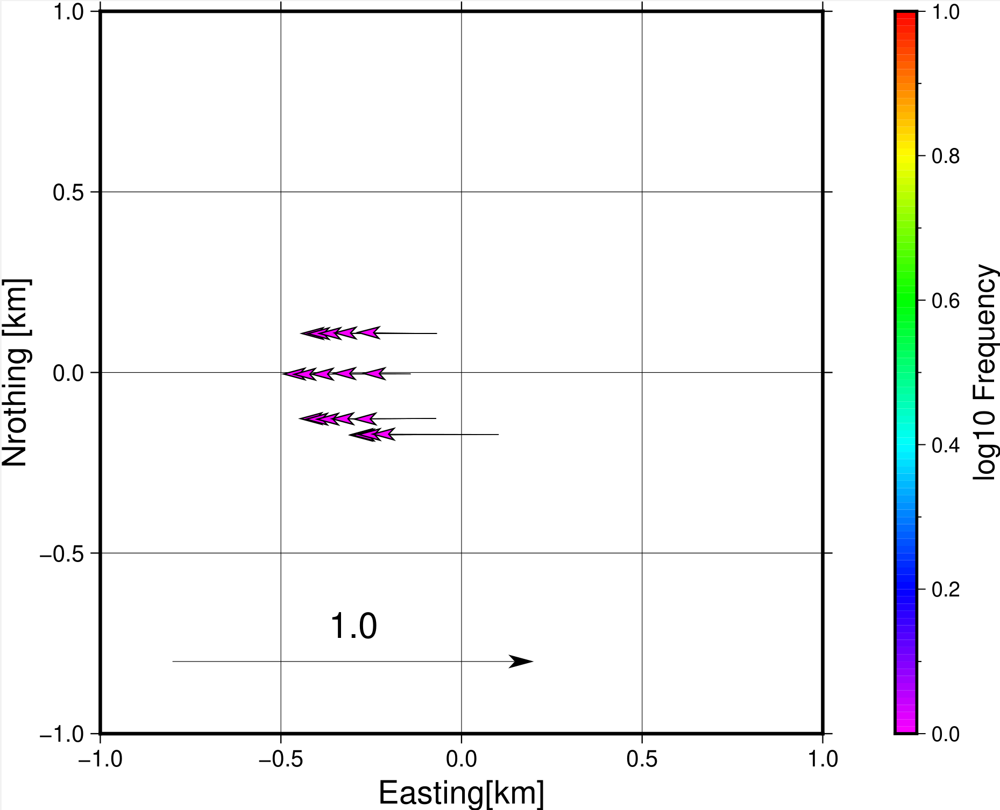

As seen in the panel, the real part of induction vector points west due to lower resistivity on the western side.

### 3.8 Step 8: MT forward simulation with MPI + OpenMP
Only MT forward simulation is now parallelized with MPI. You can do the same calculation as Fwd_test/MTfwd_test in Fwd_test/MTfwd_test_mpi/ with MPI.
```bash
$ cd Fwd_test/MTfwd_test_mpi/
$ chmod +x run_homo.sh
$ ./run_homo.sh
```
If the calculation is successful, the output is like:

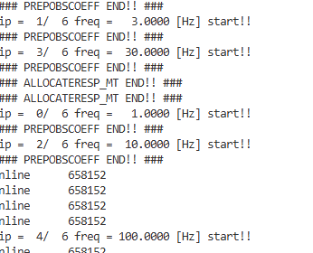

Here you can see ip=1 (node#1) calculates freq=3.0Hz, while ip=3 (node#3) does freq=30Hz, etc. Each frequency calculation is assigned to each MPI process. Then the calculation is much faster than serial version. Please confirm the results in MTfwd_test/result_homo/ and MTfwd_test_mpi/result_homo/ are identical.

## 4 Run samples for inversions <a id="Run_samples_for_inversions"></a>
In ActFEM, there 6 inversion samples: two ACTIVE, two MT, and two ACTIVE+MT joint inversion samples. To run inversions, prepare sample ACTIVE and MT data sets.

### 4.1 Step 1: Prepare mesh
Sample inversions are performed with real Aso topography. Let’s generate mesh first.
```bash
$ cd ActFEM/Joint_test/mesh_joint
$ chmod +x meshgen.sh
$ ./meshgen.sh
```
After generating the mesh, please check how it looks by gmsh viewer.
```bash
$ gmth nakadake3d.msh
```

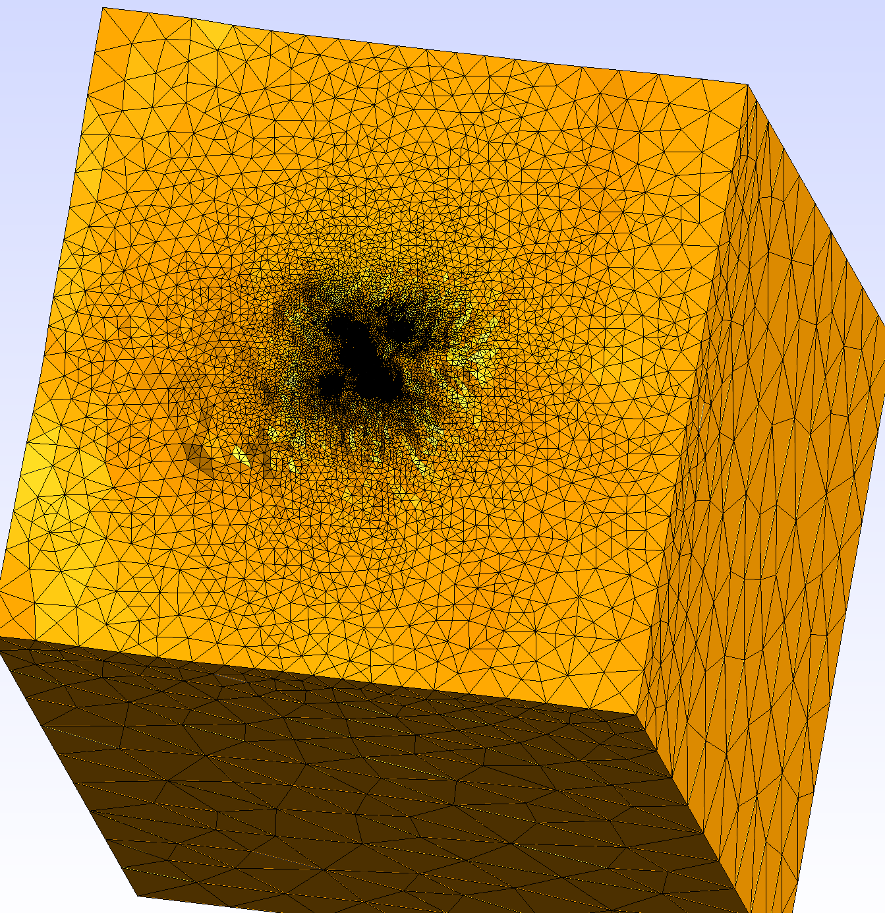 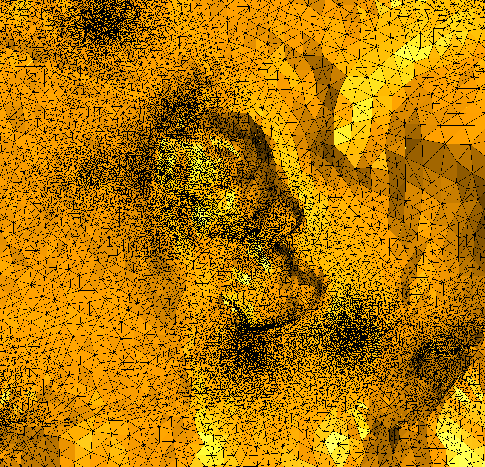

Figure. Generated tetrahedral mesh for Nakadake first crater of Aso volcano, Central Kyushu, Japan.

### 4.2 Step 2: Prepare true resistivity structure
For inversion tutorials, we should assume some goal resistivity structure. ActFEM prepares the following goal resistivity structure in ActFEM/Joint_test/structure.
```bash
$ cd ActFEM/Joint_test/structure
$ ./cond_G3.sh
$ ./cond_homo.sh
```
If it is successful, **cond_G3.msh** and **cond_homo.msh** are generated. cond_G3.msh is the goal structure below and cond_homo.msh will be used as initial and reference homogeneous structure in the following inversions. Note that cond_\*.msh files are uniquely tied to original mesh_joint/nakadake3d.msh. If you update mesh_joint/nakadake3d.msh, please regenerate cond_G3.msh and cond_homo.msh.

You can check how the anomaly of cond_G3.msh looks by
```bash
$ ./view_slice.sh
```

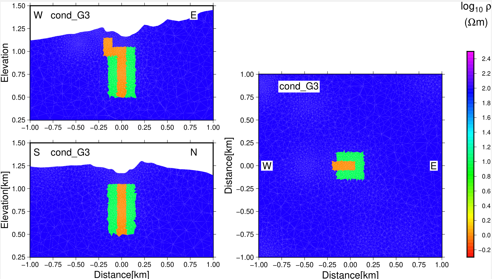

As seen in the panels, the anomaly is rectangular body extending just below the crater bottom.

### 4.3 Step 3: Generation of ACTIVE sample data for inversion
Now that we have true model, let’s generate sample inversion data by forward modelling. Firstly, active data is prepared as follows:
```bash
$ cd ActFEM/Joint_test/fwd_active/
$ chmod +x run.sh
$ ./run.sh
```
After finishing the forward calculation, prepare data with error in ActFEM/Joint_test/fwd_active:
```bash
$ chmod + generr.sh
$ ./generr.sh
```
As results, `A0*_S?_amp.dat` and `A0*_S?_pha.dat` are generated in Joint_test/fwd_active/data/. Here, `A0*` are site names written in active.ctl, while `S?` is the source name of electric dipole as written in active.ctl.

### 4.4 Step 4: Generation of MT sample data for inversion
Secondly, MT data is prepared in ActFEM/Joint_test/fwd_3DMT/
```bash
$ cd ActFEM/Joint_test/fwd_3DMT/
$ chmod +x run.sh
$ ./run.sh
```
The implementation generates **result/MT1_MT.dat** etc. The data with error are prepared by
```bash
$ chmod +x generr.sh
$ ./generr.sh
```
Then there are error files like **mt_err/MT1_MT_imp.err**, etc.

### 4.5 Step 5: Run sample inversions!!
Above, preparation for all the inversions are complete. The procedures for running inversion samples are the same. Run **run.sh**, and see the results by **plot_rms.sh** and **view_slice.sh**. For example, in Joint_test/inv_act/
```bash
$ cd ActFEM/Joint_test/inv_act/
$ ./run.sh
```
In run.sh, you should edit the number of OpenMP threads and MPI processes corresponding to your environment.

In the following, only the results are shown for obtained inversions results:

#### Results of Joint_test/inv_act
```bash
$ plot_rms.sh
$ ./view_slice.sh 06
```
Here 06 means to show model06 which is converged model.

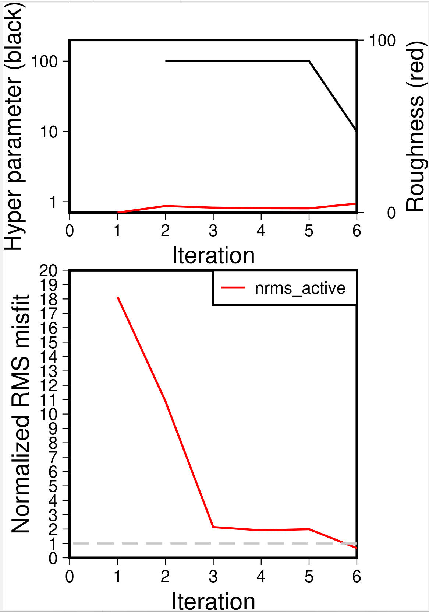 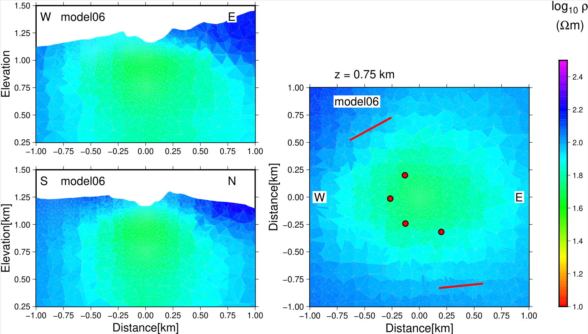

#### Results of Joint_test/inv_mt/
```bash
$ ./plot_rms.sh
$ ./view_slice.sh 09
```

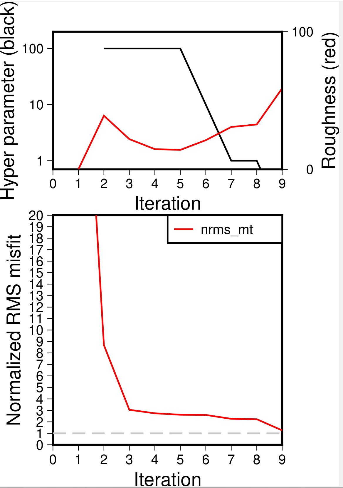 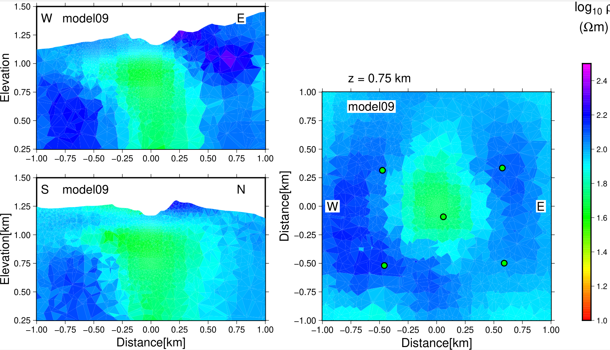

#### Result of Joint_test/inv_joint/
```bash
$ ./plot_rms.sh
$ ./view_slice.sh 08
```

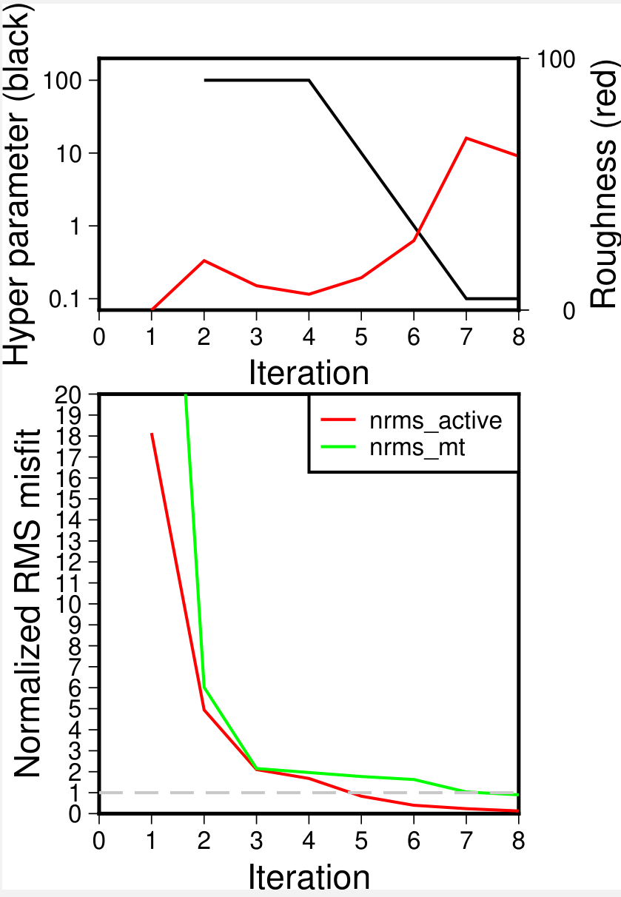 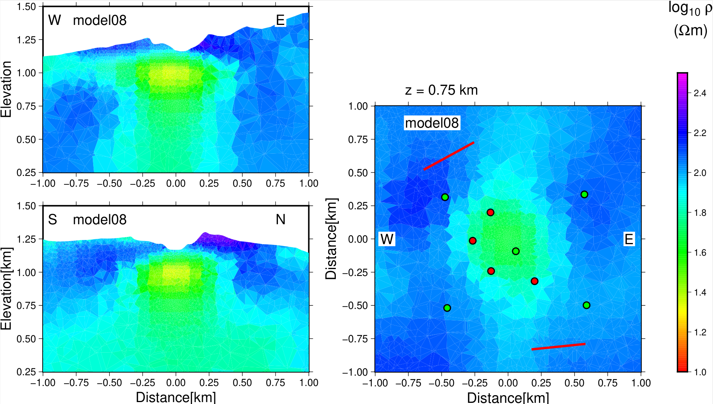

> **The following results are icombine = -1., which allows inversion to use inner outer model parametrization. The details are shown in the next section.**

#### Results of Joint_test/inv_act_icomb-1
```bash
$ plot_rms.sh
$ ./view_slice.sh 06
```

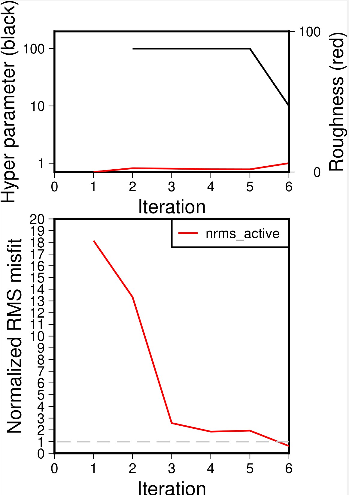 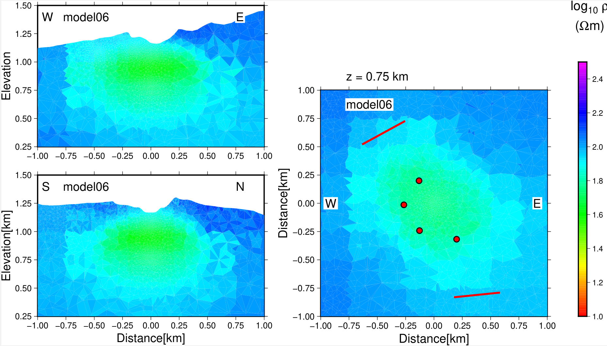

#### Results of Joint_test/inv_mt_icomb-1
```bash
$ plot_rms.sh
$ ./view_slice.sh 10
```

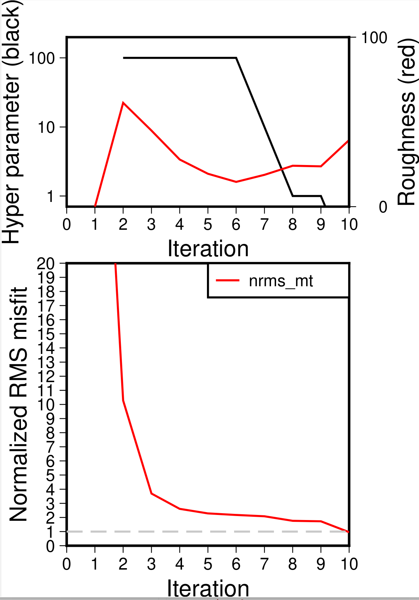 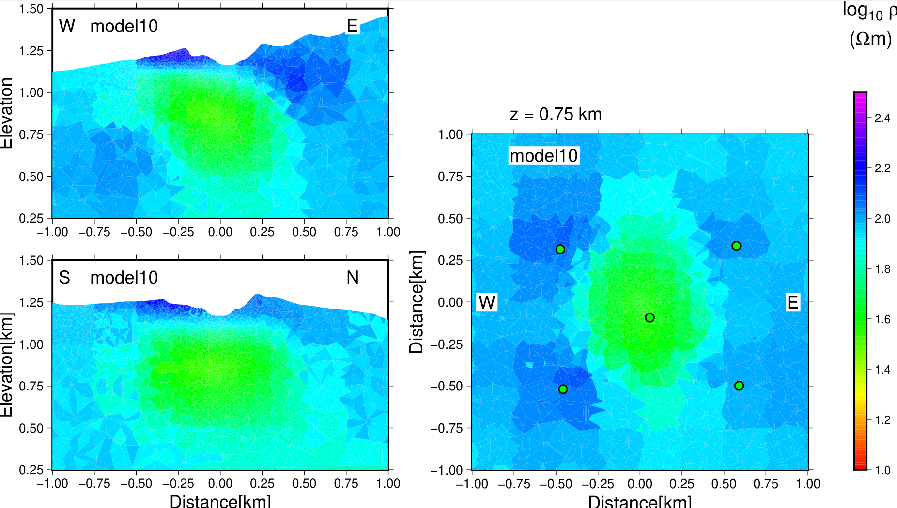

#### Results of Joint_test/inv_joint_icomb-1

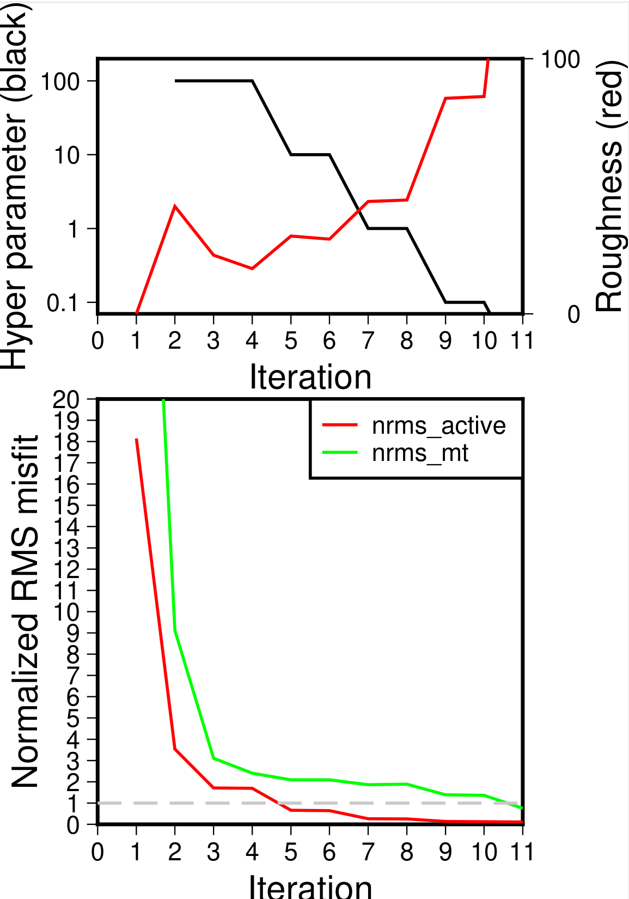 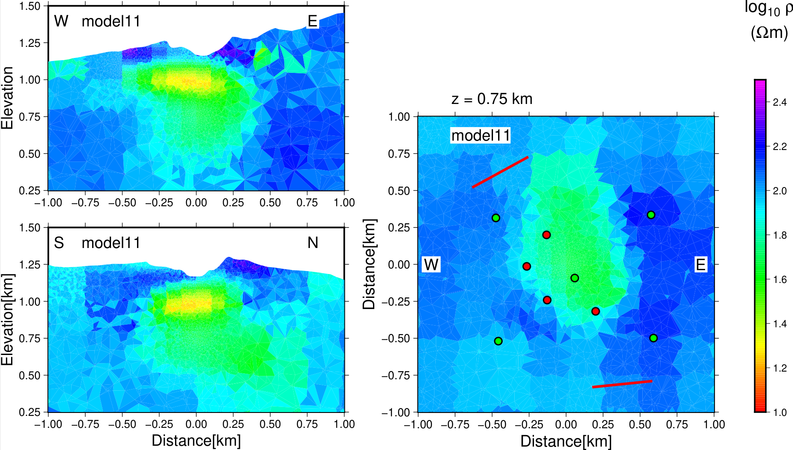

#### Results of Joint_test/inv_mt_tip
mt impedanceのerrorfloorは0.1、tipperのerrorfloorは0.1に設定し、αはpower -0.3で減少させた。-0.3が大きいと、構造の変動が大きくなり収束しない。

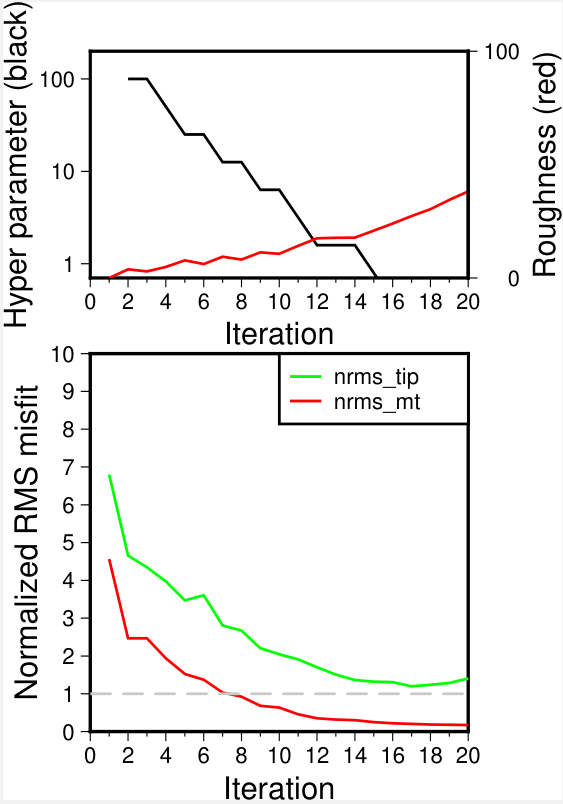 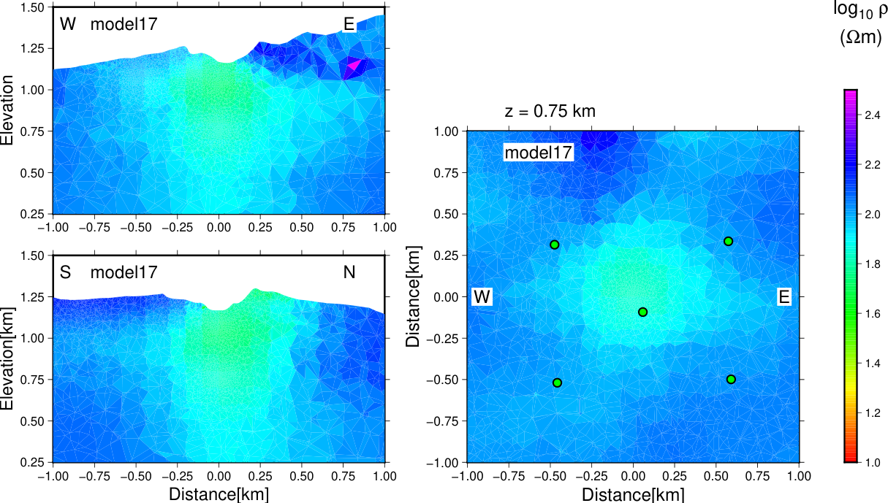

## 5 Source folder tree <a id="Source_folder_tree"></a>

| Folder               | Description                      | Test folder         |
|----------------------|----------------------------------|---------------------|
| src/solver/          | Serial ACTIVE forward solver     | Fwd_test/active     |
| src/solver_mpi/      | MPI ACTIVE forward solver        | Fwd_test/active_mpi |
| src/src_3DMT/        | Sequential 3-D MT solver         |                     |
| src/src_3DMT_mpi/    | MPI 3-D MT solver                |                     |
| src/src_inv_joint/   | ACTIVE/MT/Joint inversion code   |                     |

## 6 Governing equation and discretization <a id="Governing_equation_and_discretization"></a>
See Minami et al. (2018) for details about forward and inversion modelling in ActFEM. The induction equation in terms of the vector magnetic potential $\mathbf{A}$,

$$\nabla \times \left( \nabla \times \mathbf{A} \right) + i\omega\mu\widehat{\sigma}\mathbf{A} = \mu\mathbf{i}_{s},$$

is solved by the edge-based finite element method. $\widehat{\sigma} = \sigma + i\omega\epsilon$, where $\epsilon$ is the electric permittivity. $\omega$ is the angular frequency, $\mu$ is the magnetic permeability, $\mathbf{i}_{s}$ is the source electric current density. Note that the equation is easily converted to the induction equation in terms of the electric field $\mathbf{E}$, by using the relationship of $\mathbf{E} = i\omega\mathbf{A}$,

$$\nabla \times \nabla \times \mathbf{E} + i\omega\mu\widehat{\sigma}\mathbf{E} = i\omega\mu\mathbf{i}_{s}.$$

The magnetic field is obtained by $\mathbf{B} = \nabla \times \mathbf{A}$, after the equation is solved with respect to $\mathbf{A}$.

## 7 File formats <a id="File_formats"></a>

### 7.1 Control files
Control file “nakaya.ctl” controls the forward calculation (explanations are in parentheses).

```
## lines starting with "##" work as lines for comments ! 2020.09.28
## this file is forward control file
##-----10!-------20!
itopofile 0 or 1 !1 (0:地形ファイルを使わずメッシュ生成、1:地形ファイルを使う。)
# of topofile !1 (使う地形ファイルの数。以下、狭い領域のファイルから、広い領域のファイルの順で、入力する。)
topofile !../topo/topo127_134_29_36.xyz (地形ファイル名)
lon lat shift !0.0 0.0 (lon latの実際の値からのshift値)
mesh file !../mesh_aso_A04/nakadake3d.msh (3-D mesh file used in the fwd calc.)
2d triangle z file !../mesh_aso_A04/nakadake2dz.msh (2-D mesh with topography info)
local line file !../mesh_aso_A04/lineinfo.dat ( line information file)
output folder !./result_fwd/
header2d (a50) !nakadake2d
header3d (a50) !nakadake3d
# of frequency !2 (number of frequency for calculation)
Frequency [Hz] !1.d0 (fisrt frequency)
Frequency [Hz] !3.d0 (second frequency )
##Frequency [Hz] !7.d0 (commented out line starting with “##”)
##Frequency [Hz] !11.d0 (commented out line starting with “##”)
##Frequency [Hz] !21.d0 (commented out line starting with “##”)
##Frequency [Hz] !41.d0 (commented out line starting with “##”)
##Frequency [Hz] !61.d0 (commented out line starting with “##”)
##Frequency [Hz] !99.d0 (commented out line starting with “##”)
west bound !-1.7 (mesh parameter, not used in forward calc.)
east bound !1.7 (mesh parameter, not used in forward calc.)
south bound !-1.5 (mesh parameter, not used in forward calc.)
north bound !1.5 (mesh parameter, not used in forward calc.)
lenout [km] !50.0 (mesh parameter, not used in forward calc.)
upz in [km] (>0) !1.3 (mesh parameter, not used in forward calc.)
downz in [km](<0) !-1.1 (mesh parameter, not used in forward calc.)
zmax [km] !50.0 (mesh parameter, not used in forward calc.)
zmin [km] !-50.0 (mesh parameter, not used in forward calc.)
sizein [km] !0.15 (mesh parameter, not used in forward calc.)
sizebo [km] !10.0 (mesh parameter, not used in forward calc.)
sigma_obs [km] !0.4 (mesh parameter, not used in forward calc.)
A_obs [km] !0.01 (mesh parameter, not used in forward calc.)
dlen_source [km] !0.1 (mesh parameter, not used in forward calc.)
sigma_src [km] !0.3 (mesh parameter, not used in forward calc.)
A_src [km] !0.005 (mesh parameter, not used in forward calc.)
# of observatory !4 (# of observation sites for calculation of magnetic/electric field)
lonlat(1),xyz (2) !1 (1 for lon lat input, 2 for xyz input)
UTM ZONE |52S (UTM zone when lonlat input)
lonlatorigin !131.084782 32.884882 (lon lat origin of mesh)
1 Name !A02 (Site name 1)
1 xyz !131.083411 32.886706 -0.001 (Lon lat alt, alt is from ground surface)
2 Name !A04 (Site 2)
2 xyz,sigma,A[km] !131.081939 32.884808 -0.001 (Lon lat alt, alt is from ground surface)
3 Name !A01 (Site 3)
3 xyz,sigma,A[km] !131.083367 32.882725 -0.001 (Lon lat alt, alt is from ground surface)
4 Name !A03 (Site 4)
4 xyz,sigma,A[km] !131.086847 32.881981 -0.001 (Lon lat alt, alt is from ground surface)
ixyflg 0:no,1:surfv!0 (surface map flag)
# of sources !1 (number of electric dipole sources)
Source Name !S1 (name of the first source)
source start point !131.0784333 32.8908028 -0.001 (dipole starting point)
source end point !131.0814639 32.8912333 -0.001 (dipole ending point)
Elcetric current[A]! 1.0 (value of electric current through the electric dipole)
sigma_air [S/m] !1.e-8 (electric conductivity of the air)
condflag 0:home,1: !0 (subsurface conductivity flag, 0: homogeneous earth, 1 for file input)
nvolume !1 (when flag is 0,number of volume is specified here)
cond !0.01 (conductivity of the first volume under the ground surface)
```

## 8 Mesh generation tutorial <a id="Mesh_generation_tutorial"></a>
The mesh generation for FEM modelling is one of toughest works for forward/inversion preparation. Here, simple tutorial help the users to utilize the mesh generation codes in ActFEM forward/inversion. Please start the tutorial in the folder, ActFEMv1.0/mesh_demo_Aso/.

In ActFEM/mesh_demo_Aso/, users can two different 3-D mesh files using meshgen.sh and meshgen_add.sh, where the only difference is the adopted control file, aso.ctl and aso_add.ctl. In ActFEM/mesh_demo_Aso/, you can just perform the following
```bash
$ ./meshgen.sh
```
or
```bash
$ ./meshgen_add.sh
```
Note that all the output file names by meshgen.sh and meshgen_add.sh are the same. Please conduct
```bash
$ ./clean.sh
```
in ActFEM/mesh_demo_Aso/, if you want to delete all the output files generated by meshgen.sh or meshgen_add.sh. The difference between the two scripts, i.e. the difference in two control files, is the number of receiver sites, where, only in aso_add.ctl, receiver B02 is added, which results in the total number of receivers of 8 in aso_add.ctl rather than 7 in aso.ctl. The difference is shown in the following figure:

 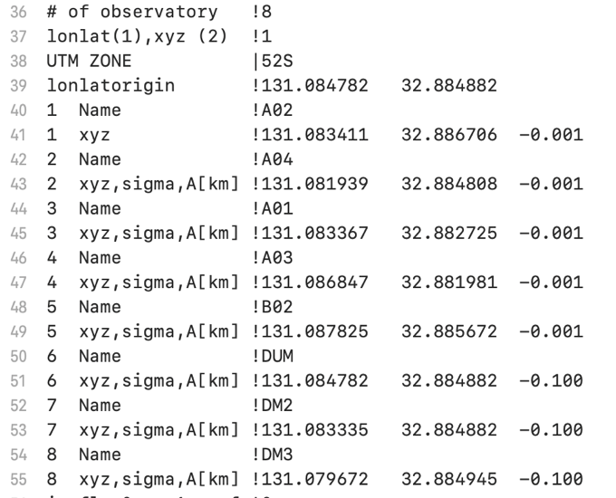

Figure. Receivers set for mesh refinement in aso.ctl (Left), and in aso_add.ctl (Right). B02 is added in aso_add.ctl.

When you succeeded in running meshgen.sh or meshgen_add.sh and generating 3-D mesh for ActFEM forward/inversion simulation, you can get the following files:


See meshgen.sh to check when each output files are generated. The final output 3-D tetrahedral mesh is nakadake3d.msh. You can check the detail of the generated 3-D tetrahedral mesh by gmsh GUI (Graphical User Interface). “Tools > Visibility > Selection of Volume 2 > Apply“ shows you the ground surface of the generated 3-D mesh.


Then please check the following two pictures of ground surface of generated 3-D meshes. You can find the refined region corresponding to B02 in the 3-D mesh generated by meshgen_add.sh (i.e. aso_add.ctl). As the modification from aso.ctl to aso_add.ctl, the users can modify the resulting 3-D mesh.

 

Figure. Nakadake3d.msh generated by meshgen.sh (Left) and that generated by meshgen_add.sh (Right).

## 9 Generation of resistivity model for forward/inversion <a id="Generation_of_resistivity_model"></a>
For forward/inversion using ActFEM, users should prepare resistivity model for a given 3-D tetrahedral mesh. Here, simple tutorial help the users to build a resistivity model for a 3-D mesh generated in the previous section. Then please conduct meshgen.sh or meshgen_add.sh in ActFEMv1.0/mesh_demo_Aso/ before trying the tutorials here. (See [Section 8](#Mesh_generation_tutorial) for details.)

To try tutorials here, first move to the folder ActFEMv1.0/mesh_demo_rec2tet/, where the resistivity model is constructed based on ActFEMv1.0/mesh_demo_Aso/nakadake3d.msh. In ActFEMv1.0/mesh_demo_rec2tet/, run
```bash
$ ./condmesh.sh
```
If you succeeded in running condmesh.sh, you can obtain the following files:

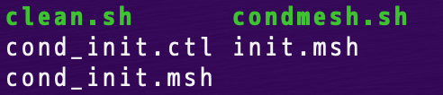

cond_init.ctl is not an output file but the control file for running condmesh.sh. cond_init.msh is the file you can use in the forward / inversion in ActFEM. Generated cond_init.msh is the file used in the initial model in Minami et al. (2018, EPS) based on Kanda et al. (2018, JpGU). Note that you cannot view the cond_init.msh simply by `gmsh cond_init.msh`, because cond_init.msh doesn’t include the 3-D mesh information. init.msh is the file combining the mesh_demo_rec2tet/cond_init.msh and mesh_demo_Aso/nakadake3d.msh. The structure difference between cond_init.msh and init.msh are as follows:


Figure. Structure of nakadake3d.msh, cond_init.msh, and init.msh

Then you can see the generated resistivity model by
```bash
$ gmsh init.msh
```
and set some viewer parameters as shown in the picture below.

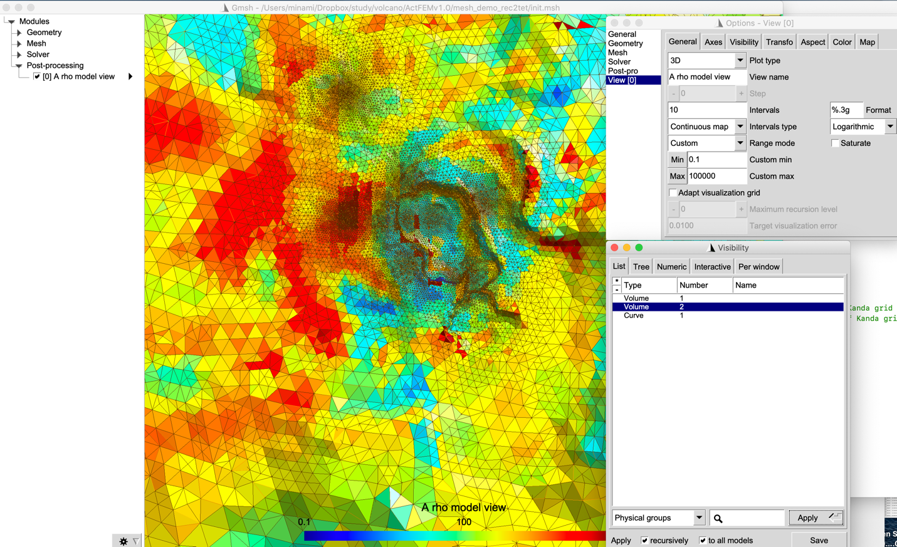

Figure. View of init.msh by gmsh GUI. If users want to inverse the color scale, namely if you want to make high resistivity in cold color, click Map tab in Option Panel, and press “i”.

In the script condmesh.sh, ActFEMv1.0/src/src_mesh/gridmdl2mesh.exe is used to generate cond_init.msh. The schematic for what condmesh.sh does is in the following figure. Then please change cond_init.ctl for modification of output resistivity file.

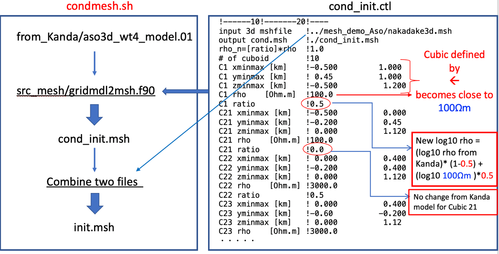

Figure. Outline of condmesh.sh

## 10 Version notes <a id="Version_notes"></a>

#### Version 1.4
May 30, 2026: Tipper inversion is now available jointly with ACTIVE (CSEM) and MT impedance inversions.

#### Version 1.0
Latest date for update is Sep 30, 2021. Forward and inversion simulation can be available.

## 11 References <a id="References"></a>
Minami, T., Utsugi, M., Utada, H., Kagiyama, T., & Inoue, H. (2018). Temporal variation in the resistivity structure of the first Nakadake crater, Aso volcano, Japan, during the magmatic eruptions from November 2014 to May 2015, as inferred by the ACTIVE electromagnetic monitoring system. *Earth, Planets and Space*, *70*(1), 1-10.

## Appendix A: Derivation of the discretized form of governing equation <a id="AppendixA"></a>
Given the governing equation,

$$\nabla \times \nabla \times \mathbf{A} + i\omega\mu\sigma\mathbf{A} = \mu\mathbf{i}_{s},$$

in the finite element method with the Galerkin method, we numerically solve

$$\int_{\Omega}{\mathbf{w} \cdot \left( \nabla \times \nabla \times \mathbf{A} + i\omega\mu\sigma\mathbf{A} - \mu\mathbf{i}_{s} \right)dV} = 0,\  \cdot \cdot \cdot \cdot (1)$$

where $w$ is arbitrary test function, where the edge-basis function is adopted for $\mathbf{w}$ in the Galerkin method, and $\Omega$ is the computational domain.

By using the relationship $\nabla \cdot \left( \mathbf{A} \times \mathbf{B} \right) = \mathbf{B} \cdot \left( \nabla \times \mathbf{A} \right) - \mathbf{A} \cdot (\nabla \times \mathbf{B})$, the first term in the left hand side of Eq. (1) is reduced to

$$\int_{\Omega}{\mathbf{w} \cdot (\nabla \times \nabla \times A)dV} = \int_{\Omega}{\left\{ \nabla \cdot \left( (\nabla \times A) \times w \right) + (\nabla \times w) \cdot (\nabla \times A) \right\} dV}$$

$$= \int_{\Omega}{\left\{ \nabla \cdot \left( \left( \nabla \times \mathbf{A} \right) \times w \right) + (\nabla \times w) \cdot (\nabla \times A) \right\} dV}$$

$$= \int_{\partial\Omega}{\left( \left( \nabla \times \mathbf{A} \right) \times \mathbf{w} \right) \cdot \mathbf{n}dS} + \int_{\Omega}{\left\{ \left( \nabla \times \mathbf{w} \right) \cdot \left( \nabla \times \mathbf{A} \right) \right\} dV}$$

$$= \int_{\partial\Omega}{\left( \mathbf{B} \times \mathbf{w} \right) \cdot \mathbf{n}dS} + \int_{\Omega}{\left\{ \left( \nabla \times \mathbf{w} \right) \cdot \left( \nabla \times \mathbf{A} \right) \right\} dV} \cdot \cdot \cdot (2)$$

Where $\mathbf{B} = \nabla \times \mathbf{A}$ represents the magnetic field and $\partial\Omega$ indicates the boundary surface of the computational domain, and $\mathbf{n}$ is a outward unit vector normal to the surface $\partial\Omega$. Taking into account that at $\partial\Omega$, we can take

$$\mathbf{n} \cdot (B \times w) = w \cdot \left( \mathbf{n} \times \mathbf{B} \right) = 0,$$

where $\nabla \cdot \left( \mathbf{n} \times \mathbf{B} \right) = B \cdot \left( \nabla \times \mathbf{n} \right) - n \cdot (\nabla \times B) = - n \cdot \left( \mu\mathbf{j} \right) = 0$ indicates there are no electric current penetrating the boundary surface. Then, Eq. (2) reduces to

$$\int_{\Omega}{\mathbf{w} \cdot \left( \nabla \times \nabla \times \mathbf{A} \right)dV = \int_{\Omega}{\left\{ \left( \nabla \times \mathbf{w} \right) \cdot \left( \nabla \times \mathbf{A} \right) \right\} dV}} \cdot \cdot \cdot (3)$$

Substituting Eq. (3) into Eq. (1), we obtain

$$\int_{\Omega}{\left\{ \left( \nabla \times \mathbf{w} \right) \cdot \left( \nabla \times \mathbf{A} \right) \right\} dV} + \int_{\Omega}{i\omega\mu\sigma\mathbf{w} \cdot \mathbf{A}dV} = \mu\int_{\Omega}{\mathbf{w} \cdot \mathbf{i}_{s}dV}. \cdot \cdot \cdot (4)$$

In the finite element method, we divide the numerical domain into finite number of the tetrahedrons and calculate the volume integral for each tetrahedral element. In the remaining, we think only an volume integral for e-th element, $\Omega_{e}$, then Eq. (4) is rewritten for e-th element as

$$\int_{\Omega_{e}}{\left\{ \left( \nabla \times \mathbf{w}_{i} \right) \cdot \left( \nabla \times \mathbf{A}_{e} \right) \right\} dV} + \int_{\Omega_{e}}{i\omega\mu\sigma\mathbf{w}_{i} \cdot \mathbf{A}_{e}dV} = \mu\int_{\Omega_{e}}{\mathbf{w}_{i} \cdot \mathbf{i}_{s_{e}}dV} \cdot \cdot \cdot (5)$$

where $w_{i}\ (i = 1, \cdot \cdot \cdot ,6)$ is the edge-basis function for each edge of the e-th tetrahedron. We represent the vector potential in the e-th element as

$$\mathbf{A}_{e}=\sum_{j = 1}^{6}{\mathbf{w}_{j}{\lbrack Al\rbrack}_{j}} \cdot \cdot \cdot \cdot (6)$$

where

$$\mathbf{w}_{j} = \mathbf{w}_{kl} = \lambda_{k}\nabla\lambda_{l} - \lambda_{l}\nabla\lambda_{k}.$$

$\lambda_{k}$ is the nodal basis function. The relationship between j and k,l are shown in the following figure and table.


Table A1.

| i, j (edge id) | k   | l   | m   | n   |
|:--------------:|:---:|:---:|:---:|:---:|
| 1              | 1   | 2   | 3   | 4   |
| 2              | 2   | 3   | 1   | 4   |
| 3              | 1   | 3   | 4   | 2   |
| 4              | 1   | 4   | 2   | 3   |
| 5              | 2   | 4   | 3   | 1   |
| 6              | 3   | 4   | 1   | 2   |

Using Eq. (6), Eq. (5) can be reduced to

$$\sum_{j = 1}^{6}{\int_{\Omega_{e}}{\left\{ \left( \nabla \times \mathbf{w}_{i} \right) \cdot \left( \nabla \times \mathbf{w}_{j} \right) \right\} dV}\lbrack Al\rbrack_{j}} + \sum_{j = 1}^{6}{\int_{\Omega_{e}}{i\omega\mu\sigma\mathbf{w}_{i} \cdot \mathbf{w}_{j}dV}\lbrack Al\rbrack_{j}} = \mu\int_{\Omega_{e}}{\mathbf{w}_{i} \cdot \mathbf{i}_{s_{e}}dV},\  \cdot \cdot \cdot (7)$$

which is rewritten in the matrix form as,

$$\left\{ \left\lbrack M_{e} \right\rbrack + i\omega\mu\sigma_{e}\left\lbrack N_{e} \right\rbrack \right\}\left\lbrack \mathbf{Al}_{e} \right\rbrack = \mathbf{s}_{e} \cdot \cdot \cdot (8)$$

$$\left\lbrack \mathbf{Al}_{e} \right\rbrack = \left\lbrack {Al}_{1}\ {Al}_{2}\ {Al}_{3}\ {Al}_{4}\ {Al}_{5}\ {Al}_{6} \right\rbrack^{T} \cdot \cdot \cdot (9)$$

$$\left\lbrack M_{e} \right\rbrack_{ij} = \int_{\Omega_{e}}{\left\{ \left( \nabla \times \mathbf{w}_{i} \right) \cdot \left( \nabla \times \mathbf{w}_{j} \right) \right\} dV} = \frac{1}{3v}\mathbf{x}_{mn} \cdot \frac{1}{3v}\mathbf{x}_{m^{'}n^{'}} \times v = \frac{1}{9v}\mathbf{x}_{mn} \cdot \mathbf{x}_{m^{'}n^{'}} \cdot \cdot \cdot (10)$$

$$\left\lbrack N_{e} \right\rbrack_{ij} = \int_{\Omega_{e}}{\mathbf{w}_{i} \cdot \mathbf{w}_{j}dV} = \int_{\Omega_{e}}{\left( \lambda_{k}\nabla\lambda_{l} - \lambda_{l}\nabla\lambda_{k} \right) \cdot \left( \lambda_{k^{'}}\nabla\lambda_{l^{'}} - \lambda_{l^{'}}\nabla\lambda_{k^{'}} \right)dV}$$

$$= \int_{\Omega_{e}}{\left( \lambda_{k}\lambda_{k^{'}}\nabla\lambda_{l} \cdot \nabla\lambda_{l^{'}} - \lambda_{k}\lambda_{l^{'}}\nabla\lambda_{l} \cdot \nabla\lambda_{k^{'}} - \lambda_{l}\lambda_{k^{'}}\nabla\lambda_{k} \cdot \nabla\lambda_{l^{'}} + \lambda_{l}\lambda_{l^{'}}\nabla\lambda_{k} \cdot \nabla\lambda_{k^{'}} \right)dV}$$

$$= \nabla\lambda_{l} \cdot \nabla\lambda_{l^{'}}\int_{\Omega_{e}}{\lambda_{k}\lambda_{k^{'}}dV} - \nabla\lambda_{l} \cdot \nabla\lambda_{k^{'}}\int_{\Omega_{e}}{\lambda_{k}\lambda_{l^{'}}dV}$$

$$- \nabla\lambda_{k} \cdot \nabla\lambda_{l^{'}}\int_{\Omega_{e}}{\lambda_{l}\lambda_{k^{'}}dV} + \nabla\lambda_{k} \cdot \nabla\lambda_{k^{'}}\int_{\Omega_{e}}{\lambda_{l}\lambda_{l^{'}}dV} \cdot \cdot \cdot (11)$$

$$s_{i}^{e} = \mu\int_{\Omega_{e}}{\mathbf{w}_{i} \cdot \mathbf{i}_{s_{e}}dV} = \mu I_{s}\left( \frac{\mathbf{w}_{i}^{e}\left( r_{p1} \right) + \mathbf{w}_{i}^{e}\left( r_{p2} \right)}{2} \right) \cdot \overrightarrow{p_{1}p_{2}}\ \ (12)$$

$$= \frac{\mu I_{s}\left( \lambda_{k}\left( p_{1} \right)\nabla\lambda_{l} - \lambda_{l}\left( p_{1} \right)\nabla\lambda_{k} + \lambda_{k}\left( p_{2} \right)\nabla\lambda_{l} - \lambda_{l}\left( p_{2} \right)\nabla\lambda_{k} \right)}{2} \cdot \overrightarrow{p_{1}p_{2}}$$

$$= \frac{\mu I_{s}\left( (\lambda_{k}\left( p_{1} \right) + \lambda_{k}\left( p_{2} \right))\nabla\lambda_{l} - \left( \lambda_{l}\left( p_{1} \right) + \lambda_{l}\left( p_{2} \right) \right)\nabla\lambda_{k} \right)}{2} \cdot \overrightarrow{p_{1}p_{2}}$$

In derivation of Eq. (12), the straight electric current defined by a Heaviside function penetrates the tetrahedron as shown below.

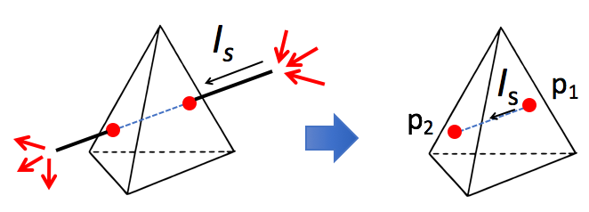

In the derivation of Eq. (9), we used the relationship of

$$\nabla \times \mathbf{w}_{j} = 2\nabla\lambda_{k} \times \nabla\lambda_{l} = \frac{1}{3v}\mathbf{x}_{mn}\  \cdot \cdot \cdot (13),$$

Correspondence between (k,l) and (m,n) are listed in Table A1.

In the calculation of Eq. (11), we can use the relationships:

$$\nabla\lambda_{k} = \frac{1}{6v}\mathbf{x}_{ln} \times \mathbf{x}_{mn} \cdot \cdot \cdot (14)$$

$$\int_{\Omega_{e}}{\lambda_{k}\lambda_{l}dV} = \left\{ \begin{matrix}
6v\frac{1!1!}{(1 + 1 + 3)!} = \frac{v}{20}\ (k \neq l) \\
6v\frac{2!}{(2 + 3)!} = \frac{v}{10}\ \ \ \ \ \ \ \ (k = l)
\end{matrix} \right.\  \cdot \cdot \cdot (15)$$

Note the theorem for integral of nodal basis function for a tetrahedron:

$$\int_{\Omega_{e}}{\lambda_{1}^{k}\lambda_{2}^{l}\lambda_{3}^{m}\lambda_{4}^{n}dV} = 6v\frac{k!l!m!n!}{(k + l + m + n + 3)!}\ \  \cdot \cdot \cdot (16)$$

## Appendix B: Scaling of the governing equation for ActFEM calculation <a id="AppendixB"></a>
In solving discretized form combining Eq. (7) and (12),

$$\sum_{j = 1}^{6}{\int_{\Omega_{e}}{\left\{ \left( \nabla \times \mathbf{w}_{i} \right) \cdot \left( \nabla \times \mathbf{w}_{j} \right) \right\} dV}\lbrack Al\rbrack_{j}} + \sum_{j = 1}^{6}{\int_{\Omega_{e}}{i\omega\mu\sigma\mathbf{w}_{i} \cdot \mathbf{w}_{j}dV}\lbrack Al\rbrack_{j}} = \mu I_{s}\left( \frac{\mathbf{w}_{i}^{e}\left( r_{p1} \right) + \mathbf{w}_{i}^{e}\left( r_{p2} \right)}{2} \right) \cdot \overrightarrow{p_{1}p_{2}}\  \cdot \cdot \cdot (17)$$

a scaling is implemented in ActFEM. Scaling length $L$, set to be 1000m in ActFEM, is used. Consider to rewrite Eq. (17) by using

$$\nabla = \frac{1}{L}\nabla^{'},\quad \mathbf{w} = \frac{1}{L}\mathbf{w}^{'},\quad dV = L^{3}dV^{'},\quad \overrightarrow{p_{1}p_{2}} = L\overrightarrow{p_{1}p_{2}'},\quad Al\left\lbrack s \cdot V/m \cdot m \right\rbrack = \int \mathbf{A} \cdot d\mathbf{l} = \frac{1}{L}Al^{'},$$

where $Al^{'}$ is in $\left\lbrack s \cdot mV/km \cdot km \right\rbrack$, and $\mathbf{E} = i\omega\mathbf{A}$. These replacements correspond to the fact that **$\mathbf{w}$ and $\nabla$ are constructed as $\mathbf{w}'$ and $\nabla'$ with the coordinate system in the unit of km.**

$$\sum_{j = 1}^{6}{\int_{\Omega_{e}}{\left\{ \left( \frac{1}{L}\nabla' \times \frac{1}{L}\mathbf{w}_{i}^{'} \right) \cdot \left( \frac{1}{L}\nabla^{'} \times \frac{1}{L}\mathbf{w}_{j}^{'} \right) \right\} L^{3}dV^{'}}\frac{1}{L}\ \left\lbrack Al^{'} \right\rbrack_{j}} + \sum_{j = 1}^{6}{\int_{\Omega_{e}}{i\omega\mu\sigma\frac{1}{L}\mathbf{w}_{i}^{'} \cdot \frac{1}{L}{\mathbf{w}^{'}}_{j}L^{3}dV'}\frac{1}{L}\left\lbrack Al^{'} \right\rbrack_{j}} = \mu I_{s}\frac{1}{L}\left( \frac{w'\left( r_{p1} \right) + w'\left( r_{p2} \right)}{2} \right) \cdot L\overrightarrow{p_{1}p_{2}'}$$

$$\Longleftrightarrow\sum_{j = 1}^{6}{\int_{\Omega_{e}}{\left\{ \left( \nabla^{'} \times \mathbf{w}_{i}^{'} \right) \cdot \left( \nabla^{'} \times \mathbf{w}_{j}^{'} \right) \right\} dV^{'}}\left\lbrack Al^{'} \right\rbrack_{j}} + \sum_{j = 1}^{6}{\int_{\Omega_{e}}{L^{2}i\omega\mu\sigma\mathbf{w}_{i}^{'} \cdot {\mathbf{w}^{'}}_{j}dV^{'}}\left\lbrack Al^{'} \right\rbrack_{j}} = \mu I_{s}L^{2}\left( \frac{w'\left( r_{p1} \right) + w'\left( r_{p2} \right)}{2} \right) \cdot \overrightarrow{p_{1}p_{2}'}$$

Note here that the source current $I_{s}$ is not scaled, namely in the unit of [A].
