<script type="text/javascript" async src="https://cdnjs.cloudflare.com/ajax/libs/mathjax/2.7.7/MathJax.js?config=TeX-MML-AM_CHTML">
</script>
<script type='text/x-mathjax-config'>
	MathJax.Hub.Config({
		tex2jax: {
			inlineMath: [['$', '$']],
			displayMath: [ ['$$','$$'],["\\[","\\]"] ]
		}
	});
</script>

# Manual of ActFEM v1.5
## ACTIVE forward-inversion simulation code using FEM

#### As of November 25, 2026

Takuto MINAMI
tminami@port.kobe-u.ac.jp
(Faculty of Science, Kobe University)

### Contents

1. [Required environment](#Required_environment)
2. [Coordinate system](#Coordinate_system)
3. [Run samples for forward modeling](#Run_the_sample)
   - [3.1 Step 1: Mesh generation (no topography)](#sec3_1)
   - [3.2 Step 2: Prepare analytical solution for ACTIVE](#sec3_2)
   - [3.3 Step 3: Active forward modelling](#sec3_3)
   - [3.4 Step 4: Compare the active forward results with analytical solution](#sec3_4)
   - [3.5 Step 5: Active forward modelling with polyline (multi-dipole) sources](#sec3_5)
   - [3.6 Step 6: MT forward calculation (without MPI) with homogeneous resistivity](#sec3_6)
   - [3.7 Step 7: Check the results of MT forward calculation accuracy](#sec3_7)
   - [3.8 Step 8: MT forward calculation (without MPI) with lateral inhomogeneous structure](#sec3_8)
   - [3.9 Step 9: MT forward simulation with MPI + OpenMP](#sec3_9)
4. [Run samples for inversions](#Run_samples_for_inversions)
   - [4.1 Step 1: Prepare mesh](#sec4_1)
   - [4.2 Step 2: Prepare true resistivity structure](#sec4_2)
   - [4.3 Step 3: Generation of ACTIVE sample data for inversion](#sec4_3)
   - [4.4 Step 4: Generation of MT sample data for inversion](#sec4_4)
   - [4.5 Step 5: Run sample inversions!!](#sec4_5)
5. [Source folder tree](#Source_folder_tree)
6. [Governing equation and discretization](#Governing_equation_and_discretization)
7. [File formats](#File_formats)
   - [7.1 Control files for mesh generation and forward modelling](#Control_files)
      - [7.1.1 General rules](#sec7_1_1)
      - [7.1.2 Items](#sec7_1_2)
      - [7.1.3 Example](#sec7_1_3)
      - [7.1.4 Water level control file](#sec7_1_4)
   - [7.2 Source definition (single dipole / multiple dipoles)](#Source_definition)
8. [Mesh generation tutorial](#Mesh_generation_tutorial)
   - [8.1 Mesh folders](#sec8_1)
   - [8.2 Run meshgen.sh](#sec8_2)
   - [8.3 How to adjust the mesh](#sec8_3)
9. [Generation of resistivity model for forward/inversion](#Generation_of_resistivity_model)
   - [9.1 Resistivity file (cond.msh)](#sec9_1)
   - [9.2 Generation by change_model2cond.exe](#sec9_2)
   - [9.3 View the resistivity model](#sec9_3)
10. [Version notes](#Version_notes)
11. [References](#References)

- [Appendix A: Derivation of the discretized form of governing equation](#AppendixA)
- [Appendix B: Scaling of the governing equation for ActFEM calculation](#AppendixB)


## 1 Required environment <a id="Required_environment"></a>
ActFEM requires Intel compiler (ifx or ifort, mpiifx or mpiifort) for openMP and intel MPI. There are serial modes only with openMP for forward modeling code. As for inversions, on the other hand, ActFEM has only hybrid (OpenMP and MPI) parallel codes for inversions. The required environments are as follows:

### Forward / inversion modelling
- Intel compiler (Linear systems are solved by PARDISO in intel MKL library)
- gmsh
  - on Mac → `brew install gmsh`
  - on Ubuntu → `sudo apt install gmsh`

### Viewer
- GMT6
  - on Mac → `brew install gmt`
  - on Ubuntu → `sudo apt install gmt`
- Gnuplot
  - on Mac → `brew install gnuplot`
  - on Ubuntu → `sudo apt install gnuplot`

gfortran can be used for mesh generation (src/src_mesh) and post processing data (src/src_post).

## 2 Coordinate system <a id="Coordinate_system"></a>
In ActFEM, the following coordinate system is used:

- X : East
- Y : North
- Z : Upward

z is the elevation [km] (sea level is z = 0) in the mesh and in resistivity models, while z of observatories and sources in control files is the height relative to the ground surface (see [7.1.1](#sec7_1_1)).

## 3 Run samples for forward modeling <a id="Run_the_sample"></a>
There is a forward sample folder, ActFEM/Fwd_test. Users can check how ActFEM calculates forward simulations: Active and MT.

### 3.1 Step 1: Mesh generation (no topography) <a id="sec3_1"></a>
```bash
$ cd ActFEM/Fwd_test/mesh_flat
$ chmod +x meshgen.sh
$ ./meshgen.sh
```
meshgen.sh first compile the source in ActFEM/src/src_mesh with gfortran and run the program with gmsh. If you successfully installed gmsh, you can see the following output in the terminal.

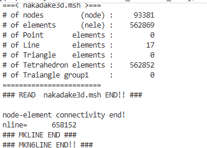

Then please check the mesh by gmsh viewer:
```bash
$ gmsh nakadake3d.msh
```

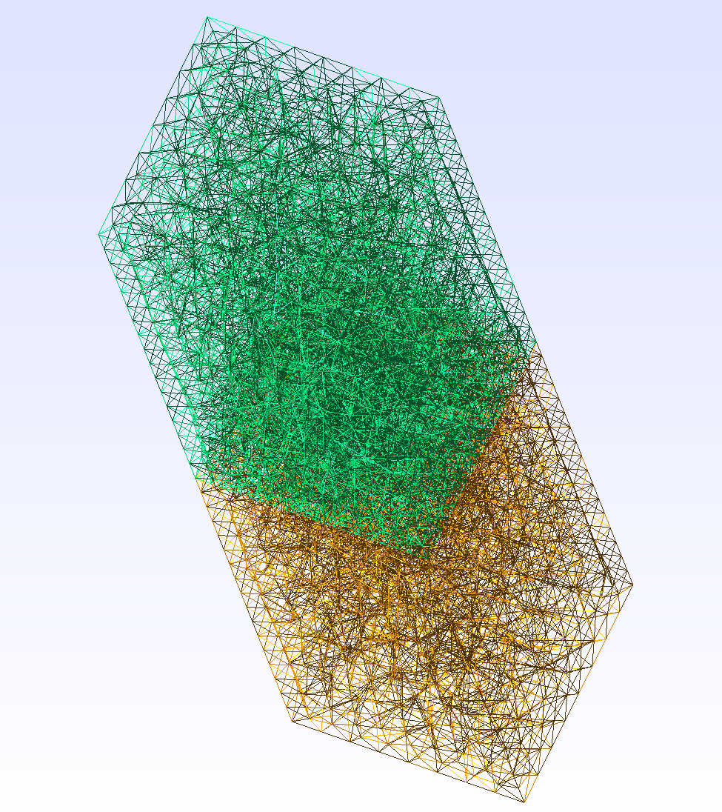 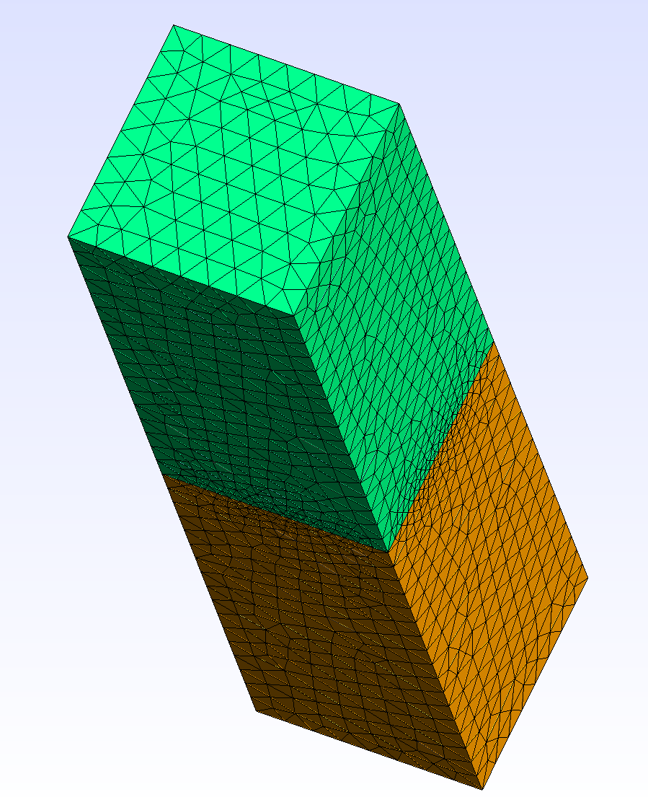 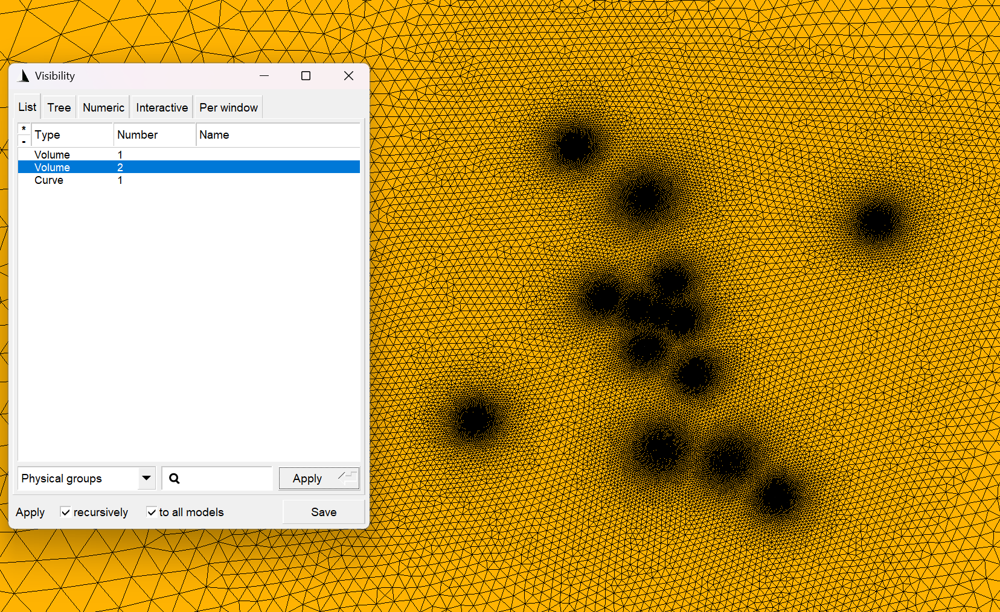

Figure. Tools > Options > Mesh > check 3D element faces shows the center panel. “Tools > Visibility > select Volume 2 > apply” shows only land elements, where you can check high resolution area for site locations.

### 3.2 Step 2: Prepare analytical solution for ACTIVE <a id="sec3_2"></a>
For evaluatng forward calucualtions, you can prepare analytical solution before forward modelling.
```bash
$ cd ActFEM/Fwd_test/active_ana/
$ chmod +x run.sh
$ run.sh
```
As default, run.sh run with ifx to compile source programs in src/ana. If run.sh successfully finish, you can see:

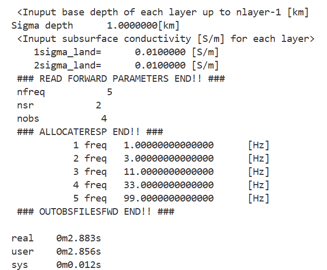

### 3.3 Step 3: Active forward modelling <a id="sec3_3"></a>
After generating mesh, you can run forward modelling for ACTIVE and MT.
```bash
$ cd ActFEM/Fwd_test/active
$ chmod +x run.sh
$ ./run.sh
```
If the active forward modelling finishes successfully, you can see:

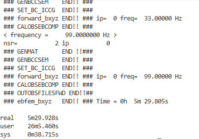

### 3.4 Step 4: Compare the active forward results with analytical solution <a id="sec3_4"></a>
After you finish active modeling, you can check the accuracy of forward simulation with analytical solution in Fwd_test/active_ana/result.

In Fwd_test/active/
```bash
$ chmod +x compana.sh
$ ./compana.sh
```
If the following panels appear, both active modelling and analytical solution calculations succeeded.

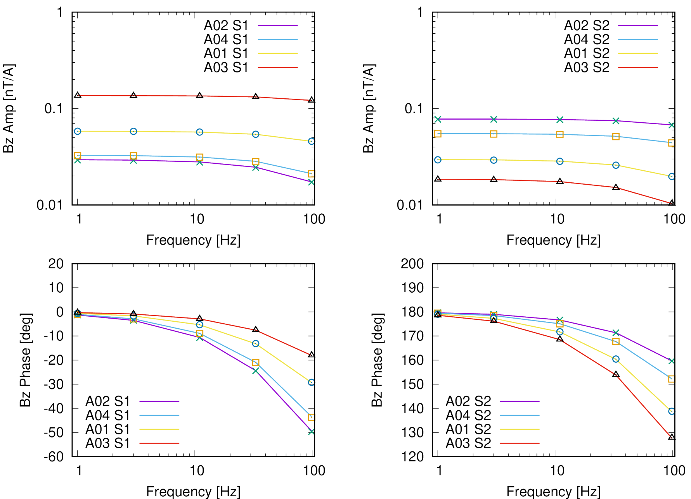

Figure. The symbols are the calculated ACTIVE response in Fwd_test/active/, while the lines are the analytical solutions calculated in Fwd_test/active_ana/. (Top: amplitude [nT/A]; Bottom: phase [deg])

### 3.5 Step 5: Active forward modelling with polyline (multi-dipole) sources <a id="sec3_5"></a>
ActFEM can treat a source wire consisting of multiple dipoles connected in series (e.g., a loop or a bent cable), where the vertices of the wire are given by a source point file (see [7.2](#Source_definition)). In Fwd_test/active_loop/, two closed-loop sources are prepared: S1 (19 dipoles given by S1.dat) and S2 (13 dipoles given by S2.dat). The mesh of [Step 1](#sec3_1) (Fwd_test/mesh_flat/) is used.
```bash
$ cd ActFEM/Fwd_test/active_loop
$ chmod +x run.sh
$ ./run.sh > result/fwd.log
```
In result/fwd.log, you can confirm that the dipoles are read from the source point files:
```
 source name: S1
 ndipole =  19
 dipole   1 xs1=      0.1763144     -0.8313663     -0.0010000 xs2=      0.2645611     -0.8773202     -0.0010000
 ...
 source name: S2
 ndipole =  13
```
and `A0*_S1.dat` and `A0*_S2.dat` are generated in result/.

Then, the results can be compared with the analytical solution. Because the analytical code (src/ana) treats only single-dipole sources, compana_loop.py gives each dipole as an independent source to active_ana.exe and sums the complex Bz over the dipoles of each source (superposition). active_ana.exe should be built beforehand ([Step 2](#sec3_2)).
```bash
$ python3 compana_loop.py
```
The ratio of amplitudes (FEM/analytical) and the phase difference [deg] are printed for each site, source and frequency, and the summed analytical responses are written in result_ana/ (columns: frequency [Hz], Bz amplitude [nT/A], Bz phase [deg]). For most site-source pairs, the amplitude ratio is within 0.995-1.006 and the phase difference is less than 0.3 degree:
```
site src  f[Hz]     |Bz|ana     |Bz|FEM  ratio  pha_ana  pha_FEM   dpha
A02  S1       1  3.8740e-02  3.8701e-02  0.999  -179.29  -179.29   0.00
A02  S1      99  4.9982e-02  4.9886e-02  0.998   169.98   169.83  -0.14
...
A03  S1       1  9.4048e+00  1.0659e+01  1.133  -179.99  -179.99  -0.00
```
Note that site A03 is located only ~18 m from the wire of S1, where Bz varies steeply and the FEM accuracy depends strongly on the mesh around the wire (Fwd_test/mesh_flat/ is refined along the straight sources in aso.ctl, not along the loops). To refine the mesh along the polyline sources, give the same `File:` lines in the source block of the mesh control file (aso.ctl); refinement points are then placed along every dipole (see [7.2](#Source_definition)). Note also that file names in control files are read as `character(50)`, so keep the paths short.

### 3.6 Step 6: MT forward calculation (without MPI) with homogeneous resistivity <a id="sec3_6"></a>
For MT calculations, there are serial (openMP) mode and Hybrid (openMP + MPI) mode. First, you can check serial model.
```bash
$ cd ActFEM/Fwd_test/MTfwd_test
$ chmod +x run.sh
$ ./run_homo.sh
```
If the calculation is successful, you can see the output:

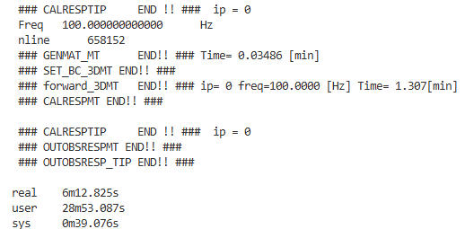

### 3.7 Step 7: Check the results of MT forward calculation accuracy <a id="sec3_7"></a>
After finishing the calculations, please see how MT simulation finished.
```bash
$ chmod +x plot_rho.sh
$ ./plot_rho.sh
```

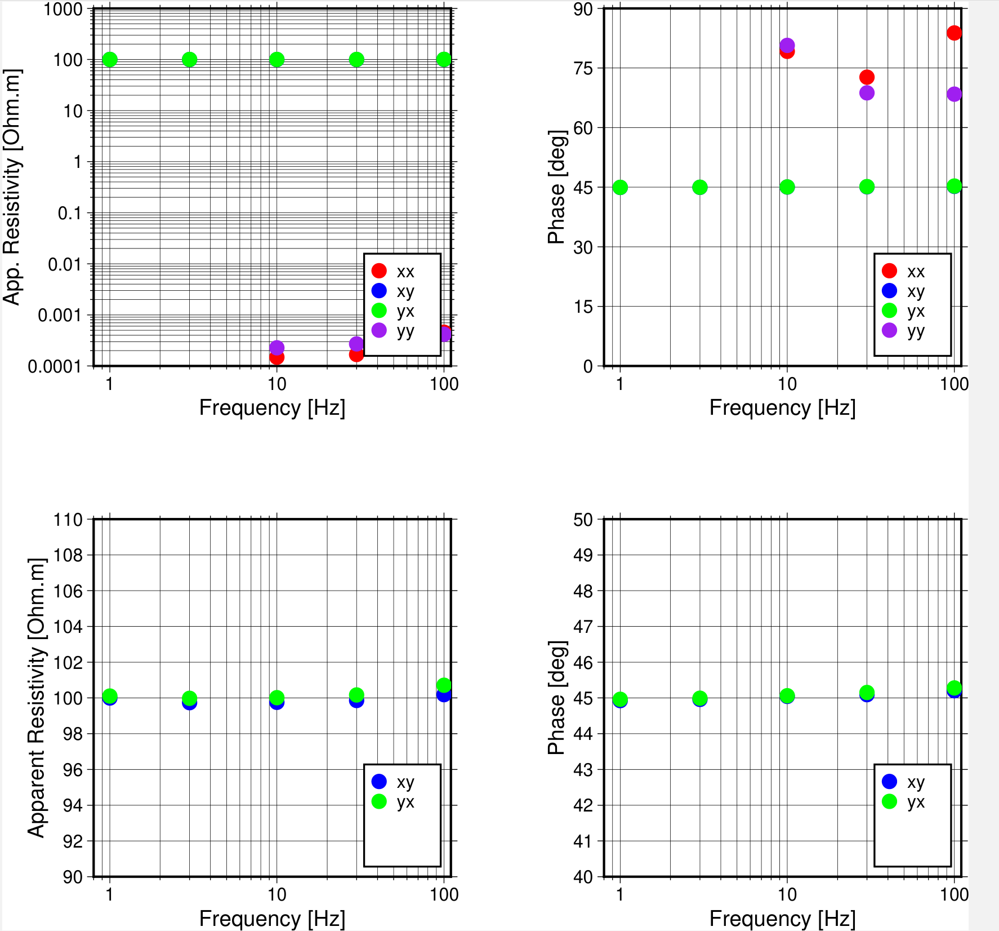

As seen in the panels, MT simulation with ActFEM succeeded in generating 100 Ohm.m apparent resistivity and 45 degrees phase over the frequency ranging from 1 to 100 Hz with less than 1% numerical error.

### 3.8 Step 8: MT forward calculation (without MPI) with lateral inhomogeneous structure <a id="sec3_8"></a>
MT forward calculation can calculate tipper as well. You can check how it works with laterally inhomogeneous structure. First it is need to generate the inhomogeneous structure. In ActFEM/Fwd_test/MTfwd_test/
```bash
$ chmod +x change_model2cond.sh
$ ./change_model2cond.sh
```
The output is like the following, resulting in **cond_lateral.msh**.

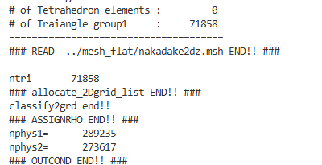

To check the generated resistivity structure, type the below command:
```bash
$ chmod +x view_slcie.sh
$ view_slcie.sh
```

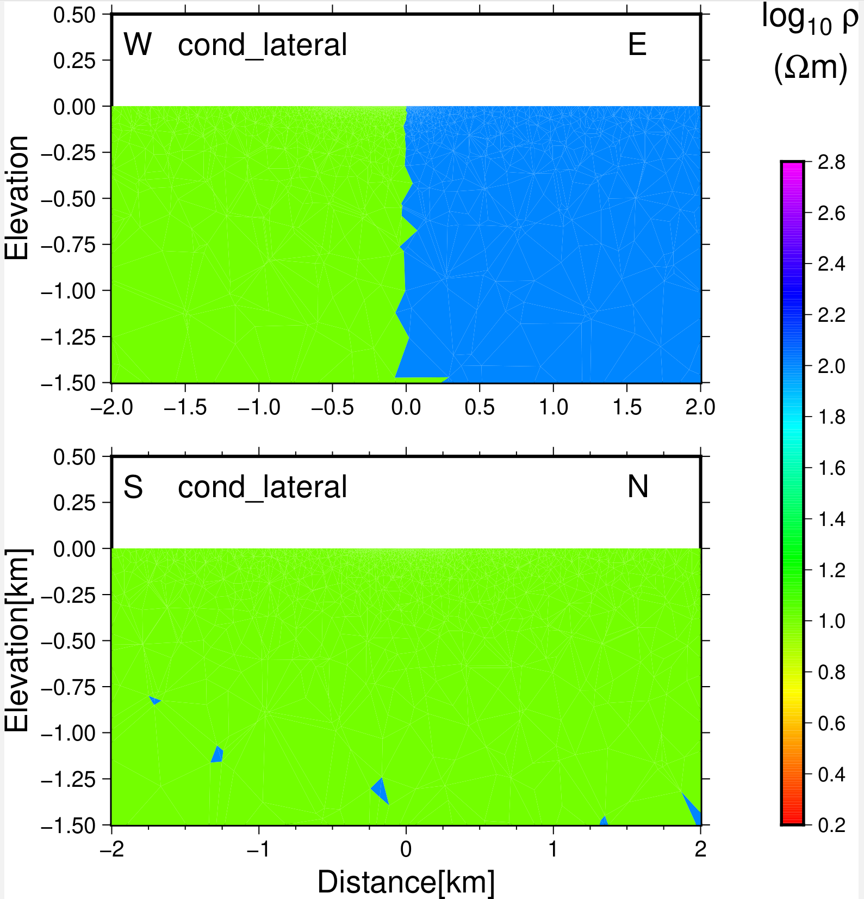

As seen in the WE and SN cross sections, the generated resistivity structure is lateral jump in resistivity at x=0 from 10 Ohm.m on the western side to 100 Ohm.m on the eastern side.

Then run the MT forward calculation with this structure by
```bash
$ chmod +x run_lateral.sh
$ ./run_lateral.sh
```
After finishing the calculation, you can see the tipper by
```bash
$ chmod +x plot_tip.sh
$ ./plot_tip.sh
```

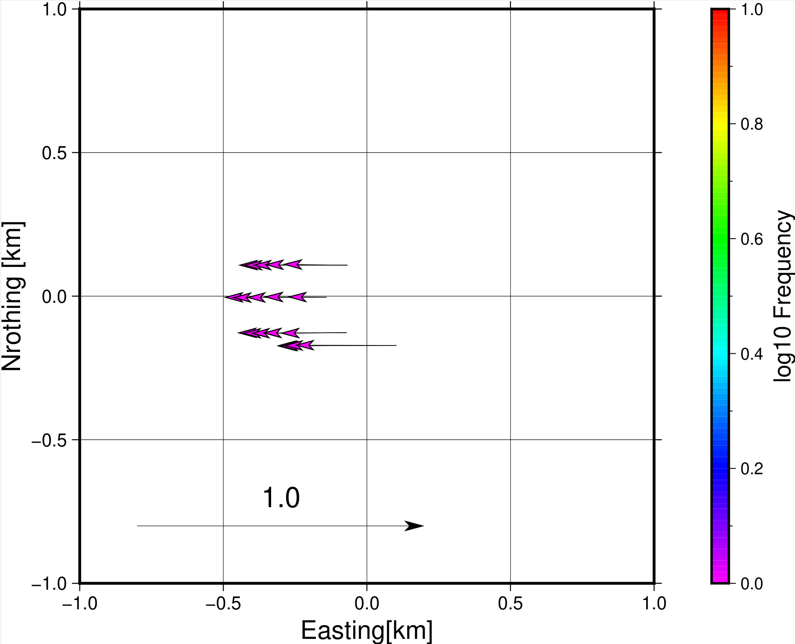

As seen in the panel, the real part of induction vector points west due to lower resistivity on the western side.

### 3.9 Step 9: MT forward simulation with MPI + OpenMP <a id="sec3_9"></a>
Only MT forward simulation is now parallelized with MPI. You can do the same calculation as Fwd_test/MTfwd_test in Fwd_test/MTfwd_test_mpi/ with MPI.
```bash
$ cd Fwd_test/MTfwd_test_mpi/
$ chmod +x run_homo.sh
$ ./run_homo.sh
```
If the calculation is successful, the output is like:

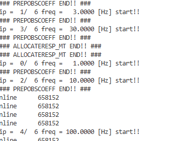

Here you can see ip=1 (node#1) calculates freq=3.0Hz, while ip=3 (node#3) does freq=30Hz, etc. Each frequency calculation is assigned to each MPI process. Then the calculation is much faster than serial version. Please confirm the results in MTfwd_test/result_homo/ and MTfwd_test_mpi/result_homo/ are identical.

## 4 Run samples for inversions <a id="Run_samples_for_inversions"></a>
In ActFEM, there 6 inversion samples: two ACTIVE, two MT, and two ACTIVE+MT joint inversion samples. To run inversions, prepare sample ACTIVE and MT data sets.

### 4.1 Step 1: Prepare mesh <a id="sec4_1"></a>
Sample inversions are performed with real Aso topography. Let’s generate mesh first.
```bash
$ cd ActFEM/Joint_test/mesh_joint
$ chmod +x meshgen.sh
$ ./meshgen.sh
```
After generating the mesh, please check how it looks by gmsh viewer.
```bash
$ gmth nakadake3d.msh
```

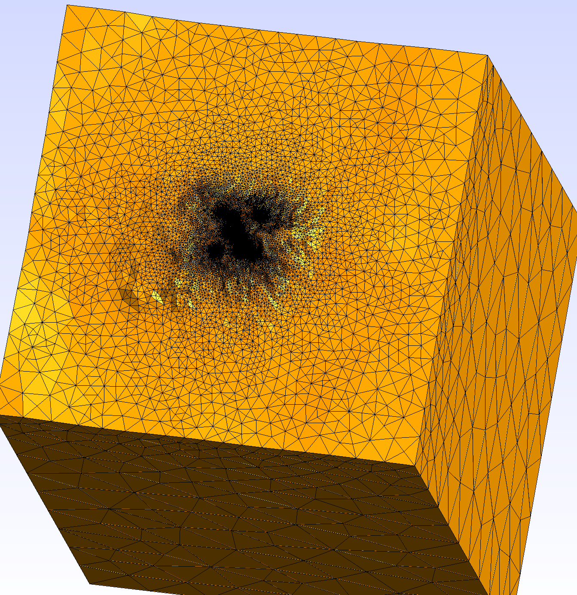 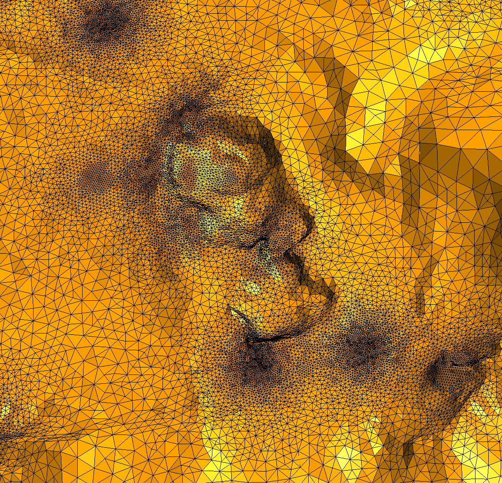

Figure. Generated tetrahedral mesh for Nakadake first crater of Aso volcano, Central Kyushu, Japan.

### 4.2 Step 2: Prepare true resistivity structure <a id="sec4_2"></a>
For inversion tutorials, we should assume some goal resistivity structure. ActFEM prepares the following goal resistivity structure in ActFEM/Joint_test/structure.
```bash
$ cd ActFEM/Joint_test/structure
$ ./cond_G3.sh
$ ./cond_homo.sh
```
If it is successful, **cond_G3.msh** and **cond_homo.msh** are generated. cond_G3.msh is the goal structure below and cond_homo.msh will be used as initial and reference homogeneous structure in the following inversions. Note that cond_\*.msh files are uniquely tied to original mesh_joint/nakadake3d.msh. If you update mesh_joint/nakadake3d.msh, please regenerate cond_G3.msh and cond_homo.msh.

You can check how the anomaly of cond_G3.msh looks by
```bash
$ ./view_slice.sh
```

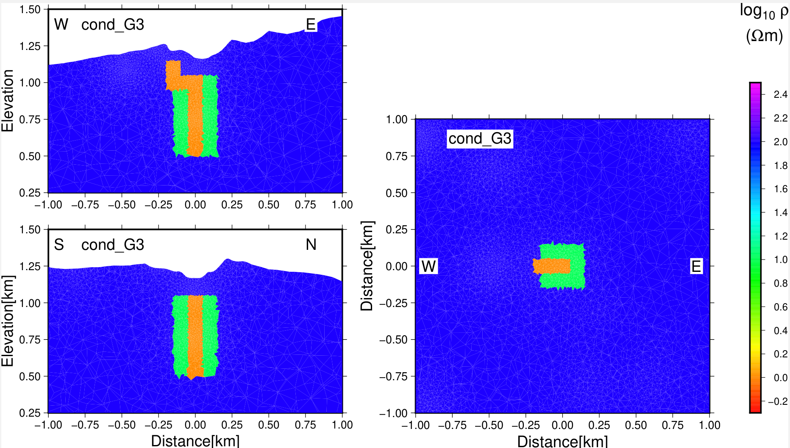

As seen in the panels, the anomaly is rectangular body extending just below the crater bottom.

### 4.3 Step 3: Generation of ACTIVE sample data for inversion <a id="sec4_3"></a>
Now that we have true model, let’s generate sample inversion data by forward modelling. Firstly, active data is prepared as follows:
```bash
$ cd ActFEM/Joint_test/fwd_active/
$ chmod +x run.sh
$ ./run.sh
```
After finishing the forward calculation, prepare data with error in ActFEM/Joint_test/fwd_active:
```bash
$ chmod + generr.sh
$ ./generr.sh
```
As results, `A0*_S?_amp.dat` and `A0*_S?_pha.dat` are generated in Joint_test/fwd_active/data/. Here, `A0*` are site names written in active.ctl, while `S?` is the source name of electric dipole as written in active.ctl.

Note that active.ctl in Joint_test/inv_act/, inv_joint/, inv_act_icomb-1/ and inv_joint_icomb-1/ are symbolic links to Joint_test/fwd_active/active.ctl, so the same sources are used in the inversions. Each source can be given by start/end points or by a source point file with `File:` (see [7.2](#Source_definition)).

### 4.4 Step 4: Generation of MT sample data for inversion <a id="sec4_4"></a>
Secondly, MT data is prepared in ActFEM/Joint_test/fwd_3DMT/
```bash
$ cd ActFEM/Joint_test/fwd_3DMT/
$ chmod +x run.sh
$ ./run.sh
```
The implementation generates **result/MT1_MT.dat** etc. The data with error are prepared by
```bash
$ chmod +x generr.sh
$ ./generr.sh
```
Then there are error files like **mt_err/MT1_MT_imp.err**, etc.

### 4.5 Step 5: Run sample inversions!! <a id="sec4_5"></a>
Above, preparation for all the inversions are complete. The procedures for running inversion samples are the same. Run **run.sh**, and see the results by **plot_rms.sh** and **view_slice.sh**. For example, in Joint_test/inv_act/
```bash
$ cd ActFEM/Joint_test/inv_act/
$ ./run.sh
```
In run.sh, you should edit the number of OpenMP threads and MPI processes corresponding to your environment.

The inversion demos in Joint_test/ are as follows. All of them use ebfem_inv_joint.exe (src/src_inv_joint), the homogeneous model Joint_test/structure/cond_homo.msh as the initial and reference models, the smoothest-model regularization (`Roughness type` = 1) and the cooling strategy for the trade-off parameter (`1:L,2:Cl,3:Mi,4:Gr` = 2). The first input of the executable (`ijoint`) selects the data: 1 for ACTIVE, 2 for MT (impedance and/or tipper) and 3 for ACTIVE + MT.

| Folder | ijoint | Data | Model parameterization (`icombine`) | Note |
|---|---|---|---|---|
| inv_act | 1 | ACTIVE Bz amplitude and phase (sources S1, S2; sites A01 - A04) | 0: normal | |
| inv_act_icomb-1 | 1 | Same as inv_act | -1: inner / outer mode | |
| inv_mt | 2 | MT impedance (MT1 - MT5) | 0: normal | |
| inv_mt_icomb-1 | 2 | Same as inv_mt | -1: inner / outer mode | |
| inv_joint | 3 | ACTIVE (as inv_act) + MT impedance (as inv_mt) | 1: outside blocks are integrated into one | |
| inv_joint_icomb-1 | 3 | Same as inv_joint | -1: inner / outer mode | |
| inv_mt_tip | 2 | MT impedance + tipper (MT1 - MT9) | 0: normal | |
| inv_tip | 2 | Tipper only (`imp: 0, 1:amp,pha` = -1) | 0: normal | Run by run_tip.sh (see readme.txt); results are not shown below |
| inv_tip_light | 2 | Tipper only, with Joint_test/mesh_light/ and structure_light/ (data in fwd_3DMT_light/) | 0: normal | Light version (2 MPI processes); results are not shown below |

The MT sites used in the inversion are selected in the inversion control file by the site index after `!`, which refers to the sites in mt.ctl (see [4.4](#sec4_4)); mt.ctl may contain more sites than those used in the inversion. The same applies to the ACTIVE sites in active.ctl. Each folder contains the following files.

| File | Description |
|---|---|
| run.sh | Builds src/src_inv_joint and runs the inversion with mpiexec (edit the numbers of MPI processes and OpenMP threads for your environment) |
| run_ism.sh | Same as run.sh for the ISM server (uses Makefile_ISM) |
| inv_act.ctl, inv_mt.ctl, joint.ctl, inv_mt_tip.ctl, inv_tip.ctl | Inversion control file (initial / reference models, regularization, data files and their site indices, model blocks) |
| active.ctl | ACTIVE forward control file (symbolic link to ../fwd_active/active.ctl) |
| mt.ctl | MT forward control file (symbolic link to ../fwd_3DMT/mt.ctl, or ../fwd_3DMT_light/mt.ctl for inv_tip_light) |
| result_inv/ | Output folder (RMS history, models modelNN.dat and model_connect.dat, responses at each iteration, log inv.log) |
| plot_rms.sh | Plots the RMS history |
| plot_fit_active.sh, plot_fit_MT.sh | Compare the observed and calculated responses |
| plot_rho_pha.sh | Plots MT apparent resistivity and phase of result_fwd/A01_MT.dat (an old script for MT forward results, not for the inversion outputs) |
| view_slice.sh | Draws slices of the obtained resistivity model (slice.exe and GMT) |
| clean.sh | Removes the outputs |

In the following, only the results are shown for obtained inversions results:

#### Results of Joint_test/inv_act
```bash
$ plot_rms.sh
$ ./view_slice.sh 06
```
Here 06 means to show model06 which is converged model.

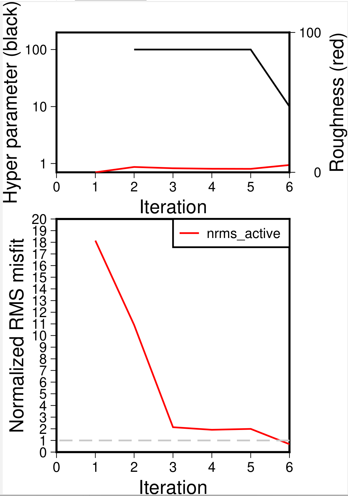 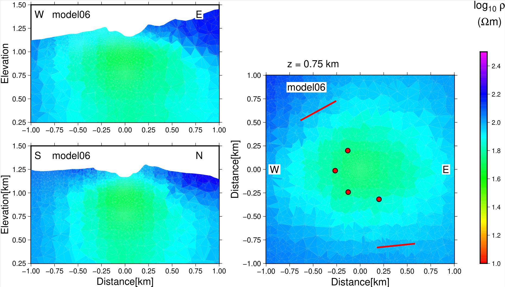

#### Results of Joint_test/inv_mt/
```bash
$ ./plot_rms.sh
$ ./view_slice.sh 09
```

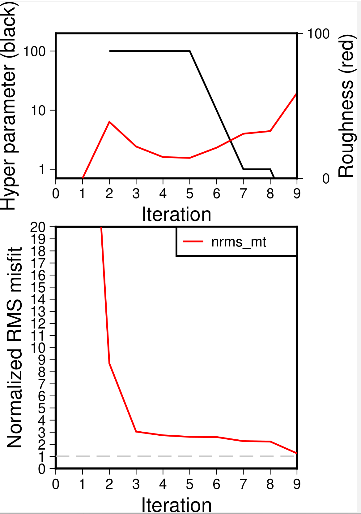 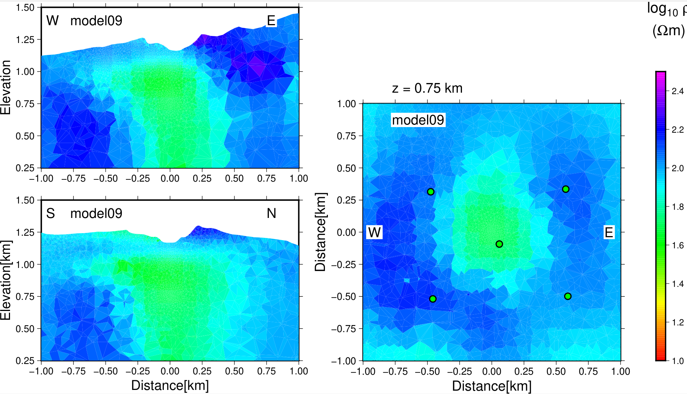

#### Result of Joint_test/inv_joint/
```bash
$ ./plot_rms.sh
$ ./view_slice.sh 08
```

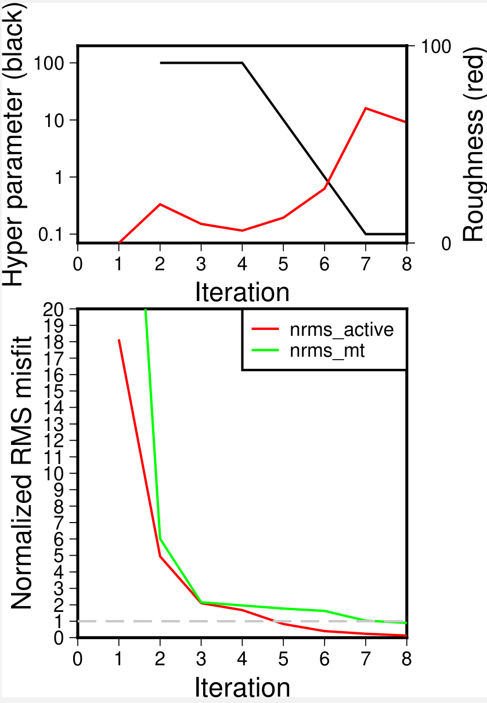 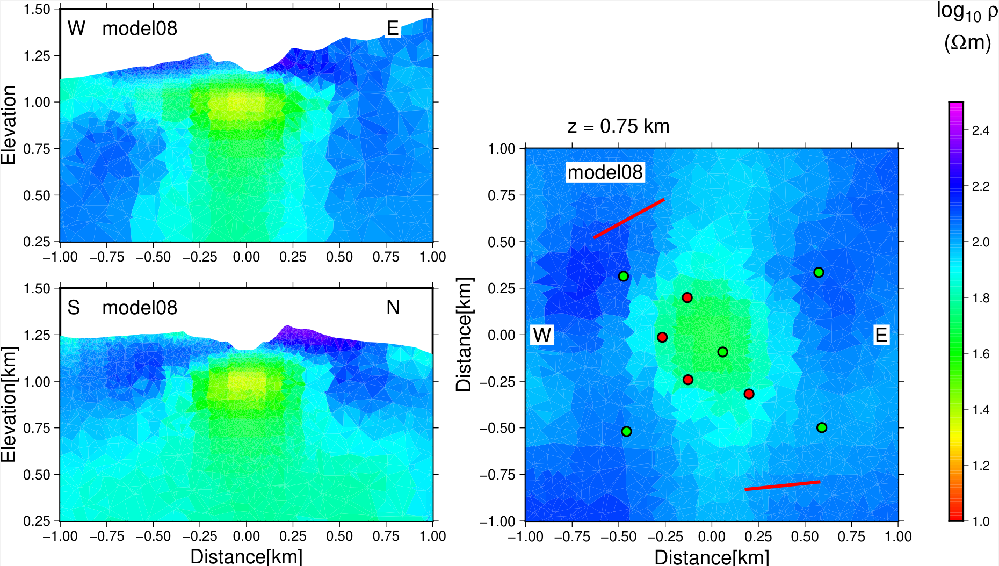

> **The following results are icombine = -1., which allows inversion to use inner outer model parametrization. The details are shown in the next section.**

#### Results of Joint_test/inv_act_icomb-1
```bash
$ plot_rms.sh
$ ./view_slice.sh 06
```

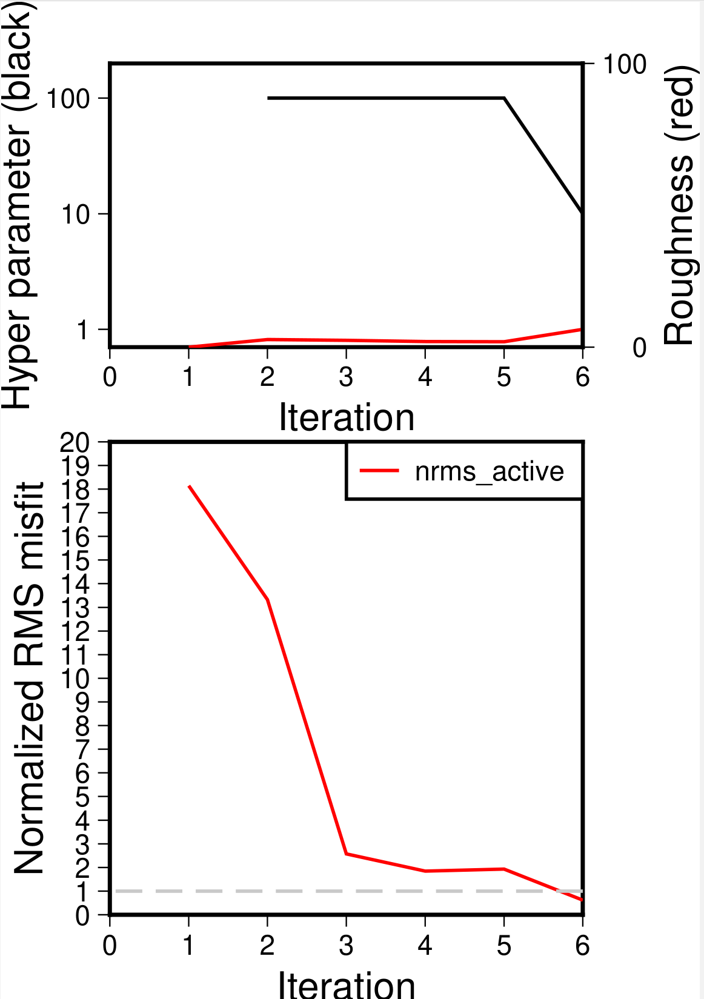 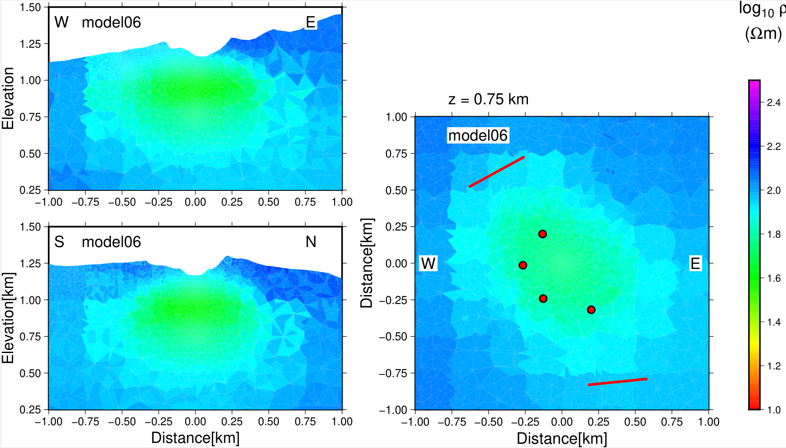

#### Results of Joint_test/inv_mt_icomb-1
```bash
$ plot_rms.sh
$ ./view_slice.sh 10
```

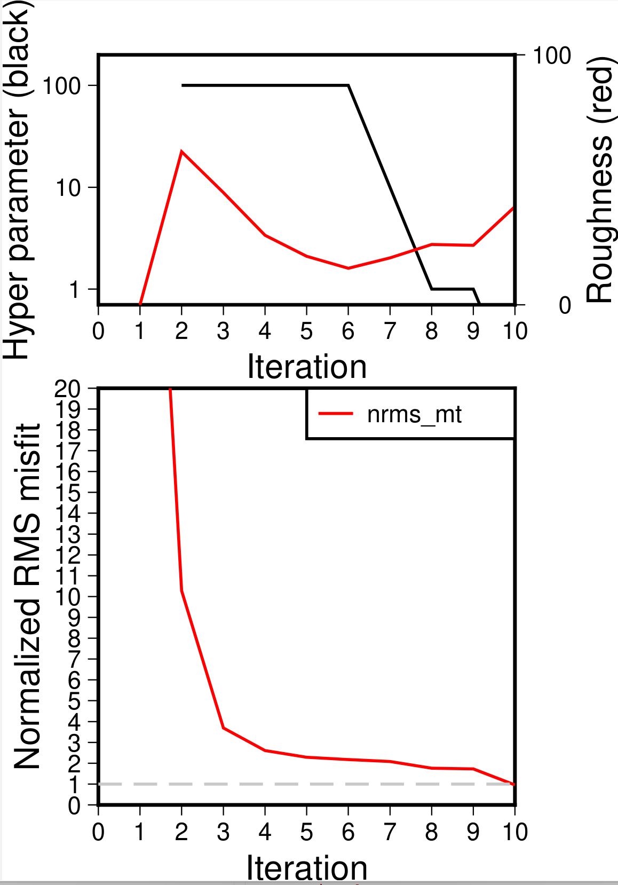 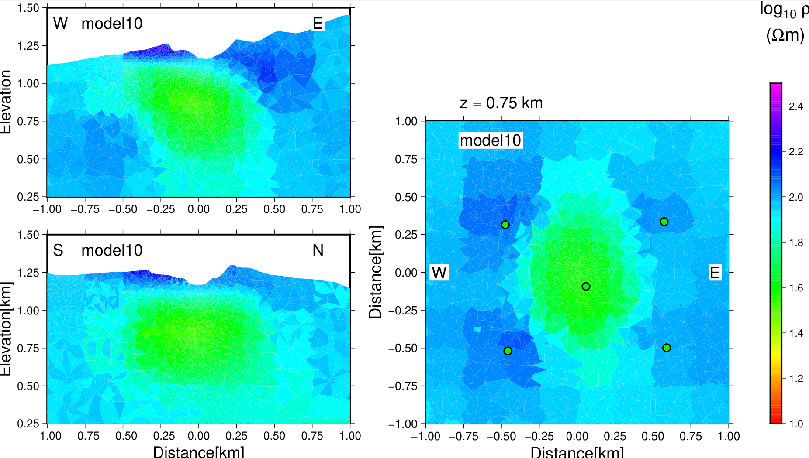

#### Results of Joint_test/inv_joint_icomb-1

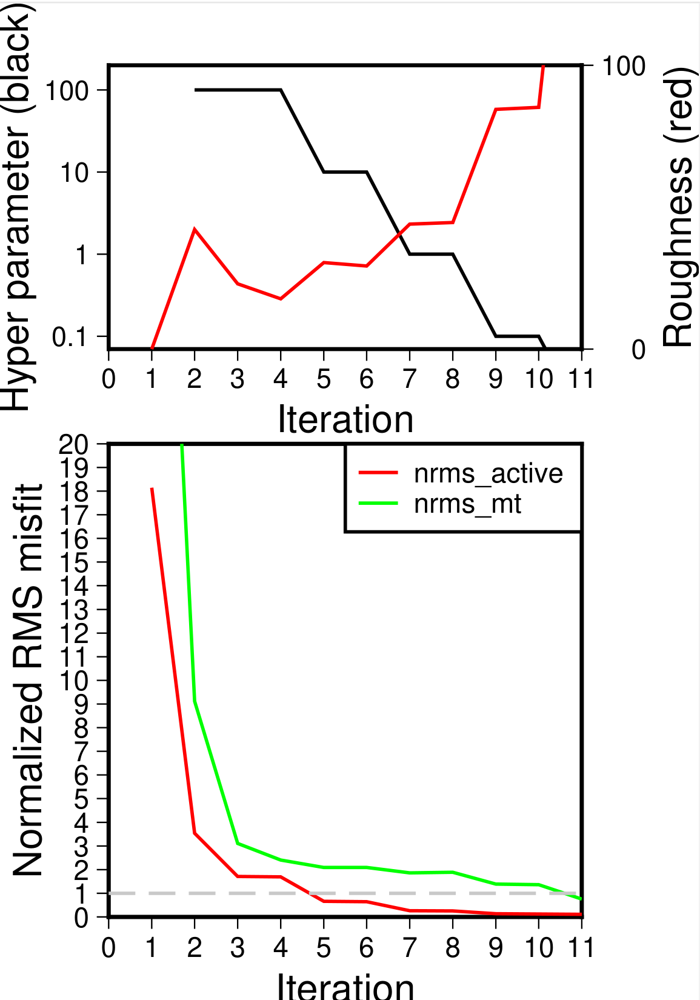 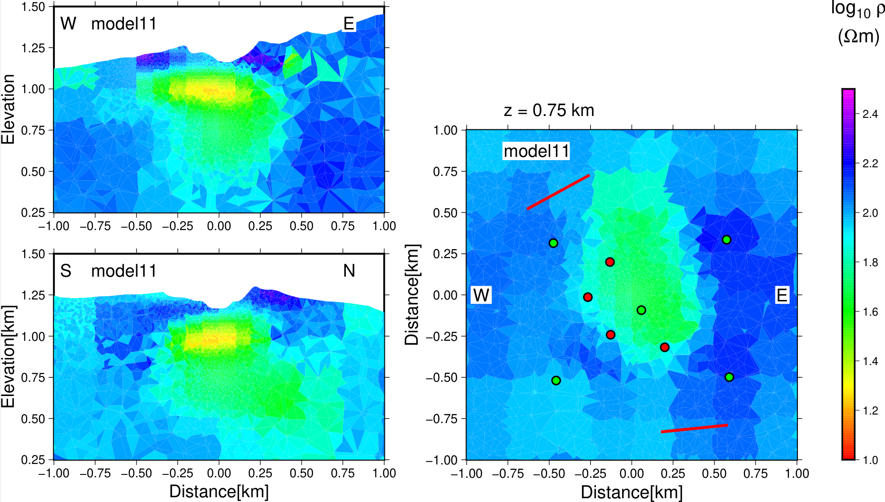

#### Results of Joint_test/inv_mt_tip
mt impedanceのerrorfloorは0.1、tipperのerrorfloorは0.1に設定し、αはpower -0.3で減少させた。-0.3が大きいと、構造の変動が大きくなり収束しない。

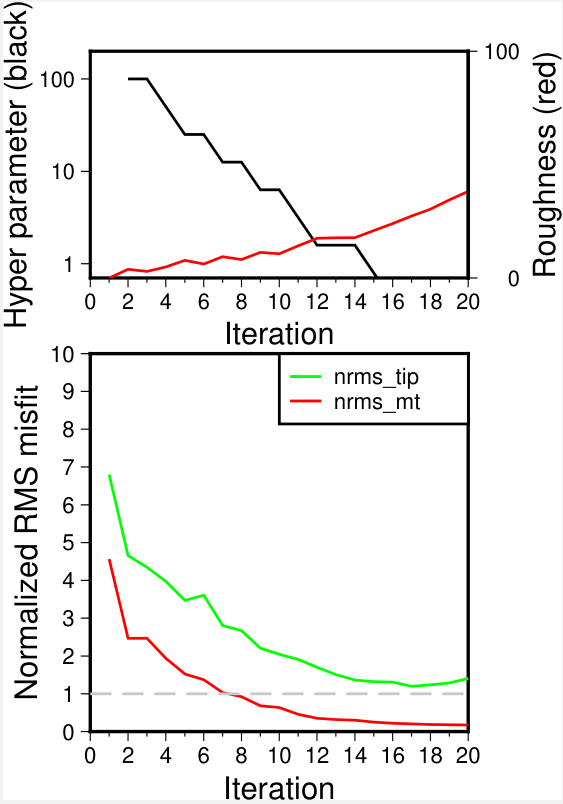 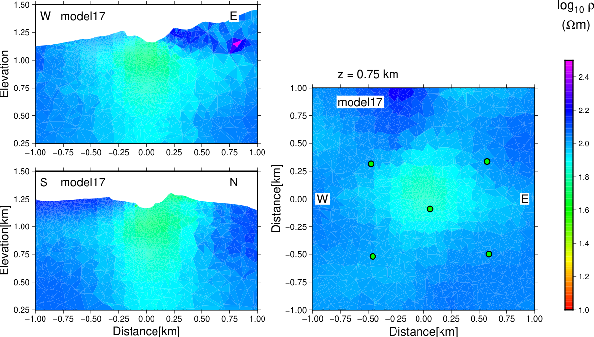

## 5 Source folder tree <a id="Source_folder_tree"></a>

| Folder | Description | Test folders |
|---|---|---|
| src/common/ | Common modules (parameters, mesh, matrix, model parameterization, etc.) used by all programs | |
| src/common_mpi/ | Modules for MPI communication | |
| src/solver/ | Serial (OpenMP) ACTIVE forward solver (ebfem_bxyz.exe) | Fwd_test/active, Fwd_test/active_loop, Joint_test/fwd_active |
| src/src_2D/ | 2-D TM mode solver (used as boundary conditions for MT) | |
| src/src_3DMT/ | Serial (OpenMP) 3-D MT forward solver (n_ebfem_3DMT.exe) | Fwd_test/MTfwd_test, Joint_test/fwd_3DMT |
| src/src_3DMT_mpi/ | MPI 3-D MT forward solver (n_ebfem_3DMT.exe) | Fwd_test/MTfwd_test_mpi, Joint_test/fwd_3DMT |
| src/src_inv_joint/ | ACTIVE, MT, tipper and joint inversion code (ebfem_inv_joint.exe) | Joint_test/inv_* |
| src/src_mesh/ | Mesh generation (meshgen1.exe, meshgen2.exe, mkline.exe, mkface.exe) | Fwd_test/mesh_flat, Joint_test/mesh_joint, Joint_test/mesh_light |
| src/src_post/ | Post processing (change_model2cond.exe, slice.exe, etc.) | Joint_test/structure, Joint_test/inv_*/view_slice.sh |
| src/ana/ | Analytical solution for ACTIVE (active_ana.exe) | Fwd_test/active_ana |
| src/solver_mpi/ | MPI ACTIVE forward solver (not updated for the current version and cannot be compiled) | |

All the inversion codes are integrated into src/src_inv_joint/. The former inversion codes (src/src_inv/, src/src_inv_ap/, src/src_inv_mpi/ and src/src_inv_mdm/) were removed in version 1.5; the files of src/src_inv/ still used by other programs (m_modelpart.f90 and solvebeta.f90) were moved to src/common/.

## 6 Governing equation and discretization <a id="Governing_equation_and_discretization"></a>
See Minami et al. (2018) for details about forward and inversion modelling in ActFEM. The induction equation in terms of the vector magnetic potential $\mathbf{A}$,

$$\nabla \times \left( \nabla \times \mathbf{A} \right) + i\omega\mu\widehat{\sigma}\mathbf{A} = \mu\mathbf{i}_{s},$$

is solved by the edge-based finite element method. $\widehat{\sigma} = \sigma + i\omega\epsilon$, where $\epsilon$ is the electric permittivity. $\omega$ is the angular frequency, $\mu$ is the magnetic permeability, $\mathbf{i}_{s}$ is the source electric current density. Note that the equation is easily converted to the induction equation in terms of the electric field $\mathbf{E}$, by using the relationship of $\mathbf{E} = i\omega\mathbf{A}$,

$$\nabla \times \nabla \times \mathbf{E} + i\omega\mu\widehat{\sigma}\mathbf{E} = i\omega\mu\mathbf{i}_{s}.$$

The magnetic field is obtained by $\mathbf{B} = \nabla \times \mathbf{A}$, after the equation is solved with respect to $\mathbf{A}$.

## 7 File formats <a id="File_formats"></a>

### 7.1 Control files for mesh generation and forward modelling <a id="Control_files"></a>
Mesh generation (meshgen1.exe, meshgen2.exe, mkline.exe and mkface.exe in src/src_mesh) and ACTIVE forward modelling (ebfem_bxyz.exe in src/solver) use control files in **the same format**, which are read by the same subroutine (`readparam` in src/common/m_param.f90). The ACTIVE control file for inversions (e.g., Joint_test/inv_act/active.ctl) is also in this format. Typical examples are:
- Mesh generation: Fwd_test/mesh_flat/aso.ctl, Joint_test/mesh_joint/aso.ctl
- Forward modelling: Fwd_test/active/active.ctl, Fwd_test/active_loop/active.ctl, Joint_test/fwd_active/active.ctl

#### 7.1.1 General rules <a id="sec7_1_1"></a>
- Lines starting with `##` (at columns 1-2) are comment lines and are skipped.
- In the other lines, **columns 1-20 are a label** and are ignored. The value is read **from column 21**. By convention, `!` is written at column 20 to separate the label and the value:
  ```
  ##-----10!-------20!
  iflag_map          !2
  ```
- Labels are free text; the items are read in the fixed order shown in [7.1.2](#sec7_1_2). Do not add or remove lines, except for the lines that depend on flags (e.g., `UTM zone` only for `iflag_map = 2`) or on the number of items (topography files, frequencies, observatories, sources).
- Do not insert blank lines.
- File names and folder names are read as `character(50)`. Keep each path within 50 characters (relative paths are recommended).
- Lengths and coordinates are in [km]. x is eastward, y is northward and z is upward (see [2](#Coordinate_system)). When lon/lat input is used, it is converted to x, y with the origin given by `lonlatorigin`.
- **The z (third value) of observatories and source points is the height [km] relative to the ground surface, not the elevation**, for both input formats (`lonlat(1),xyz (2)` = 1: lon lat z, = 2: x y z). For example, -0.001 means 1 m below the ground surface and 0.1 means 100 m above it. Each program interpolates the elevation of the ground surface z_surface(x, y) from the 2-D surface mesh with topography and uses z_surface(x, y) + z as the absolute z: calzobsr (src/common/calzobsr.f90) in mesh generation (meshgen2.exe), PREPZSRCOBS in ACTIVE forward modelling (src/solver/n_ebfem_bxyz.f90) and the inversion (src/src_inv_joint/n_inv_joint.f90), and PREPZOBSMT in MT forward modelling and the inversion. The converted absolute z is shown in the log (e.g., `z=    -0.00100 ->     1.28612 [km]` for site A02 in Joint_test/fwd_active/, whose ground surface is at about 1.287 km). When itopofile = 0, the ground surface is at z = 0, so the given z is equal to the absolute z.
- Mesh generation does not read the items after `Electric current [A]` (conductivity), while forward modelling reads all items. Mesh parameters (`west bound` - `A_src`) must also be written in the forward control file, but they are not used in the forward calculation (except for `west bound` - `north bound` when `ixyflg = 1`).

#### 7.1.2 Items <a id="sec7_1_2"></a>
The items are read in the following order. "Used by" shows the programs which use the item (M: mesh generation, F: forward modelling).

| # | Label (example) | Condition | Description | Used by |
|---|---|---|---|---|
| 1 | `itopofile` | | 0: no topography file (flat surface at z = 0; coordinates of observatories and sources must be given by xyz). 1: topography file(s) are given. | M, F |
| 2 | `iflag_map` | itopofile = 1 | Map projection for lon/lat. 1: Equidistant Cylindrical Projection (ECP), 2: UTM. | M, F |
| 3 | `UTM zone` | iflag_map = 2 | UTM zone (e.g., `52S`). | M, F |
| 4 | `lonlatorigin` | itopofile = 1 | Longitude and latitude [deg] of the origin of x, y. | M, F |
| 5 | `# of topo file` | itopofile = 1 | Number of topography files, nfile. Give files from the narrowest area to the widest area. | M |
| 6 | `topofile` | itopofile = 1, repeated nfile times with #7 | Topography file (lon, lat, altitude). | M |
| 7 | `lon lat shift` | itopofile = 1, repeated nfile times with #6 | Shift of lon, lat [deg] applied to the topography file. | M |
| 8 | `mesh file` | | 3-D mesh file used in the forward calculation (`<header3d>.msh` generated by mesh generation). | F |
| 9 | `2d triangle z file` | | 2-D surface mesh with topography (`<header2d>z.msh`). Used to convert the altitude of observatories and sources. | F |
| 10 | `local line file` | | Edge information file (`lineinfo.dat` generated by mkline.exe). | F |
| 11 | `angle` | | Rotation angle [deg] (N deg E) of the x axis, which originally points east. Usually 0.0. | M, F |
| 12 | `water level` | | 0: no water level control, 1: water level control file is given in the next line (see [7.1.4](#sec7_1_4)). | M |
| 13 | `water level file` | water level = 1 | Water level control file. | M |
| 14 | `output folder` | | Output folder for the forward results (end with `/`, e.g., `./result/`). Not used in mesh generation (any string, e.g., `-`). | F |
| 15 | `header2d` | | Header of the 2-D mesh files generated by mesh generation (`<header2d>.geo`, `.pos`, `.msh`, `<header2d>z.msh`, etc.). | M |
| 16 | `header3d` | | Header of the 3-D mesh files (`<header3d>.geo`, `.pos`, `.msh`). | M |
| 17 | `# of frequency` | | Number of frequencies, nfreq. | F |
| 18 | `Frequency [Hz]` | repeated nfreq times | Frequency [Hz]. | F |
| 19-22 | `west bound`, `east bound`, `south bound`, `north bound` | | x of the west and east, and y of the south and north boundaries [km] of the inner (focus) area. | M (F for ixyflg = 1) |
| 23 | `lenout [km]` | | Horizontal distance [km] from the inner area to the outer boundary. The outer boundary is at x = west bound - lenout and x = -(west bound - lenout) (same for y). | M |
| 24 | `upz in [km]` | | Upper z [km] of the inner area. | M |
| 25 | `downz in [km]` | | Lower z [km] of the inner area. | M |
| 26 | `zmax [km]` | | Top of the calculation domain (air) [km]. | M |
| 27 | `zmin [km]` | | Bottom of the calculation domain [km]. | M |
| 28 | `sizein [km]` | | Element size [km] in the inner area. | M |
| 29 | `sizebo [km]` | | Element size [km] at the outer boundary. | M |
| 30 | `sigma_obs [km]` | | Radius [km] of mesh refinement around each observatory (see below). | M |
| 31 | `A_obs [km]` | | Element size [km] at each observatory. | M |
| 32 | `dlen_source [km]` | | Interval [km] of the refinement points placed along each dipole. A dipole shorter than dlen_source has one refinement point at its midpoint. | M |
| 33 | `sigma_src [km]` | | Radius [km] of mesh refinement around each refinement point of sources. | M |
| 34 | `A_src [km]` | | Element size [km] at each refinement point of sources. | M |
| 35 | `# of observatory` | | Number of observatories, nobs. | M, F |
| 36 | `lonlat(1),xyz (2)` | | Coordinate format of observatories and sources. 1: lon lat z (itopofile = 1 is required), 2: x y z [km]. In both cases, z is the height [km] relative to the ground surface (see [7.1.1](#sec7_1_1)). | M, F |
| 37 | `Name` | repeated nobs times with #38 | Name of the observatory (used in output file names). | M, F |
| 38 | `xyz` | repeated nobs times with #37 | Coordinates of the observatory (format of #36; z is relative to the ground surface). | M, F |
| 39 | `ixyflg` | | 0: nothing, 1: field values are also calculated on nx × ny grid points in the inner area (west - east, south - north bounds). | F |
| 40 | `xy file header` | ixyflg = 1 | Header of the output files for the grid points. | F |
| 41 | `nx ny` | ixyflg = 1 | Number of grid points in x and y. | F |
| 42 | `# of sources` | | Number of sources, nsource. | M, F |
| 43 | `Source Name` | repeated nsource times | Name of the source (used in output file names), followed by the source geometry: two lines of start and end points, or one line of `File:<source point file>` (see [7.2](#Source_definition)). | M, F |
| 44 | `Electric current [A]` | | Electric current [A] through the source wire (common to all sources). | F |
| 45 | `sigma_air [S/m]` | forward only | Conductivity of the air [S/m]. | F |
| 46 | `condflag` | forward only | 0: (partitioned) homogeneous earth given by #47-48, 1: conductivity file given by #49. | F |
| 47 | `nvolume` | condflag = 0 | Number of physical volumes in the land region, nvolume. | F |
| 48 | `cond` | condflag = 0, repeated nvolume times | Conductivity [S/m] of each volume. | F |
| 49 | `condfile` | condflag = 1 | Conductivity file (see [9](#Generation_of_resistivity_model)). | F |

Mesh refinement: in the inner area, the element size at a horizontal distance r from an observatory (or a refinement point of a source) is given by sizein - (sizein - A) exp(-r² / 2σ²) for r ≤ 3σ, where A and σ are A_obs and sigma_obs (A_src and sigma_src for sources). The smallest value among all observatories and refinement points is used.

#### 7.1.3 Example <a id="sec7_1_3"></a>
Fwd_test/active/active.ctl (forward modelling):
```
## lines starting with "##" work as lines for comments ! 2020.09.28
## this file is forward control file
##-----10!-------20!
   itopofile       !1
iflag_map          !2
UTM zone           !52S
lonlatorigin       !131.084782     32.884882
# of topo file     !1
topofile           !../mesh_flat/topo_aso_flat.dat
lon lat shift      !0.0         0.0
mesh file          !../mesh_flat/nakadake3d.msh
2d triangle z file !../mesh_flat/nakadake2dz.msh
local line file    !../mesh_flat/lineinfo.dat
angle              !0.0
water level        !0
output folder      !./result/
header2d  (a50)    !nakadake2d
header3d  (a50)    !nakadake3d
# of frequency     !5
Frequency [Hz]     !1.d0
Frequency [Hz]     !3.d0
Frequency [Hz]     !11.d0
Frequency [Hz]     !33.d0
Frequency [Hz]     !99.d0
west bound         !-1.7
east bound         !1.7
south bound        !-1.5
north bound        !1.5
lenout [km]        !50.0
upz in [km]  (>0)  !1.3
downz in [km](<0)  !-1.1
zmax   [km]        !50.0
zmin   [km]        !-50.0
sizein [km]        !0.15
sizebo [km]        !10.0
sigma_obs [km]     !0.4
A_obs     [km]     !0.01
dlen_source [km]   !0.1
sigma_src [km]     !0.3
A_src     [km]     !0.005
# of observatory   !4
lonlat(1),xyz (2)  !1
1  Name            !A02
1  xyz             !131.083411   32.886706  -0.001
2  Name            !A04
2  xyz,sigma,A[km] !131.081939   32.884808  -0.001
3  Name            !A01
3  xyz,sigma,A[km] !131.083367   32.882725  -0.001
4  Name            !A03
4  xyz,sigma,A[km] !131.086847   32.881981  -0.001
ixyflg 0:no,1:surfv!0
# of sources       !2
Source Name        !S1
source start point !131.086490   32.877356   -0.001
source end   point !131.090840   32.877658   -0.001
Source Name        !S2
source start point !131.0784333  32.8908028  -0.001
source end   point !131.0814639  32.8912333  -0.001
Elcetric current[A]! 1.0
sigma_air    [S/m] !1.e-8
condflag 0:homo,1: !0
nvolume            !1
cond               !0.01
```
The mesh control file Fwd_test/mesh_flat/aso.ctl has the same structure. In mesh generation, `mesh file`, `2d triangle z file`, `local line file`, `output folder` and the frequencies are read but not used. Observatories and sources in the mesh control file determine where the mesh is refined, so they should include all observatories and sources used in the forward calculation (additional points, e.g., points below the crater, can be added only for refinement, as in Joint_test/mesh_joint/aso.ctl). Note that the outputs of mesh generation are written in the current folder with the names given by `header2d` and `header3d`, and `lineinfo.dat` (mkline.exe) and `faceinfo.dat` (mkface.exe) are also written there. Note that `faceinfo.dat` is not read in the current version: the inversion code reads the path of `face info file` in its control file, but generates the face information internally.

#### 7.1.4 Water level control file <a id="sec7_1_4"></a>
When `water level` is 1, the water level control file given in the next line is read in mesh generation. Its format is (the first 20 columns of each line are a label):
```
header line
# of water levels  |1
lake center lon    |131.0848
lake center lat    |32.8849
water level [km]   |1.0
```
The last line is repeated for the number of water levels. Comment lines (`##`) cannot be used in this file, and the lake center is converted by UTM (`iflag_map = 2` is required).

### 7.2 Source definition (single dipole / multiple dipoles) <a id="Source_definition"></a>
Each source is specified by the line `Source Name` followed by the source geometry. Two input styles are available and can be mixed among sources.

**(a) Single dipole (conventional format).** Two lines give the start and end points of one electric dipole.
```
Source Name        !S1
source start point !131.086490   32.877356   -0.001
source end   point !131.090840   32.877658   -0.001
```

**(b) Multiple dipoles given by a source point file.** Write `File:` followed by the path of the source point file (relative to the directory where the program is executed) in the line after `Source Name`.
```
Source Name        !S1
1st source file    !File:S1.dat
```
The source point file has the following format:
```
20                                 <- 1st line: number of points npoint (>= 2)
131.086490  32.877356  -0.001      <- 2nd- lines: coordinates of each point
131.087423  32.876926  -0.001
...
131.086490  32.877356  -0.001
```
- Points are connected in order, and dipole *j* is defined from point *j* to point *j*+1, i.e., `npoint` points give `npoint - 1` dipoles connected in series (a polyline wire). The same electric current `Elcetric current[A]` flows through all dipoles.
- The coordinate format of each point follows the `lonlat(1),xyz (2)` flag of the observatory block: `lon lat z` for 1, and `x y z` [km] for 2. In both cases, z [km] is the height relative to the ground surface (see [7.1.1](#sec7_1_1)). Lon/lat are converted with the projection given by `iflag_map` (ECP or UTM).
- If the last point coincides with the first point (within 1 mm), the source is regarded as a **closed loop**.
- The `File:` keyword is case-sensitive and must be at the head of the value (leading spaces are allowed). In the source point file, write coordinates only (one point per line, no labels).
- In mesh generation, refinement points (`dlen_source`, `sigma_src`, `A_src`) are placed along every dipole; the duplicated points at the junctions of consecutive dipoles (and at the start point of a closed loop) are automatically removed.
- Both input styles are available in the ACTIVE forward code (ebfem_bxyz.exe), the mesh generation codes (src/src_mesh) and the joint inversion code (ebfem_inv_joint.exe, used in Joint_test/inv_act/, inv_joint/, etc.). In the inversion, `<source name>_site.dat` in the output folder lists all vertices of the source (start points of all dipoles and the end point of the last dipole). src/solver_mpi/ is not updated for this format.

Example: Fwd_test/active_loop/ (active.ctl, S1.dat, S2.dat); see [3.5](#sec3_5) for how to run it.

## 8 Mesh generation tutorial <a id="Mesh_generation_tutorial"></a>
The mesh generation for FEM modelling is one of the toughest works for forward/inversion preparation. This section explains how 3-D tetrahedral meshes are generated in ActFEM and how to adjust them. The format of the mesh control file is described in [7.1](#Control_files).

### 8.1 Mesh folders <a id="sec8_1"></a>
The following mesh folders are prepared. Each folder has a control file (aso.ctl) and a script (meshgen.sh).

| Folder | Topography | Used by | Size of the mesh |
|---|---|---|---|
| Fwd_test/mesh_flat/ | Flat (topo/topo_aso_flat.dat) | Forward samples in Fwd_test/ ([section 3](#Run_the_sample)) | 93,381 nodes, 562,852 tetrahedra |
| Joint_test/mesh_joint/ | Aso topography (topo/aso_map.data and topo/topo127_134_29_36.xyz) | Inversion samples in Joint_test/ ([section 4](#Run_samples_for_inversions)) | 112,898 nodes, 692,839 tetrahedra |
| Joint_test/mesh_light/ | Same as mesh_joint | Light samples (Joint_test/fwd_3DMT_light/, inv_tip_light/) | 71,594 nodes, 434,529 tetrahedra |

mesh_light uses the same observatories and sources as mesh_joint, but with a smaller calculation domain and larger elements (`lenout` 5.0 km instead of 8.0 km, `sizein` 0.11 km instead of 0.1 km, `sizebo` 2.0 km instead of 3.0 km, `A_obs` 0.01 km instead of 0.008 km, `dlen_source` 0.5 km instead of 0.3 km, and `A_src` 0.01 km instead of 0.006 km).

### 8.2 Run meshgen.sh <a id="sec8_2"></a>
In this tutorial, Joint_test/mesh_joint/ is used. Run
```bash
$ cd ActFEM/Joint_test/mesh_joint
$ chmod +x meshgen.sh
$ ./meshgen.sh > log.txt
```
meshgen.sh first compiles the programs in src/src_mesh with gfortran (Makefile_gfort), and then runs the following steps. All the outputs are written in the current folder; `nakadake2d` and `nakadake3d` are the headers given by `header2d` and `header3d` in aso.ctl.

| Step | Command | Main outputs |
|---|---|---|
| 1 | `meshgen1.exe` (reads aso.ctl) | nakadake2d.geo, nakadake2d.pos (2-D geometry and background mesh for element size) |
| 2 | `gmsh -2 nakadake2d.geo -bgm nakadake2d.pos -format msh2` | nakadake2d.msh (2-D triangle mesh of the surface) |
| 3 | `meshgen2.exe` (reads aso.ctl) | nakadake2dz.msh, nakadake2d_lonlatz.msh (surface mesh with topography), nakadake3d.geo, nakadake3d.pos |
| 4 | `gmsh -3 nakadake3d.geo -bgm nakadake3d.pos -format msh2` | nakadake3d.msh (3-D tetrahedral mesh), nakadake3d.log |
| 5 | `mkline.exe` (reads aso.ctl) | lineinfo.dat (edge information) |
| 6 | `mkface.exe` (reads aso.ctl) | faceinfo.dat (face information) |

In Fwd_test/mesh_flat/meshgen.sh, step 4 is run without the background mesh (`-bgm`), and step 6 is not run. The whole procedure takes about 30 seconds for mesh_joint (20 seconds for mesh_light).

If meshgen.sh finishes successfully, log.txt shows the summary of the generated meshes. For the 2-D mesh (step 3):
```
 # of nodes         (node) :     13683
 # of elements      (nele) :     27368
 # of Point       elements :         4
 # of Line        elements :        72
 # of Triangle    elements :     27292
 # of Tetrahedron elements :         0
```
and for the 3-D mesh (steps 5 and 6):
```
 # of nodes         (node) :    112898
 # of elements      (nele) :    692848
 # of Point       elements :         0
 # of Line        elements :         9
 # of Triangle    elements :         0
 # of Tetrahedron elements :    692839
 ...
 nline=      806917
 ### MKLINE END ###
 ...
 nface=     1386859
 ### MKFACE END ###
```
The final 3-D mesh is nakadake3d.msh, and the files used in the forward calculation are nakadake3d.msh, nakadake2dz.msh and lineinfo.dat (`mesh file`, `2d triangle z file` and `local line file` in the forward control file). In meshgen.sh, the random seed of gmsh is fixed by `-string "Mesh.RandomSeed=1;"`, so running meshgen.sh again with the same aso.ctl gives the same nakadake3d.msh. To remove all the outputs, run `./clean.sh`.

The generated mesh can be checked with the gmsh viewer:
```bash
$ gmsh nakadake3d.msh
```
"Tools > Options > Mesh > 3D element faces" shows the faces of the tetrahedra, and "Tools > Visibility > select Volume 2 > Apply" shows only the land elements, where you can check the refined areas around the observatories and sources.

Note that the conductivity files in Joint_test/structure/ (cond_G3.msh and cond_homo.msh) are tied to Joint_test/mesh_joint/nakadake3d.msh. If you change mesh_joint/aso.ctl and regenerate the mesh, regenerate the conductivity files as well (see [4.2](#sec4_2)).

### 8.3 How to adjust the mesh <a id="sec8_3"></a>
The mesh is adjusted by editing the control file (aso.ctl). The main parameters are as follows (see [7.1.2](#sec7_1_2) for details).
- **Calculation domain**: `west bound` - `north bound` give the inner (focus) area, `upz in` and `downz in` give its vertical range, and `lenout`, `zmax` and `zmin` give the outer boundary.
- **Element size**: `sizein` (inner area) and `sizebo` (outer boundary). Smaller values give more elements.
- **Refinement around observatories**: the element size becomes `A_obs` at each observatory and approaches `sizein` within a radius of about 3 × `sigma_obs`. All observatories used in the forward calculation and the inversion should be included in the mesh control file.
- **Refinement points only for the mesh**: points which are not used as observatories can be added in the observatory list only for refinement. For example, Joint_test/mesh_joint/aso.ctl contains DUM and DM1 (100 m and 400 m below the origin), DM2 and DM3 (100 m below the ground surface to the west of the origin), and MT1 - MT4 (MT sites), in addition to the ACTIVE sites A01 - A04. The number of observatories (`# of observatory`) must be changed accordingly.
- **Refinement along sources**: refinement points are placed along every dipole of each source with the interval `dlen_source`, and the element size becomes `A_src` there with the radius `sigma_src`. Polyline sources given by `File:` (see [7.2](#Source_definition)) are also refined along every dipole.

After editing aso.ctl, run meshgen.sh again and compare the numbers of nodes and elements in log.txt. The difference between mesh_joint and mesh_light ([8.1](#sec8_1)) is an example of how the element size parameters change the size of the mesh.

## 9 Generation of resistivity model for forward/inversion <a id="Generation_of_resistivity_model"></a>
For forward/inversion using ActFEM, users should prepare a resistivity model for a given 3-D tetrahedral mesh. This section explains the format of the resistivity (conductivity) file and how to generate it with change_model2cond.exe (src/src_post). The examples are in Joint_test/structure/ (for Joint_test/mesh_joint/) and Joint_test/structure_light/ (for Joint_test/mesh_light/).

### 9.1 Resistivity file (cond.msh) <a id="sec9_1"></a>
The resistivity model is given by the file specified by `condfile` with `condflag = 1` in the forward control file (see [7.1](#Control_files)), and by `ref cond file` and `init cond file` in the inversion control file. The file is in the gmsh ElementData format, and gives the resistivity [Ohm.m] of every tetrahedron in the land region:
```
$MeshFormat
2.2 0 8
$EndMeshFormat
$ElementData
1
"A rho model view"
1
0.0
3
0
1
    405664                              <- number of land elements
      287185   300.00000000000000       <- element id, resistivity [Ohm.m]
      287186   300.00000000000000
...
$EndElementData
```
The first 11 lines are a header. The element ids correspond to the element numbers in the 3-D mesh file, so **a resistivity file is tied to the 3-D mesh** used to generate it. If the mesh is regenerated with a different control file, the resistivity file must also be regenerated. Because the resistivity file does not include the mesh, it cannot be viewed by gmsh alone; it can be viewed by merging it with the mesh, e.g., `gmsh nakadake3d.msh cond_G3.msh`.

### 9.2 Generation by change_model2cond.exe <a id="sec9_2"></a>
change_model2cond.exe starts from a base model (a homogeneous model, an existing resistivity file, or an inversion result) and changes the resistivity of the elements whose centers are inside the given cuboids. In Joint_test/structure/,
```bash
$ cd ActFEM/Joint_test/structure
$ ./cond_homo.sh
$ ./cond_G3.sh
```
generate cond_homo.msh (homogeneous 300 Ohm.m) and cond_G3.msh (true model for the inversion samples in [section 4](#Run_samples_for_inversions); see [4.2](#sec4_2)). Each script writes a control file, compiles src/src_post with gfortran (Makefile_gfort), and runs `change_model2cond.exe < control file`.

The control file of change_model2cond.exe is as follows. As in [7.1](#Control_files), the first 20 columns of each line are a label, and the value is read from column 21. The first line is a header, and comment lines (`##`) cannot be used in this file.

| # | Label (example) | Condition | Description |
|---|---|---|---|
| 1 | `!------10!-------20!` | | Header line (skipped). |
| 2 | `input 3d mshfile` | | 3-D mesh file (e.g., ../mesh_joint/nakadake3d.msh). |
| 3 | `0homo,1cond,2model` | | Base model. 0: homogeneous, 1: existing resistivity file, 2: inversion result. |
| 4 | `homo resistivity` | base = 0 | Resistivity [Ohm.m] of the homogeneous model. |
| 4 | `input cond` | base = 1 | Resistivity file (cond.msh type). |
| 4-5 | `model connect file`, `input model` | base = 2 | model_connect.dat and modelNN.dat in the output folder of the inversion. |
| 6 | `output cond` | | Output resistivity file. |
| 7 | `0:elevation,1:depth` | | z range of the cuboids. 0: elevation [km], 1: depth from the ground surface [km] (negative values, e.g., -0.3 and -0.1). |
| 8 | `2d topo file` | z range = 1 | 2-D surface mesh with topography (e.g., ../mesh_joint/nakadake2dz.msh). |
| 9 | `# of cuboid` | | Number of cuboids, ncuboid (0 for no change). |
| 10-13 | `xminmax [km]`, `yminmax [km]`, `zminmax [km]`, `rho [Ohm.m]` | repeated ncuboid times | Range of x, y and z [km] (two values each) and the resistivity [Ohm.m] of the cuboid. |

The cuboids are applied in the given order, so a later cuboid overwrites earlier ones where they overlap. For example, cond_G3.sh uses the following control file, where the 10 Ohm.m cuboid C22 is given first and the 1 Ohm.m cuboids C20 and C21 are given after it:
```
!------10!-------20!----
input 3d mshfile   !../mesh_joint/nakadake3d.msh
0homo,1cond,2model !0
homo resistivity   !100.0
output cond        !./cond_G3.msh
0:elevation,1:depth!0
# of cuboid        !4
C22 xminmax [km]   !-0.150         0.1500
C22 yminmax [km]   !-0.1500        0.1500
C22 zminmax [km]   ! 0.5000        1.05
C22 rho    [Ohm.m] !10.0
C20 xminmax [km]   !-0.0500         0.0500
C20 yminmax [km]   !-0.05000        0.0500
C20 zminmax [km]   ! 0.500         1.05
C20 rho    [Ohm.m] !1.0
C21 xminmax [km]   !-0.200          0.0500
C21 yminmax [km]   !-0.0500         0.0500
C21 zminmax [km]   ! 0.9500         1.05
C21 rho    [Ohm.m] !1.0
C21 xminmax [km]   !-0.2000         -0.100
C21 yminmax [km]   !-0.0500         0.050
C21 zminmax [km]   ! 0.9500         1.15
C21 rho    [Ohm.m] !1.0
```
Other examples of control files (an existing resistivity file or an inversion result as the base model, and cuboids given by depth from the surface) are written in cond_G3.sh as test1.ctl - test5.ctl, which are not used in the script (the paths of the mesh files in them should be changed before use). With base = 2, an inversion result (modelNN.dat) can be converted to a resistivity file, which can be used, e.g., as the initial model of another inversion. In Joint_test/structure_light/, cond_homo.sh and cond_lateral.sh generate the models for mesh_light in the same way.

### 9.3 View the resistivity model <a id="sec9_3"></a>
The generated resistivity model can be checked by vertical and horizontal slices:
```bash
$ ./view_slice.sh
```
view_slice.sh runs slice.exe (src/src_post) to cut the slices out of the resistivity file and draws them with GMT (see the explanation at the beginning of view_slice.sh for the parameters of slices). By default, it draws the W-E (y = 0) and S-N (x = 0) vertical slices and the horizontal slice at z = 1.0 km for cond_G3.msh (see the figure in [4.2](#sec4_2)). To view another model, change `ID` and `condfile` in view_slice.sh.

## 10 Version notes <a id="Version_notes"></a>

#### Version 1.5
Nov 25, 2026: The manual is largely revised. The description of the control files for mesh generation and forward modelling ([7.1](#Control_files)) is updated to the current format (items, conditions, programs using each item, and an example), and the water level control file is described. The mesh generation tutorial ([8](#Mesh_generation_tutorial)) is rewritten for the current mesh folders (Fwd_test/mesh_flat/, Joint_test/mesh_joint/ and Joint_test/mesh_light/), and the generation of resistivity models ([9](#Generation_of_resistivity_model)) is rewritten for the current procedure with change_model2cond.exe. The inversion codes are integrated into src/src_inv_joint/ and the source folder tree ([5](#Source_folder_tree)) is updated. Anchors are added to all sections and subsections, the references to sections in the text are linked, and the contents list the subsections.

#### Version 1.4
Nov 23, 2026: Polyline (multi-dipole) sources are now available for ACTIVE forward modelling, mesh generation and the joint inversion (ebfem_inv_joint.exe). Each source can be given either by start/end points (single dipole, conventional format) or by a source point file with `File:` (multiple dipoles connected in series, including closed loops) (see [7.2](#Source_definition)). A test for loop sources (Fwd_test/active_loop/) and its comparison script with the analytical solution (compana_loop.py) are added (see [3.5](#sec3_5)).

May 30, 2026: Tipper inversion is now available jointly with ACTIVE (CSEM) and MT impedance inversions.

#### Version 1.0
Latest date for update is Sep 30, 2021. Forward and inversion simulation can be available.

## 11 References <a id="References"></a>
Minami, T., Utsugi, M., Utada, H., Kagiyama, T., & Inoue, H. (2018). Temporal variation in the resistivity structure of the first Nakadake crater, Aso volcano, Japan, during the magmatic eruptions from November 2014 to May 2015, as inferred by the ACTIVE electromagnetic monitoring system. *Earth, Planets and Space*, *70*(1), 1-10.

## Appendix A: Derivation of the discretized form of governing equation <a id="AppendixA"></a>
Given the governing equation,

$$\nabla \times \nabla \times \mathbf{A} + i\omega\mu\sigma\mathbf{A} = \mu\mathbf{i}_{s},$$

in the finite element method with the Galerkin method, we numerically solve

$$\int_{\Omega}{\mathbf{w} \cdot \left( \nabla \times \nabla \times \mathbf{A} + i\omega\mu\sigma\mathbf{A} - \mu\mathbf{i}_{s} \right)dV} = 0,\  \cdot \cdot \cdot \cdot (1)$$

where $w$ is arbitrary test function, where the edge-basis function is adopted for $\mathbf{w}$ in the Galerkin method, and $\Omega$ is the computational domain.

By using the relationship $\nabla \cdot \left( \mathbf{A} \times \mathbf{B} \right) = \mathbf{B} \cdot \left( \nabla \times \mathbf{A} \right) - \mathbf{A} \cdot (\nabla \times \mathbf{B})$, the first term in the left hand side of Eq. (1) is reduced to

$$\int_{\Omega}{\mathbf{w} \cdot (\nabla \times \nabla \times A)dV} = \int_{\Omega}{\left\{ \nabla \cdot \left( (\nabla \times A) \times w \right) + (\nabla \times w) \cdot (\nabla \times A) \right\} dV}$$

$$= \int_{\Omega}{\left\{ \nabla \cdot \left( \left( \nabla \times \mathbf{A} \right) \times w \right) + (\nabla \times w) \cdot (\nabla \times A) \right\} dV}$$

$$= \int_{\partial\Omega}{\left( \left( \nabla \times \mathbf{A} \right) \times \mathbf{w} \right) \cdot \mathbf{n}dS} + \int_{\Omega}{\left\{ \left( \nabla \times \mathbf{w} \right) \cdot \left( \nabla \times \mathbf{A} \right) \right\} dV}$$

$$= \int_{\partial\Omega}{\left( \mathbf{B} \times \mathbf{w} \right) \cdot \mathbf{n}dS} + \int_{\Omega}{\left\{ \left( \nabla \times \mathbf{w} \right) \cdot \left( \nabla \times \mathbf{A} \right) \right\} dV} \cdot \cdot \cdot (2)$$

Where $\mathbf{B} = \nabla \times \mathbf{A}$ represents the magnetic field and $\partial\Omega$ indicates the boundary surface of the computational domain, and $\mathbf{n}$ is a outward unit vector normal to the surface $\partial\Omega$. Taking into account that at $\partial\Omega$, we can take

$$\mathbf{n} \cdot (B \times w) = w \cdot \left( \mathbf{n} \times \mathbf{B} \right) = 0,$$

where $\nabla \cdot \left( \mathbf{n} \times \mathbf{B} \right) = B \cdot \left( \nabla \times \mathbf{n} \right) - n \cdot (\nabla \times B) = - n \cdot \left( \mu\mathbf{j} \right) = 0$ indicates there are no electric current penetrating the boundary surface. Then, Eq. (2) reduces to

$$\int_{\Omega}{\mathbf{w} \cdot \left( \nabla \times \nabla \times \mathbf{A} \right)dV = \int_{\Omega}{\left\{ \left( \nabla \times \mathbf{w} \right) \cdot \left( \nabla \times \mathbf{A} \right) \right\} dV}} \cdot \cdot \cdot (3)$$

Substituting Eq. (3) into Eq. (1), we obtain

$$\int_{\Omega}{\left\{ \left( \nabla \times \mathbf{w} \right) \cdot \left( \nabla \times \mathbf{A} \right) \right\} dV} + \int_{\Omega}{i\omega\mu\sigma\mathbf{w} \cdot \mathbf{A}dV} = \mu\int_{\Omega}{\mathbf{w} \cdot \mathbf{i}_{s}dV}. \cdot \cdot \cdot (4)$$

In the finite element method, we divide the numerical domain into finite number of the tetrahedrons and calculate the volume integral for each tetrahedral element. In the remaining, we think only an volume integral for e-th element, $\Omega_{e}$, then Eq. (4) is rewritten for e-th element as

$$\int_{\Omega_{e}}{\left\{ \left( \nabla \times \mathbf{w}_{i} \right) \cdot \left( \nabla \times \mathbf{A}_{e} \right) \right\} dV} + \int_{\Omega_{e}}{i\omega\mu\sigma\mathbf{w}_{i} \cdot \mathbf{A}_{e}dV} = \mu\int_{\Omega_{e}}{\mathbf{w}_{i} \cdot \mathbf{i}_{s_{e}}dV} \cdot \cdot \cdot (5)$$

where $w_{i}\ (i = 1, \cdot \cdot \cdot ,6)$ is the edge-basis function for each edge of the e-th tetrahedron. We represent the vector potential in the e-th element as

$$\mathbf{A}_{e}=\sum_{j = 1}^{6}{\mathbf{w}_{j}{\lbrack Al\rbrack}_{j}} \cdot \cdot \cdot \cdot (6)$$

where

$$\mathbf{w}_{j} = \mathbf{w}_{kl} = \lambda_{k}\nabla\lambda_{l} - \lambda_{l}\nabla\lambda_{k}.$$

$\lambda_{k}$ is the nodal basis function. The relationship between j and k,l are shown in the following figure and table.

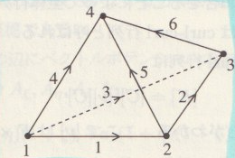

Table A1.

| i, j (edge id) | k   | l   | m   | n   |
|:--------------:|:---:|:---:|:---:|:---:|
| 1              | 1   | 2   | 3   | 4   |
| 2              | 2   | 3   | 1   | 4   |
| 3              | 1   | 3   | 4   | 2   |
| 4              | 1   | 4   | 2   | 3   |
| 5              | 2   | 4   | 3   | 1   |
| 6              | 3   | 4   | 1   | 2   |

Using Eq. (6), Eq. (5) can be reduced to

$$\sum_{j = 1}^{6}{\int_{\Omega_{e}}{\left\{ \left( \nabla \times \mathbf{w}_{i} \right) \cdot \left( \nabla \times \mathbf{w}_{j} \right) \right\} dV}\lbrack Al\rbrack_{j}} + \sum_{j = 1}^{6}{\int_{\Omega_{e}}{i\omega\mu\sigma\mathbf{w}_{i} \cdot \mathbf{w}_{j}dV}\lbrack Al\rbrack_{j}} = \mu\int_{\Omega_{e}}{\mathbf{w}_{i} \cdot \mathbf{i}_{s_{e}}dV},\  \cdot \cdot \cdot (7)$$

which is rewritten in the matrix form as,

$$\left\{ \left\lbrack M_{e} \right\rbrack + i\omega\mu\sigma_{e}\left\lbrack N_{e} \right\rbrack \right\}\left\lbrack \mathbf{Al}_{e} \right\rbrack = \mathbf{s}_{e} \cdot \cdot \cdot (8)$$

$$\left\lbrack \mathbf{Al}_{e} \right\rbrack = \left\lbrack {Al}_{1}\ {Al}_{2}\ {Al}_{3}\ {Al}_{4}\ {Al}_{5}\ {Al}_{6} \right\rbrack^{T} \cdot \cdot \cdot (9)$$

$$\left\lbrack M_{e} \right\rbrack_{ij} = \int_{\Omega_{e}}{\left\{ \left( \nabla \times \mathbf{w}_{i} \right) \cdot \left( \nabla \times \mathbf{w}_{j} \right) \right\} dV} = \frac{1}{3v}\mathbf{x}_{mn} \cdot \frac{1}{3v}\mathbf{x}_{m^{'}n^{'}} \times v = \frac{1}{9v}\mathbf{x}_{mn} \cdot \mathbf{x}_{m^{'}n^{'}} \cdot \cdot \cdot (10)$$

$$\left\lbrack N_{e} \right\rbrack_{ij} = \int_{\Omega_{e}}{\mathbf{w}_{i} \cdot \mathbf{w}_{j}dV} = \int_{\Omega_{e}}{\left( \lambda_{k}\nabla\lambda_{l} - \lambda_{l}\nabla\lambda_{k} \right) \cdot \left( \lambda_{k^{'}}\nabla\lambda_{l^{'}} - \lambda_{l^{'}}\nabla\lambda_{k^{'}} \right)dV}$$

$$= \int_{\Omega_{e}}{\left( \lambda_{k}\lambda_{k^{'}}\nabla\lambda_{l} \cdot \nabla\lambda_{l^{'}} - \lambda_{k}\lambda_{l^{'}}\nabla\lambda_{l} \cdot \nabla\lambda_{k^{'}} - \lambda_{l}\lambda_{k^{'}}\nabla\lambda_{k} \cdot \nabla\lambda_{l^{'}} + \lambda_{l}\lambda_{l^{'}}\nabla\lambda_{k} \cdot \nabla\lambda_{k^{'}} \right)dV}$$

$$= \nabla\lambda_{l} \cdot \nabla\lambda_{l^{'}}\int_{\Omega_{e}}{\lambda_{k}\lambda_{k^{'}}dV} - \nabla\lambda_{l} \cdot \nabla\lambda_{k^{'}}\int_{\Omega_{e}}{\lambda_{k}\lambda_{l^{'}}dV}$$

$$- \nabla\lambda_{k} \cdot \nabla\lambda_{l^{'}}\int_{\Omega_{e}}{\lambda_{l}\lambda_{k^{'}}dV} + \nabla\lambda_{k} \cdot \nabla\lambda_{k^{'}}\int_{\Omega_{e}}{\lambda_{l}\lambda_{l^{'}}dV} \cdot \cdot \cdot (11)$$

$$s_{i}^{e} = \mu\int_{\Omega_{e}}{\mathbf{w}_{i} \cdot \mathbf{i}_{s_{e}}dV} = \mu I_{s}\left( \frac{\mathbf{w}_{i}^{e}\left( r_{p1} \right) + \mathbf{w}_{i}^{e}\left( r_{p2} \right)}{2} \right) \cdot \overrightarrow{p_{1}p_{2}}\ \ (12)$$

$$= \frac{\mu I_{s}\left( \lambda_{k}\left( p_{1} \right)\nabla\lambda_{l} - \lambda_{l}\left( p_{1} \right)\nabla\lambda_{k} + \lambda_{k}\left( p_{2} \right)\nabla\lambda_{l} - \lambda_{l}\left( p_{2} \right)\nabla\lambda_{k} \right)}{2} \cdot \overrightarrow{p_{1}p_{2}}$$

$$= \frac{\mu I_{s}\left( (\lambda_{k}\left( p_{1} \right) + \lambda_{k}\left( p_{2} \right))\nabla\lambda_{l} - \left( \lambda_{l}\left( p_{1} \right) + \lambda_{l}\left( p_{2} \right) \right)\nabla\lambda_{k} \right)}{2} \cdot \overrightarrow{p_{1}p_{2}}$$

In derivation of Eq. (12), the straight electric current defined by a Heaviside function penetrates the tetrahedron as shown below.

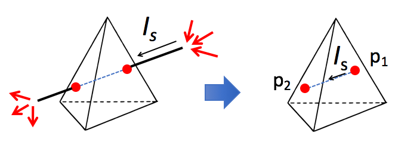

In the derivation of Eq. (9), we used the relationship of

$$\nabla \times \mathbf{w}_{j} = 2\nabla\lambda_{k} \times \nabla\lambda_{l} = \frac{1}{3v}\mathbf{x}_{mn}\  \cdot \cdot \cdot (13),$$

Correspondence between (k,l) and (m,n) are listed in Table A1.

In the calculation of Eq. (11), we can use the relationships:

$$\nabla\lambda_{k} = \frac{1}{6v}\mathbf{x}_{ln} \times \mathbf{x}_{mn} \cdot \cdot \cdot (14)$$

$$\int_{\Omega_{e}}{\lambda_{k}\lambda_{l}dV} = \left\{ \begin{matrix}
6v\frac{1!1!}{(1 + 1 + 3)!} = \frac{v}{20}\ (k \neq l) \\
6v\frac{2!}{(2 + 3)!} = \frac{v}{10}\ \ \ \ \ \ \ \ (k = l)
\end{matrix} \right.\  \cdot \cdot \cdot (15)$$

Note the theorem for integral of nodal basis function for a tetrahedron:

$$\int_{\Omega_{e}}{\lambda_{1}^{k}\lambda_{2}^{l}\lambda_{3}^{m}\lambda_{4}^{n}dV} = 6v\frac{k!l!m!n!}{(k + l + m + n + 3)!}\ \  \cdot \cdot \cdot (16)$$

## Appendix B: Scaling of the governing equation for ActFEM calculation <a id="AppendixB"></a>
In solving discretized form combining Eq. (7) and (12),

$$\sum_{j = 1}^{6}{\int_{\Omega_{e}}{\left\{ \left( \nabla \times \mathbf{w}_{i} \right) \cdot \left( \nabla \times \mathbf{w}_{j} \right) \right\} dV}\lbrack Al\rbrack_{j}} + \sum_{j = 1}^{6}{\int_{\Omega_{e}}{i\omega\mu\sigma\mathbf{w}_{i} \cdot \mathbf{w}_{j}dV}\lbrack Al\rbrack_{j}} = \mu I_{s}\left( \frac{\mathbf{w}_{i}^{e}\left( r_{p1} \right) + \mathbf{w}_{i}^{e}\left( r_{p2} \right)}{2} \right) \cdot \overrightarrow{p_{1}p_{2}}\  \cdot \cdot \cdot (17)$$

a scaling is implemented in ActFEM. Scaling length $L$, set to be 1000m in ActFEM, is used. Consider to rewrite Eq. (17) by using

$$\nabla = \frac{1}{L}\nabla^{'},\quad \mathbf{w} = \frac{1}{L}\mathbf{w}^{'},\quad dV = L^{3}dV^{'},\quad \overrightarrow{p_{1}p_{2}} = L\overrightarrow{p_{1}p_{2}'},\quad Al\left\lbrack s \cdot V/m \cdot m \right\rbrack = \int \mathbf{A} \cdot d\mathbf{l} = \frac{1}{L}Al^{'},$$

where $Al^{'}$ is in $\left\lbrack s \cdot mV/km \cdot km \right\rbrack$, and $\mathbf{E} = i\omega\mathbf{A}$. These replacements correspond to the fact that **$\mathbf{w}$ and $\nabla$ are constructed as $\mathbf{w}'$ and $\nabla'$ with the coordinate system in the unit of km.**

$$\sum_{j = 1}^{6}{\int_{\Omega_{e}}{\left\{ \left( \frac{1}{L}\nabla' \times \frac{1}{L}\mathbf{w}_{i}^{'} \right) \cdot \left( \frac{1}{L}\nabla^{'} \times \frac{1}{L}\mathbf{w}_{j}^{'} \right) \right\} L^{3}dV^{'}}\frac{1}{L}\ \left\lbrack Al^{'} \right\rbrack_{j}} + \sum_{j = 1}^{6}{\int_{\Omega_{e}}{i\omega\mu\sigma\frac{1}{L}\mathbf{w}_{i}^{'} \cdot \frac{1}{L}{\mathbf{w}^{'}}_{j}L^{3}dV'}\frac{1}{L}\left\lbrack Al^{'} \right\rbrack_{j}} = \mu I_{s}\frac{1}{L}\left( \frac{w'\left( r_{p1} \right) + w'\left( r_{p2} \right)}{2} \right) \cdot L\overrightarrow{p_{1}p_{2}'}$$

$$\Longleftrightarrow\sum_{j = 1}^{6}{\int_{\Omega_{e}}{\left\{ \left( \nabla^{'} \times \mathbf{w}_{i}^{'} \right) \cdot \left( \nabla^{'} \times \mathbf{w}_{j}^{'} \right) \right\} dV^{'}}\left\lbrack Al^{'} \right\rbrack_{j}} + \sum_{j = 1}^{6}{\int_{\Omega_{e}}{L^{2}i\omega\mu\sigma\mathbf{w}_{i}^{'} \cdot {\mathbf{w}^{'}}_{j}dV^{'}}\left\lbrack Al^{'} \right\rbrack_{j}} = \mu I_{s}L^{2}\left( \frac{w'\left( r_{p1} \right) + w'\left( r_{p2} \right)}{2} \right) \cdot \overrightarrow{p_{1}p_{2}'}$$

Note here that the source current $I_{s}$ is not scaled, namely in the unit of [A].
