<script type="text/javascript" async src="https://cdnjs.cloudflare.com/ajax/libs/mathjax/2.7.7/MathJax.js?config=TeX-MML-AM_CHTML">
</script>
<script type='text/x-mathjax-config'>
	MathJax.Hub.Config({
		tex2jax: {
			inlineMath: [['$', '$']],
			displayMath: [ ['$$','$$'],["\\[","\\]"] ]
		}
	});
</script>

# ActFEM v1.5 マニュアル
## 有限要素法による ACTIVE 順計算・インバージョン コード

#### 2026年11月25日 現在

南 拓人（Takuto MINAMI）
tminami@port.kobe-u.ac.jp
（神戸大学 理学部）

### 目次

1. [必要な環境](#Required_environment)
2. [座標系](#Coordinate_system)
3. [順計算サンプルの実行](#Run_the_sample)
   - [3.1 Step 1: メッシュ生成（地形なし）](#sec3_1)
   - [3.2 Step 2: ACTIVE の解析解の準備](#sec3_2)
   - [3.3 Step 3: ACTIVE 順計算](#sec3_3)
   - [3.4 Step 4: ACTIVE 順計算結果と解析解の比較](#sec3_4)
   - [3.5 Step 5: 折れ線（複数ダイポール）送信源による ACTIVE 順計算](#sec3_5)
   - [3.6 Step 6: 一様比抵抗構造での MT 順計算（MPI なし）](#sec3_6)
   - [3.7 Step 7: MT 順計算の精度確認](#sec3_7)
   - [3.8 Step 8: 水平方向に不均質な構造での MT 順計算（MPI なし）](#sec3_8)
   - [3.9 Step 9: MPI + OpenMP による MT 順計算](#sec3_9)
4. [インバージョンサンプルの実行](#Run_samples_for_inversions)
   - [4.1 Step 1: メッシュの準備](#sec4_1)
   - [4.2 Step 2: 真の比抵抗構造の準備](#sec4_2)
   - [4.3 Step 3: インバージョン用 ACTIVE サンプルデータの作成](#sec4_3)
   - [4.4 Step 4: インバージョン用 MT サンプルデータの作成](#sec4_4)
   - [4.5 Step 5: サンプルインバージョンの実行](#sec4_5)
5. [ソースフォルダ構成](#Source_folder_tree)
6. [支配方程式と離散化](#Governing_equation_and_discretization)
7. [ファイル形式](#File_formats)
   - [7.1 メッシュ生成・順計算の制御ファイル](#Control_files)
      - [7.1.1 共通の規則](#sec7_1_1)
      - [7.1.2 項目一覧](#sec7_1_2)
      - [7.1.3 例](#sec7_1_3)
      - [7.1.4 水位制御ファイル](#sec7_1_4)
   - [7.2 送信源の指定（単一ダイポール／複数ダイポール）](#Source_definition)
8. [メッシュ生成チュートリアル](#Mesh_generation_tutorial)
   - [8.1 メッシュフォルダ](#sec8_1)
   - [8.2 meshgen.sh の実行](#sec8_2)
   - [8.3 メッシュの調整方法](#sec8_3)
9. [順計算・インバージョン用比抵抗モデルの作成](#Generation_of_resistivity_model)
   - [9.1 比抵抗ファイル（cond.msh）](#sec9_1)
   - [9.2 change_model2cond.exe による作成](#sec9_2)
   - [9.3 比抵抗モデルの確認](#sec9_3)
10. [バージョン履歴](#Version_notes)
11. [参考文献](#References)

- [付録A：支配方程式の離散化形式の導出](#AppendixA)
- [付録B：ActFEM 計算のための支配方程式のスケーリング](#AppendixB)


## 1 必要な環境 <a id="Required_environment"></a>
ActFEM には、OpenMP 用の Intel コンパイラ（ifx または ifort、mpiifx または mpiifort）と Intel MPI が必要です。順計算コードには OpenMP のみのシリアルモードがあります。一方、インバージョンには OpenMP と MPI のハイブリッド並列版のみが用意されています。必要な環境は以下のとおりです。

### 順計算・インバージョン
- Intel コンパイラ（連立一次方程式は Intel MKL ライブラリの PARDISO で解きます）
- gmsh
  - Mac → `brew install gmsh`
  - Ubuntu → `sudo apt install gmsh`

### 可視化
- GMT6
  - Mac → `brew install gmt`
  - Ubuntu → `sudo apt install gmt`
- Gnuplot
  - Mac → `brew install gnuplot`
  - Ubuntu → `sudo apt install gnuplot`

メッシュ生成（src/src_mesh）と後処理（src/src_post）には gfortran も使用できます。

## 2 座標系 <a id="Coordinate_system"></a>
ActFEM では以下の座標系を用います。

- X : 東向き
- Y : 北向き
- Z : 上向き

メッシュと比抵抗モデルでは z は標高 [km]（海面が z = 0）ですが、制御ファイルで与える観測点と送信源の z は地表面からの相対高度です（[7.1.1](#sec7_1_1) 参照）。

## 3 順計算サンプルの実行 <a id="Run_the_sample"></a>
順計算のサンプルフォルダ ActFEM/Fwd_test があります。ここで、ActFEM による ACTIVE と MT の順計算を確認できます。

### 3.1 Step 1: メッシュ生成（地形なし） <a id="sec3_1"></a>
```bash
$ cd ActFEM/Fwd_test/mesh_flat
$ chmod +x meshgen.sh
$ ./meshgen.sh
```
meshgen.sh は、まず ActFEM/src/src_mesh のソースを gfortran でコンパイルし、gmsh を使ってプログラムを実行します。gmsh が正しくインストールされていれば、ターミナルに次のような出力が表示されます。

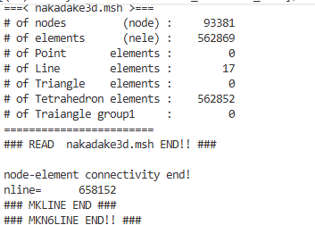

次に、gmsh ビューアでメッシュを確認してください。
```bash
$ gmsh nakadake3d.msh
```

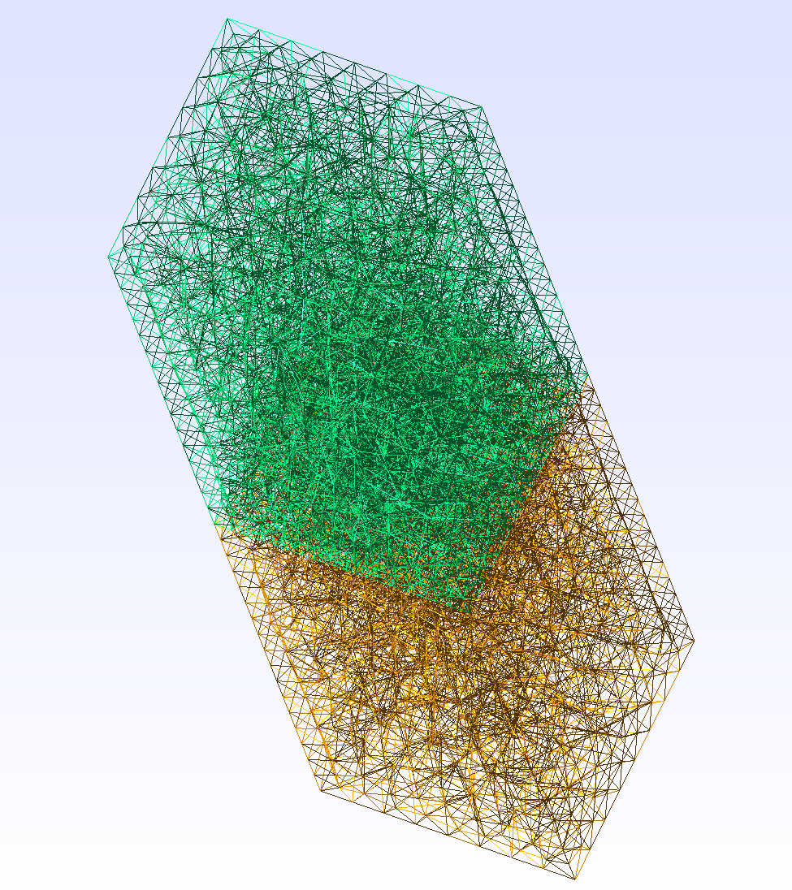 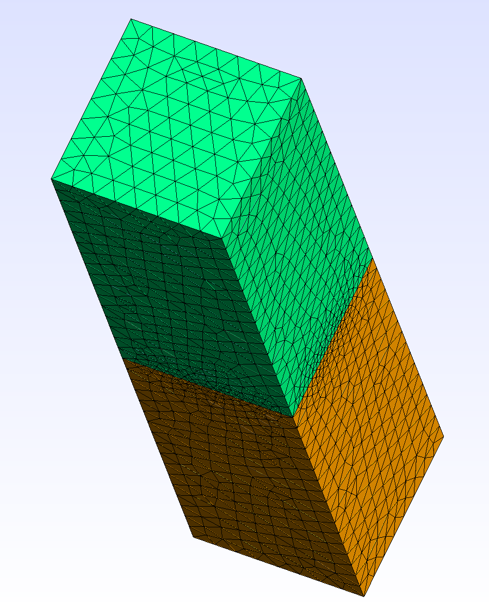 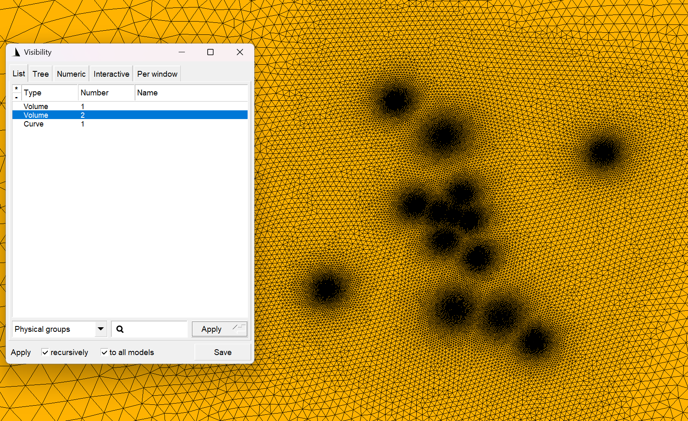

図. Tools > Options > Mesh で「3D element faces」にチェックを入れると中央の図のように表示されます。「Tools > Visibility > Volume 2 を選択 > Apply」で陸側の要素のみが表示され、観測点付近の高解像度領域を確認できます。

### 3.2 Step 2: ACTIVE の解析解の準備 <a id="sec3_2"></a>
順計算の精度を評価するため、順計算の前に解析解を用意しておきます。
```bash
$ cd ActFEM/Fwd_test/active_ana/
$ chmod +x run.sh
$ run.sh
```
デフォルトでは、run.sh は ifx で src/ana のソースをコンパイルします。run.sh が正常に終了すると、次のように表示されます。

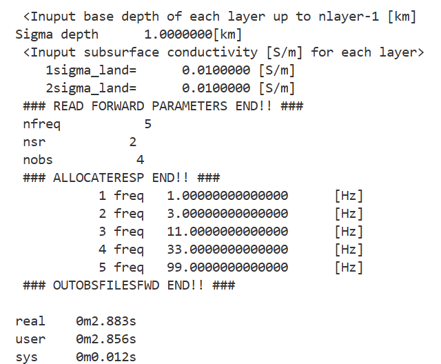

### 3.3 Step 3: ACTIVE 順計算 <a id="sec3_3"></a>
メッシュを生成したら、ACTIVE と MT の順計算を実行できます。
```bash
$ cd ActFEM/Fwd_test/active
$ chmod +x run.sh
$ ./run.sh
```
ACTIVE 順計算が正常に終了すると、次のように表示されます。

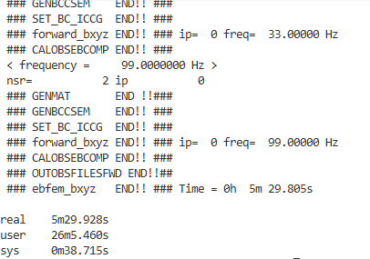

### 3.4 Step 4: ACTIVE 順計算結果と解析解の比較 <a id="sec3_4"></a>
ACTIVE の計算が終わったら、Fwd_test/active_ana/result の解析解と比較して順計算の精度を確認できます。

Fwd_test/active/ で
```bash
$ chmod +x compana.sh
$ ./compana.sh
```
以下の図が表示されれば、ACTIVE 順計算と解析解の計算はどちらも成功しています。

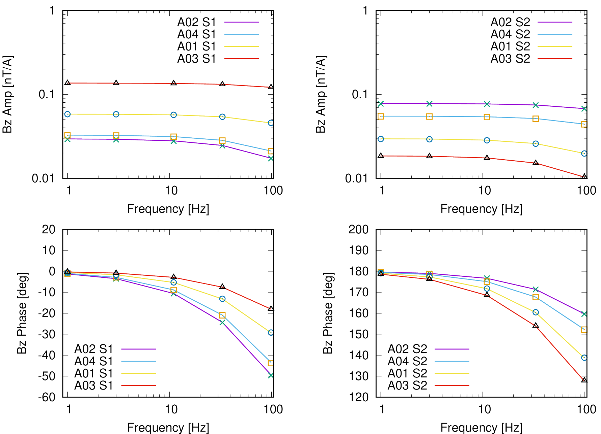

図. シンボルは Fwd_test/active/ で計算した ACTIVE 応答、線は Fwd_test/active_ana/ で計算した解析解です。（上：振幅 [nT/A]、下：位相 [deg]）

### 3.5 Step 5: 折れ線（複数ダイポール）送信源による ACTIVE 順計算 <a id="sec3_5"></a>
ActFEM では、複数のダイポールを直列につないだ送信ケーブル（ループや折れ曲がったケーブルなど）を扱えます。ケーブルの頂点は送信源点ファイルで与えます（[7.2](#Source_definition) 参照）。Fwd_test/active_loop/ には、閉ループの送信源 S1（S1.dat で与える19本のダイポール）と S2（S2.dat で与える13本のダイポール）が用意されています。メッシュは [Step 1](#sec3_1) のもの（Fwd_test/mesh_flat/）を使います。
```bash
$ cd ActFEM/Fwd_test/active_loop
$ chmod +x run.sh
$ ./run.sh > result/fwd.log
```
result/fwd.log で、送信源点ファイルからダイポールが読み込まれたことを確認できます。
```
 source name: S1
 ndipole =  19
 dipole   1 xs1=      0.1763144     -0.8313663     -0.0010000 xs2=      0.2645611     -0.8773202     -0.0010000
 ...
 source name: S2
 ndipole =  13
```
また、result/ に `A0*_S1.dat` と `A0*_S2.dat` が出力されます。

次に、結果を解析解と比較します。解析解のコード（src/ana）は単一ダイポールの送信源しか扱えないため、compana_loop.py は各ダイポールを独立な送信源として active_ana.exe に与え、送信源ごとに複素 Bz をダイポールについて足し合わせます（重ね合わせ）。active_ana.exe は事前にビルドしておいてください（[Step 2](#sec3_2)）。
```bash
$ python3 compana_loop.py
```
観測点・送信源・周波数ごとに、振幅比（FEM/解析解）と位相差 [deg] が表示されます。足し合わせた解析解は result_ana/ に出力されます（列: 周波数 [Hz]、Bz 振幅 [nT/A]、Bz 位相 [deg]）。ほとんどの観測点・送信源の組で、振幅比は 0.995〜1.006、位相差は 0.3 度未満です。
```
site src  f[Hz]     |Bz|ana     |Bz|FEM  ratio  pha_ana  pha_FEM   dpha
A02  S1       1  3.8740e-02  3.8701e-02  0.999  -179.29  -179.29   0.00
A02  S1      99  4.9982e-02  4.9886e-02  0.998   169.98   169.83  -0.14
...
A03  S1       1  9.4048e+00  1.0659e+01  1.133  -179.99  -179.99  -0.00
```
なお、観測点 A03 は S1 のケーブルから約 18 m しか離れていません。ここでは Bz が急変するため、FEM の精度はケーブル周辺のメッシュに強く依存します（Fwd_test/mesh_flat/ は aso.ctl の直線送信源に沿って細分化されており、ループには沿っていません）。折れ線送信源に沿ってメッシュを細分化するには、メッシュ制御ファイル（aso.ctl）の送信源ブロックにも同じ `File:` 行を書きます。これで各ダイポールに沿って細分化点が配置されます（[7.2](#Source_definition) 参照）。また、制御ファイル中のファイル名は `character(50)` で読み込まれるため、パスは短くしてください。

### 3.6 Step 6: 一様比抵抗構造での MT 順計算（MPI なし） <a id="sec3_6"></a>
MT 計算には、シリアル（OpenMP）モードとハイブリッド（OpenMP + MPI）モードがあります。まずシリアルモードを確認します。
```bash
$ cd ActFEM/Fwd_test/MTfwd_test
$ chmod +x run.sh
$ ./run_homo.sh
```
計算が成功すると、次のような出力が得られます。

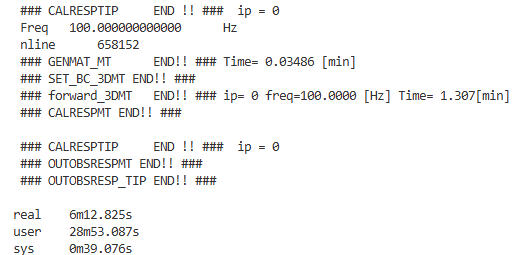

### 3.7 Step 7: MT 順計算の精度確認 <a id="sec3_7"></a>
計算が終わったら、MT 計算の結果を確認してください。
```bash
$ chmod +x plot_rho.sh
$ ./plot_rho.sh
```

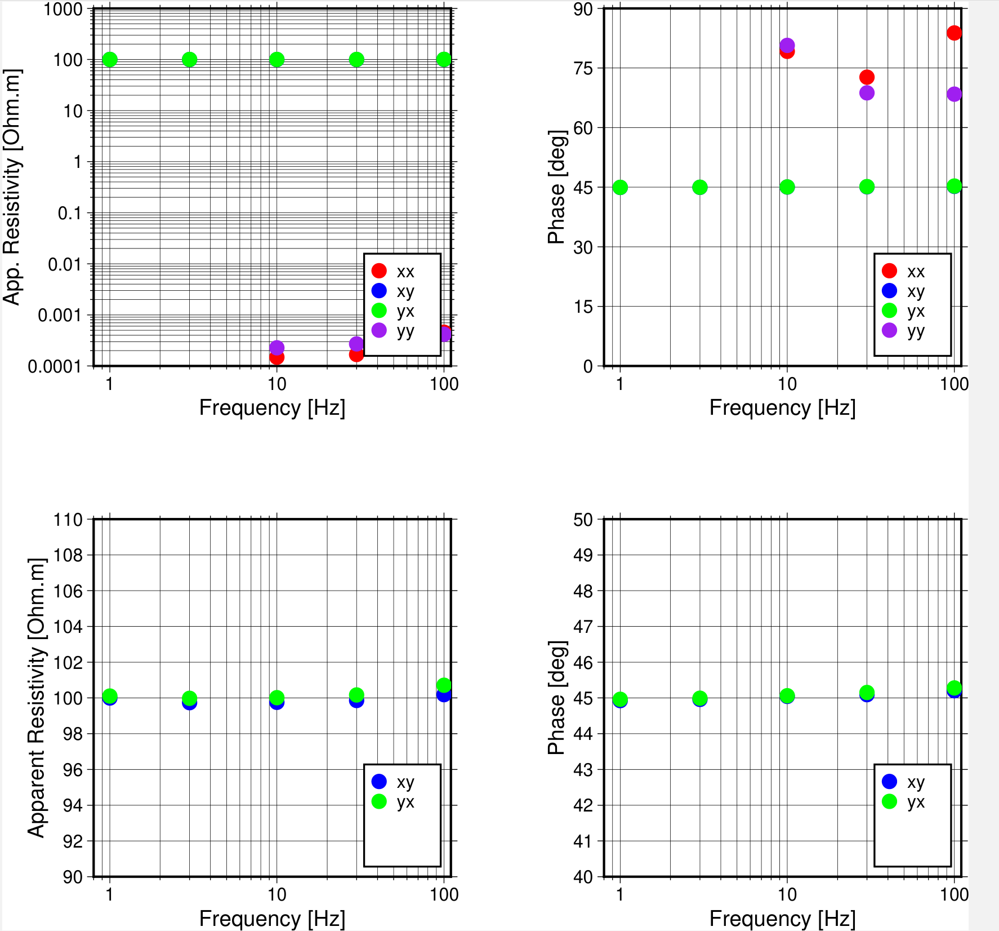

図のとおり、ActFEM の MT 計算は 1〜100 Hz の周波数範囲で、見かけ比抵抗 100 Ohm.m・位相 45 度を数値誤差 1% 未満で再現できています。

### 3.8 Step 8: 水平方向に不均質な構造での MT 順計算（MPI なし） <a id="sec3_8"></a>
MT 順計算ではティッパーも計算できます。水平方向に不均質な構造でその動作を確認できます。まず不均質構造を作成します。ActFEM/Fwd_test/MTfwd_test/ で
```bash
$ chmod +x change_model2cond.sh
$ ./change_model2cond.sh
```
次のような出力とともに **cond_lateral.msh** が生成されます。

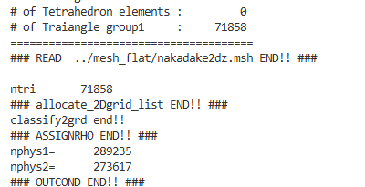

生成された比抵抗構造を確認するには、以下のコマンドを実行します。
```bash
$ chmod +x view_slcie.sh
$ view_slcie.sh
```

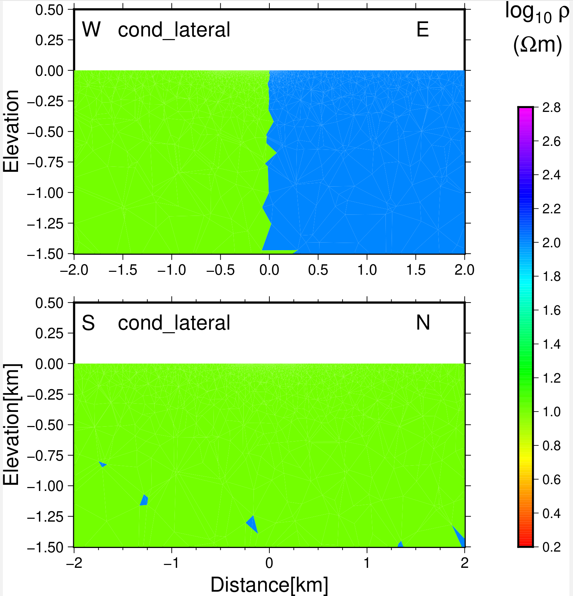

東西・南北断面に見られるように、生成された比抵抗構造は x=0 を境に、西側の 10 Ohm.m から東側の 100 Ohm.m へと水平方向に不連続に変化しています。

次に、この構造で MT 順計算を実行します。
```bash
$ chmod +x run_lateral.sh
$ ./run_lateral.sh
```
計算が終わったら、ティッパーを確認します。
```bash
$ chmod +x plot_tip.sh
$ ./plot_tip.sh
```

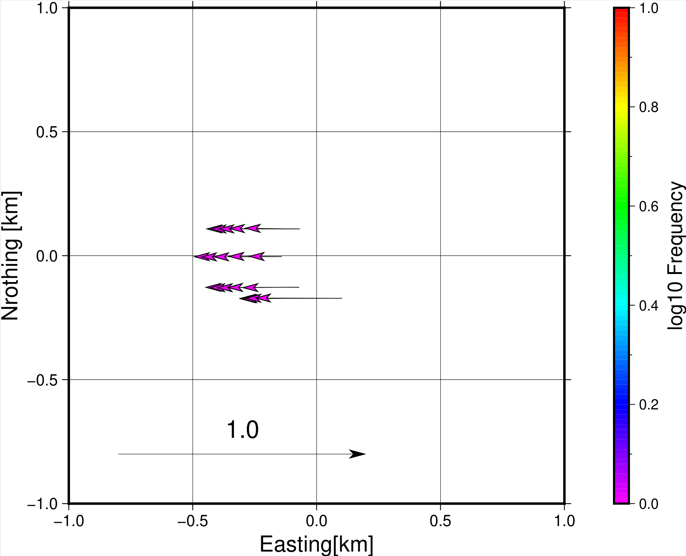

図のとおり、西側の比抵抗が低いため、インダクションベクトルの実部は西を向いています。

### 3.9 Step 9: MPI + OpenMP による MT 順計算 <a id="sec3_9"></a>
現在、MPI で並列化されているのは MT 順計算のみです。Fwd_test/MTfwd_test と同じ計算を、Fwd_test/MTfwd_test_mpi/ で MPI を使って実行できます。
```bash
$ cd Fwd_test/MTfwd_test_mpi/
$ chmod +x run_homo.sh
$ ./run_homo.sh
```
計算が成功すると、次のような出力が得られます。

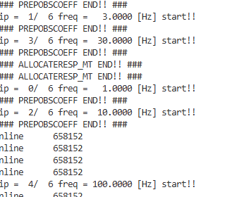

ip=1（ノード1）が freq=3.0Hz を、ip=3（ノード3）が freq=30Hz を計算している、というように、周波数ごとの計算が各 MPI プロセスに割り当てられます。そのため、シリアル版よりも大幅に高速です。MTfwd_test/result_homo/ と MTfwd_test_mpi/result_homo/ の結果が一致することを確認してください。

## 4 インバージョンサンプルの実行 <a id="Run_samples_for_inversions"></a>
ActFEM には、ACTIVE 2件、MT 2件、ACTIVE+MT 同時インバージョン 2件の、計6件のインバージョンサンプルがあります。インバージョンを実行するには、まず ACTIVE と MT のサンプルデータセットを用意します。

### 4.1 Step 1: メッシュの準備 <a id="sec4_1"></a>
サンプルインバージョンは阿蘇の実地形を用いて行います。まずメッシュを生成しましょう。
```bash
$ cd ActFEM/Joint_test/mesh_joint
$ chmod +x meshgen.sh
$ ./meshgen.sh
```
メッシュを生成したら、gmsh ビューアで確認してください。
```bash
$ gmth nakadake3d.msh
```

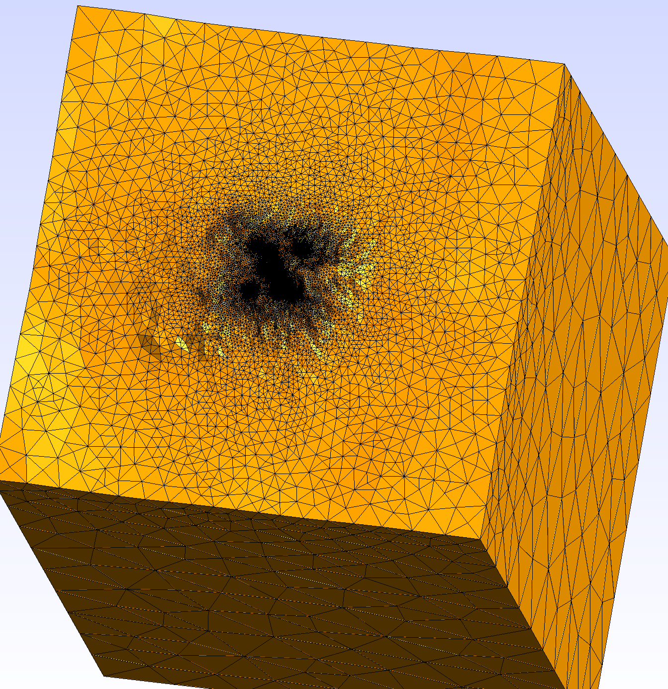 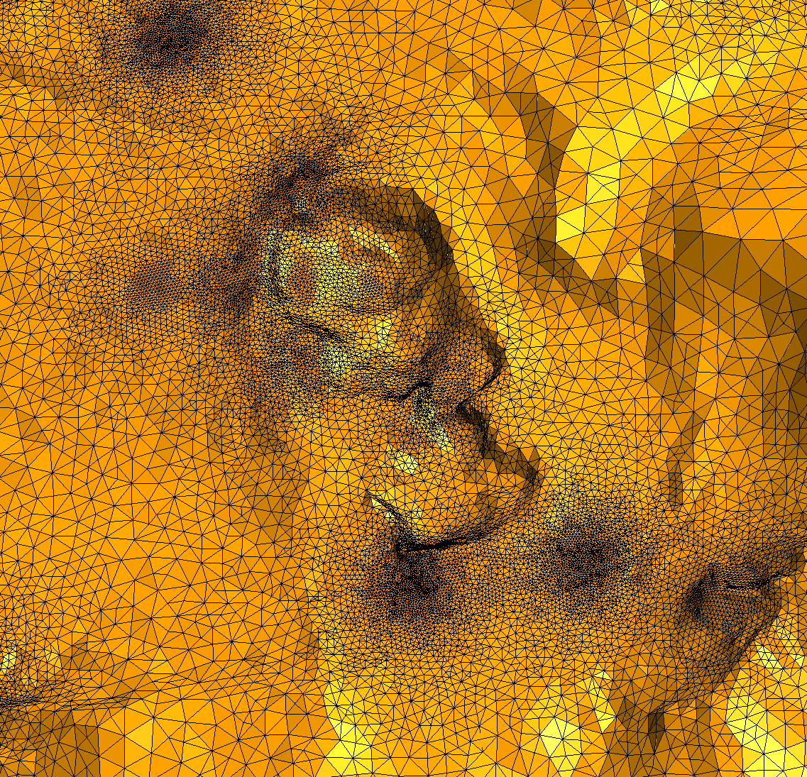

図. 阿蘇火山（九州中部）中岳第一火口周辺の四面体メッシュ。

### 4.2 Step 2: 真の比抵抗構造の準備 <a id="sec4_2"></a>
インバージョンのチュートリアルでは、目標とする比抵抗構造を仮定する必要があります。ActFEM では ActFEM/Joint_test/structure に次の目標構造を用意しています。
```bash
$ cd ActFEM/Joint_test/structure
$ ./cond_G3.sh
$ ./cond_homo.sh
```
成功すると **cond_G3.msh** と **cond_homo.msh** が生成されます。cond_G3.msh は下図の目標構造、cond_homo.msh は以下のインバージョンで初期モデルおよび参照モデルとして使う一様構造です。cond_\*.msh は元の mesh_joint/nakadake3d.msh と一対一に対応している点に注意してください。mesh_joint/nakadake3d.msh を更新した場合は、cond_G3.msh と cond_homo.msh も作り直してください。

cond_G3.msh の異常体は次のコマンドで確認できます。
```bash
$ ./view_slice.sh
```

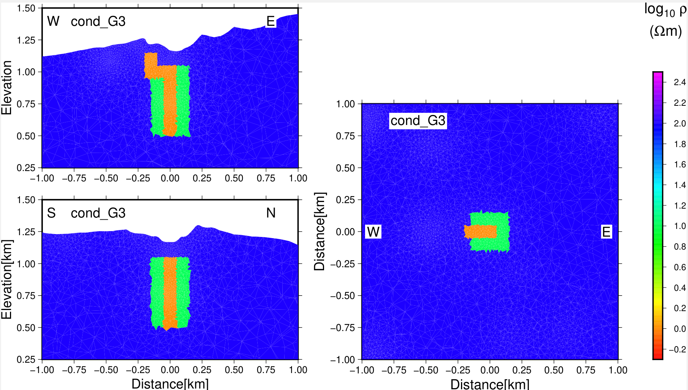

図のとおり、異常体は火口底の直下に広がる直方体です。

### 4.3 Step 3: インバージョン用 ACTIVE サンプルデータの作成 <a id="sec4_3"></a>
真のモデルができたので、順計算によってインバージョン用のサンプルデータを作成します。まず ACTIVE データを次のように用意します。
```bash
$ cd ActFEM/Joint_test/fwd_active/
$ chmod +x run.sh
$ ./run.sh
```
順計算が終わったら、ActFEM/Joint_test/fwd_active で誤差付きのデータを作成します。
```bash
$ chmod + generr.sh
$ ./generr.sh
```
その結果、Joint_test/fwd_active/data/ に `A0*_S?_amp.dat` と `A0*_S?_pha.dat` が生成されます。`A0*` は active.ctl に記載された観測点名、`S?` は active.ctl に記載された電気ダイポール送信源の名前です。

なお、Joint_test/inv_act/、inv_joint/、inv_act_icomb-1/、inv_joint_icomb-1/ の active.ctl は Joint_test/fwd_active/active.ctl へのシンボリックリンクで、インバージョンでも同じ送信源が使われます。各送信源は、始点・終点、または `File:` による送信源点ファイルで指定できます（[7.2](#Source_definition) 参照）。

### 4.4 Step 4: インバージョン用 MT サンプルデータの作成 <a id="sec4_4"></a>
次に、ActFEM/Joint_test/fwd_3DMT/ で MT データを用意します。
```bash
$ cd ActFEM/Joint_test/fwd_3DMT/
$ chmod +x run.sh
$ ./run.sh
```
これにより **result/MT1_MT.dat** などが生成されます。誤差付きデータは次のコマンドで作成します。
```bash
$ chmod +x generr.sh
$ ./generr.sh
```
すると **mt_err/MT1_MT_imp.err** などの誤差ファイルが作成されます。

### 4.5 Step 5: サンプルインバージョンの実行 <a id="sec4_5"></a>
以上で、すべてのインバージョンの準備が整いました。どのサンプルも手順は同じで、**run.sh** を実行し、**plot_rms.sh** と **view_slice.sh** で結果を確認します。たとえば Joint_test/inv_act/ では次のようにします。
```bash
$ cd ActFEM/Joint_test/inv_act/
$ ./run.sh
```
run.sh 内の OpenMP スレッド数と MPI プロセス数は、お使いの環境に合わせて編集してください。

Joint_test/ のインバージョンデモは次のとおりです。どのデモも ebfem_inv_joint.exe（src/src_inv_joint）を使い、初期モデルと参照モデルには一様モデル Joint_test/structure/cond_homo.msh を、正則化には最も滑らかなモデル（`Roughness type` = 1）を、トレードオフパラメータの決め方には冷却法（`1:L,2:Cl,3:Mi,4:Gr` = 2）を使います。実行ファイルへの最初の入力（`ijoint`）で使うデータを選びます。1 は ACTIVE、2 は MT（インピーダンスとティッパーの一方または両方）、3 は ACTIVE + MT です。

| フォルダ | ijoint | データ | モデルのパラメータ化（`icombine`） | 備考 |
|---|---|---|---|---|
| inv_act | 1 | ACTIVE の Bz 振幅・位相（送信源 S1、S2、観測点 A01〜A04） | 0：通常 | |
| inv_act_icomb-1 | 1 | inv_act と同じ | -1：内側／外側モード | |
| inv_mt | 2 | MT インピーダンス（MT1〜MT5） | 0：通常 | |
| inv_mt_icomb-1 | 2 | inv_mt と同じ | -1：内側／外側モード | |
| inv_joint | 3 | ACTIVE（inv_act と同じ）+ MT インピーダンス（inv_mt と同じ） | 1：外側のブロックを1つにまとめる | |
| inv_joint_icomb-1 | 3 | inv_joint と同じ | -1：内側／外側モード | |
| inv_mt_tip | 2 | MT インピーダンス + ティッパー（MT1〜MT9） | 0：通常 | |
| inv_tip | 2 | ティッパーのみ（`imp: 0, 1:amp,pha` = -1） | 0：通常 | run_tip.sh で実行（readme.txt 参照）。以下に結果は示していません |
| inv_tip_light | 2 | ティッパーのみ。Joint_test/mesh_light/ と structure_light/ を使用（データは fwd_3DMT_light/） | 0：通常 | 軽量版（MPI 2 プロセス）。以下に結果は示していません |

インバージョンで使う MT 観測点は、インバージョンの制御ファイルで `!` の後に書く観測点番号で選びます。この番号は mt.ctl の観測点の番号です（[4.4](#sec4_4) 参照）。mt.ctl には、インバージョンで使う観測点より多くの観測点を含めておけます。active.ctl の ACTIVE の観測点も同様です。各フォルダには次のファイルがあります。

| ファイル | 説明 |
|---|---|
| run.sh | src/src_inv_joint をビルドし、mpiexec でインバージョンを実行する（MPI プロセス数と OpenMP スレッド数は環境に合わせて編集） |
| run_ism.sh | ISM サーバー用の run.sh（Makefile_ISM を使用） |
| inv_act.ctl、inv_mt.ctl、joint.ctl、inv_mt_tip.ctl、inv_tip.ctl | インバージョンの制御ファイル（初期・参照モデル、正則化、データファイルと観測点番号、モデルのブロック） |
| active.ctl | ACTIVE 順計算の制御ファイル（../fwd_active/active.ctl へのシンボリックリンク） |
| mt.ctl | MT 順計算の制御ファイル（../fwd_3DMT/mt.ctl へのシンボリックリンク。inv_tip_light では ../fwd_3DMT_light/mt.ctl） |
| result_inv/ | 出力フォルダ（RMS の履歴、モデル modelNN.dat と model_connect.dat、各反復の応答、ログ inv.log） |
| plot_rms.sh | RMS の履歴を描く |
| plot_fit_active.sh、plot_fit_MT.sh | 観測値と計算値を比べる |
| plot_rho_pha.sh | result_fwd/A01_MT.dat の MT 見かけ比抵抗と位相を描く（MT 順計算結果用の古いスクリプトで、インバージョンの出力用ではない） |
| view_slice.sh | 得られた比抵抗モデルの断面を描く（slice.exe と GMT） |
| clean.sh | 出力を削除する |

以下では、得られたインバージョン結果のみを示します。

#### Joint_test/inv_act の結果
```bash
$ plot_rms.sh
$ ./view_slice.sh 06
```
ここで 06 は、収束したモデル model06 を表示することを意味します。

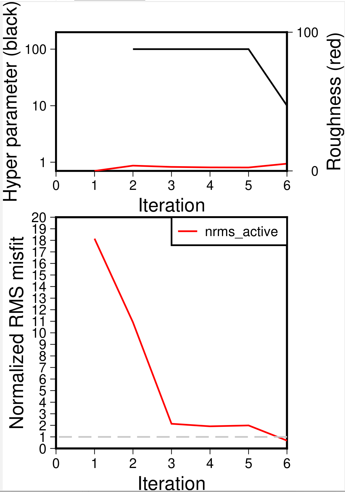 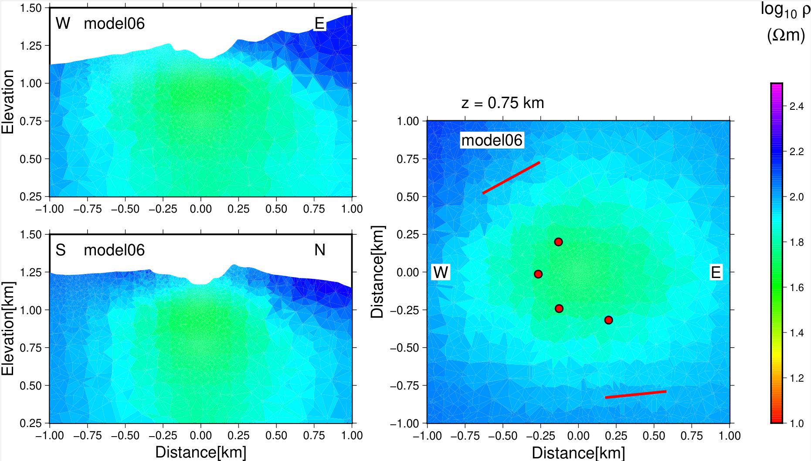

#### Joint_test/inv_mt/ の結果
```bash
$ ./plot_rms.sh
$ ./view_slice.sh 09
```

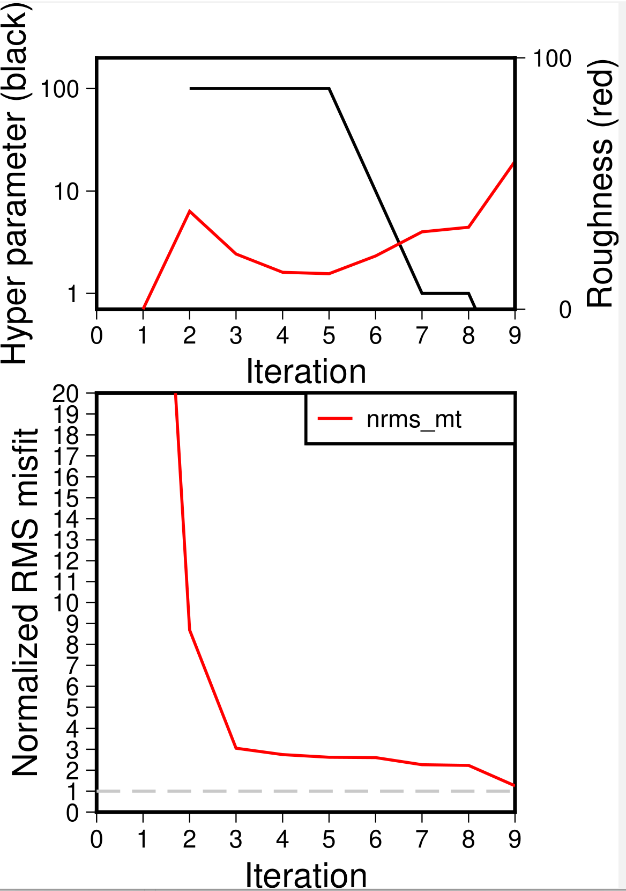 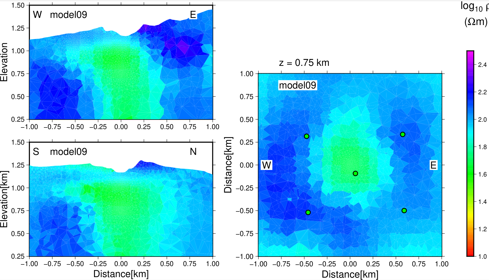

#### Joint_test/inv_joint/ の結果
```bash
$ ./plot_rms.sh
$ ./view_slice.sh 08
```

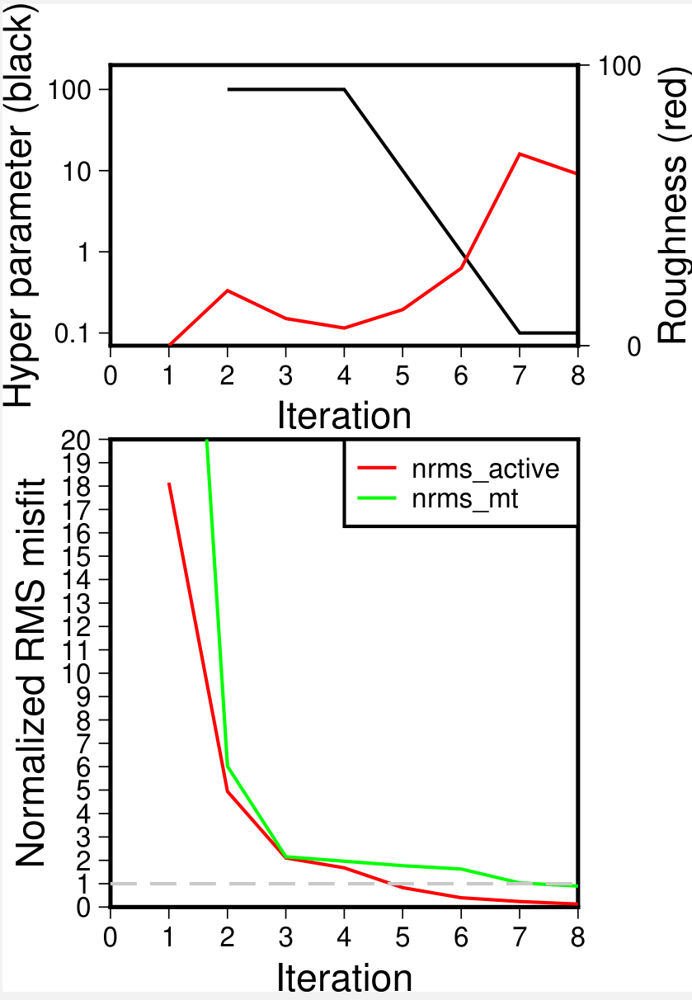 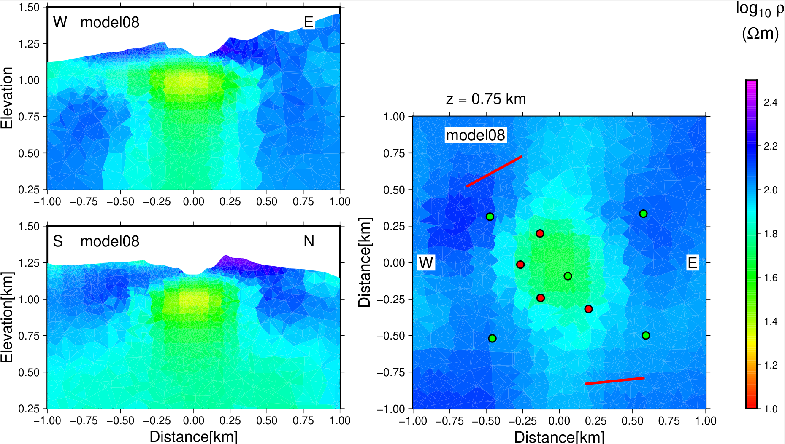

> **以下は icombine = -1 の結果です。この設定では、インバージョンで内側・外側のモデルパラメータ化を使用できます。詳細は次節で説明します。**

#### Joint_test/inv_act_icomb-1 の結果
```bash
$ plot_rms.sh
$ ./view_slice.sh 06
```

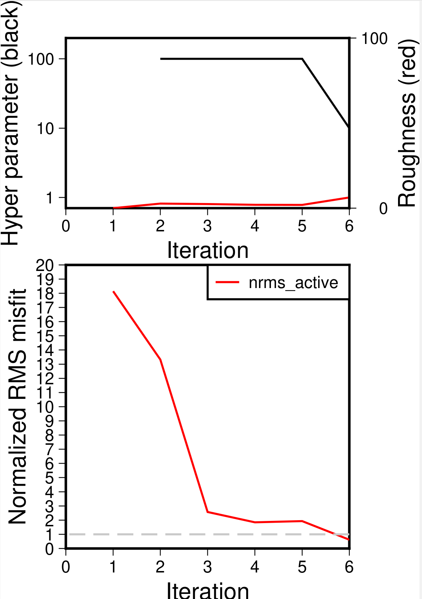 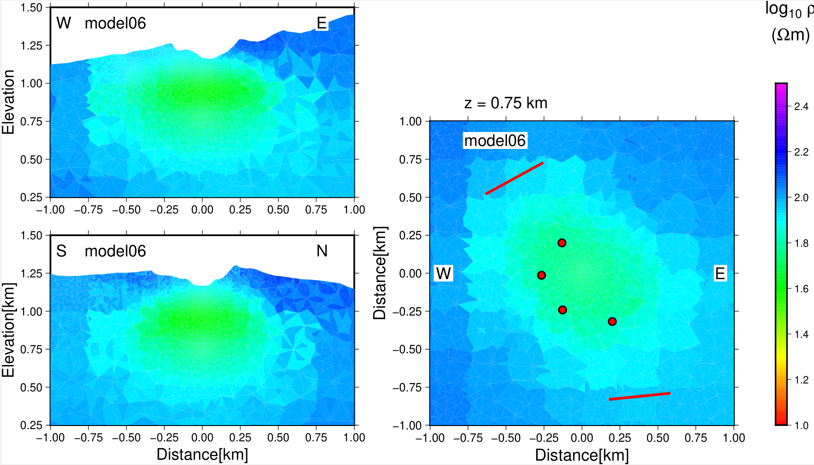

#### Joint_test/inv_mt_icomb-1 の結果
```bash
$ plot_rms.sh
$ ./view_slice.sh 10
```

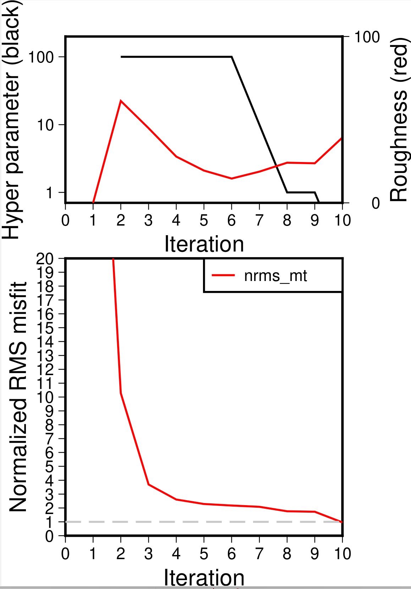 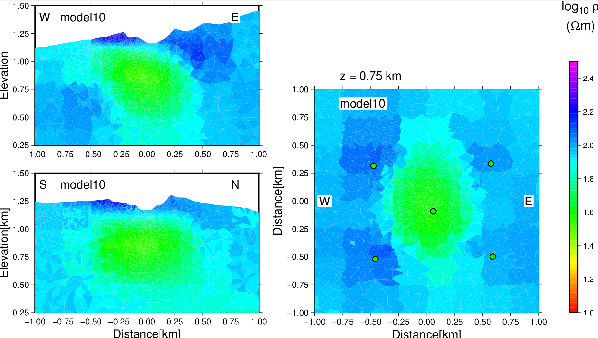

#### Joint_test/inv_joint_icomb-1 の結果

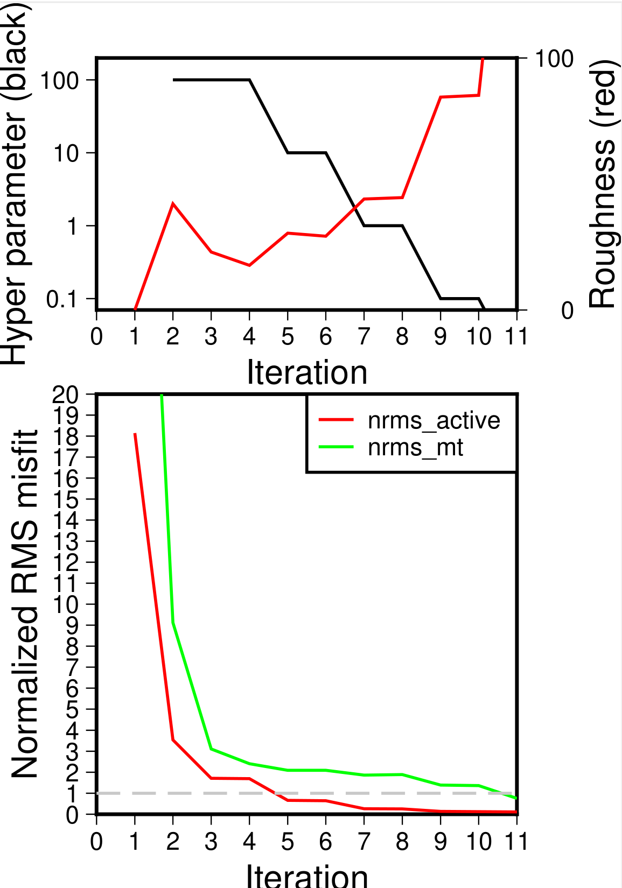 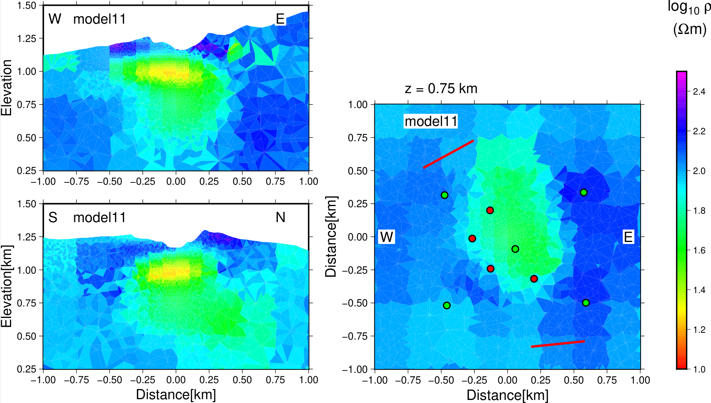

#### Joint_test/inv_mt_tip の結果
mt impedanceのerrorfloorは0.1、tipperのerrorfloorは0.1に設定し、αはpower -0.3で減少させた。-0.3が大きいと、構造の変動が大きくなり収束しない。

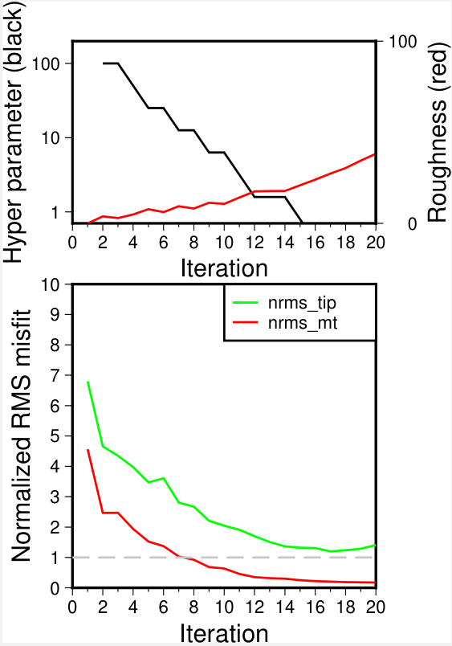 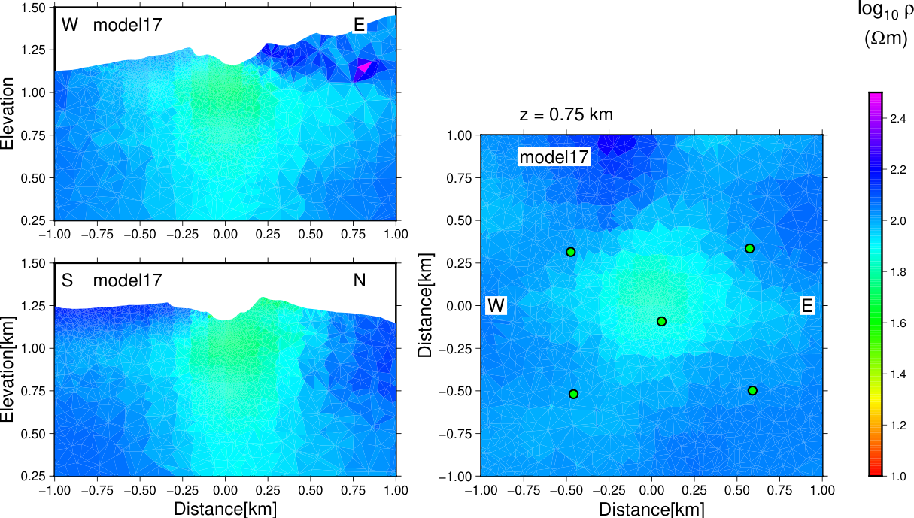

## 5 ソースフォルダ構成 <a id="Source_folder_tree"></a>

| フォルダ | 内容 | テストフォルダ |
|---|---|---|
| src/common/ | 全プログラムで使う共通モジュール（パラメータ、メッシュ、行列、モデルのパラメータ化など） | |
| src/common_mpi/ | MPI 通信用のモジュール | |
| src/solver/ | シリアル（OpenMP）版 ACTIVE 順計算ソルバー（ebfem_bxyz.exe） | Fwd_test/active、Fwd_test/active_loop、Joint_test/fwd_active |
| src/src_2D/ | 2次元 TM モードソルバー（MT の境界条件に使用） | |
| src/src_3DMT/ | シリアル（OpenMP）版 3次元 MT 順計算ソルバー（n_ebfem_3DMT.exe） | Fwd_test/MTfwd_test、Joint_test/fwd_3DMT |
| src/src_3DMT_mpi/ | MPI 版 3次元 MT 順計算ソルバー（n_ebfem_3DMT.exe） | Fwd_test/MTfwd_test_mpi、Joint_test/fwd_3DMT |
| src/src_inv_joint/ | ACTIVE・MT・ティッパー・同時インバージョンコード（ebfem_inv_joint.exe） | Joint_test/inv_* |
| src/src_mesh/ | メッシュ生成（meshgen1.exe、meshgen2.exe、mkline.exe、mkface.exe） | Fwd_test/mesh_flat、Joint_test/mesh_joint、Joint_test/mesh_light |
| src/src_post/ | 後処理（change_model2cond.exe、slice.exe など） | Joint_test/structure、Joint_test/inv_*/view_slice.sh |
| src/ana/ | ACTIVE の解析解（active_ana.exe） | Fwd_test/active_ana |
| src/solver_mpi/ | MPI 版 ACTIVE 順計算ソルバー（現在のバージョンに未対応で、コンパイルできません） | |

インバージョンコードはすべて src/src_inv_joint/ に統合されています。以前のインバージョンコード（src/src_inv/、src/src_inv_ap/、src/src_inv_mpi/、src/src_inv_mdm/）はバージョン 1.5 で削除しました。src/src_inv/ のうち他のプログラムが使っていたファイル（m_modelpart.f90 と solvebeta.f90）は src/common/ に移しました。

## 6 支配方程式と離散化 <a id="Governing_equation_and_discretization"></a>
ActFEM の順計算・インバージョンの詳細は Minami et al. (2018) を参照してください。ベクトルポテンシャル $\mathbf{A}$ に関する誘導方程式

$$\nabla \times \left( \nabla \times \mathbf{A} \right) + i\omega\mu\widehat{\sigma}\mathbf{A} = \mu\mathbf{i}_{s},$$

を辺要素有限要素法で解きます。ここで $\widehat{\sigma} = \sigma + i\omega\epsilon$ であり、$\epsilon$ は誘電率、$\omega$ は角周波数、$\mu$ は透磁率、$\mathbf{i}_{s}$ は送信源の電流密度です。なお、$\mathbf{E} = i\omega\mathbf{A}$ の関係を用いれば、この式は電場 $\mathbf{E}$ に関する誘導方程式

$$\nabla \times \nabla \times \mathbf{E} + i\omega\mu\widehat{\sigma}\mathbf{E} = i\omega\mu\mathbf{i}_{s}$$

に容易に書き換えられます。

磁場は、$\mathbf{A}$ について方程式を解いた後に $\mathbf{B} = \nabla \times \mathbf{A}$ から求めます。

## 7 ファイル形式 <a id="File_formats"></a>

### 7.1 メッシュ生成・順計算の制御ファイル <a id="Control_files"></a>
メッシュ生成（src/src_mesh の meshgen1.exe、meshgen2.exe、mkline.exe、mkface.exe）と ACTIVE 順計算（src/solver の ebfem_bxyz.exe）は、**同じ形式**の制御ファイルを使います。どちらも同じサブルーチン（src/common/m_param.f90 の `readparam`）で読み込まれます。インバージョンで使う ACTIVE の制御ファイル（例：Joint_test/inv_act/active.ctl）もこの形式です。代表的な例は次のとおりです。
- メッシュ生成：Fwd_test/mesh_flat/aso.ctl、Joint_test/mesh_joint/aso.ctl
- 順計算：Fwd_test/active/active.ctl、Fwd_test/active_loop/active.ctl、Joint_test/fwd_active/active.ctl

#### 7.1.1 共通の規則 <a id="sec7_1_1"></a>
- `##` で始まる行（1〜2列目）はコメント行で、読み飛ばされます。
- それ以外の行では、**1〜20列目はラベル**で、読み込まれません。値は **21列目から**読み込まれます。慣例として、ラベルと値の区切りに20列目に `!` を書きます。
  ```
  ##-----10!-------20!
  iflag_map          !2
  ```
- ラベルは自由な文字列です。項目は [7.1.2](#sec7_1_2) に示す決まった順番で読み込まれます。フラグに応じた行（例：`iflag_map = 2` のときだけの `UTM zone`）や、個数に応じて繰り返す行（地形ファイル、周波数、観測点、送信源）を除き、行を足したり減らしたりしないでください。
- 空行を入れないでください。
- ファイル名・フォルダ名は `character(50)` で読み込まれます。各パスは50文字以内にしてください（相対パスを推奨します）。
- 長さと座標の単位は [km] です。x は東向き、y は北向き、z は上向きです（[2](#Coordinate_system) 参照）。経度緯度で入力した場合は、`lonlatorigin` を原点として x, y に変換されます。
- **観測点と送信源の点の z（3番目の値）は、標高ではなく地表面からの相対高度 [km] です。** これは座標の入力形式（`lonlat(1),xyz (2)` が 1：経度 緯度 z、2：x y z）のどちらでも同じです。例えば -0.001 は地表面下 1 m、0.1 は地表面上 100 m を表します。各プログラムは、地形付きの2次元地表面メッシュからその位置の地表面の標高 z_surface(x, y) を補間し、z_surface(x, y) + z を絶対的な z として使います。担当するルーチンは、メッシュ生成（meshgen2.exe）では calzobsr（src/common/calzobsr.f90）、ACTIVE 順計算（src/solver/n_ebfem_bxyz.f90）とインバージョン（src/src_inv_joint/n_inv_joint.f90）では PREPZSRCOBS、MT 順計算とインバージョンでは PREPZOBSMT です。変換後の絶対的な z はログに表示されます（例：Joint_test/fwd_active/ の観測点 A02 では `z=    -0.00100 ->     1.28612 [km]`。地表面の標高は約 1.287 km）。itopofile = 0 のときは地表面が z = 0 なので、与えた z がそのまま絶対的な z になります。
- メッシュ生成では `Electric current [A]` より後ろの項目（電気伝導度）は読み込まれません。順計算ではすべての項目が読み込まれます。メッシュ用パラメータ（`west bound`〜`A_src`）は順計算の制御ファイルにも書く必要がありますが、順計算では使われません（`ixyflg = 1` のときの `west bound`〜`north bound` を除く）。

#### 7.1.2 項目一覧 <a id="sec7_1_2"></a>
項目は次の順に読み込まれます。「使用」は、その項目を使うプログラムです（M：メッシュ生成、F：順計算）。

| # | ラベル（例） | 条件 | 説明 | 使用 |
|---|---|---|---|---|
| 1 | `itopofile` | | 0：地形ファイルなし（z = 0 の平坦な地表面。観測点と送信源の座標は xyz で与える）。1：地形ファイルを与える。 | M, F |
| 2 | `iflag_map` | itopofile = 1 | 経度緯度の投影法。1：正距円筒図法（ECP）、2：UTM。 | M, F |
| 3 | `UTM zone` | iflag_map = 2 | UTM ゾーン（例：`52S`）。 | M, F |
| 4 | `lonlatorigin` | itopofile = 1 | x, y の原点の経度・緯度 [deg]。 | M, F |
| 5 | `# of topo file` | itopofile = 1 | 地形ファイルの数 nfile。狭い領域のファイルから広い領域のファイルの順に与える。 | M |
| 6 | `topofile` | itopofile = 1、#7 と組で nfile 回 | 地形ファイル（経度、緯度、標高）。 | M |
| 7 | `lon lat shift` | itopofile = 1、#6 と組で nfile 回 | 地形ファイルの経度・緯度に加えるシフト量 [deg]。 | M |
| 8 | `mesh file` | | 順計算で使う3次元メッシュファイル（メッシュ生成で作られる `<header3d>.msh`）。 | F |
| 9 | `2d triangle z file` | | 地形付きの2次元地表面メッシュ（`<header2d>z.msh`）。観測点と送信源の高度の変換に使う。 | F |
| 10 | `local line file` | | 辺情報ファイル（mkline.exe で作られる `lineinfo.dat`）。 | F |
| 11 | `angle` | | もともと東を向いている x 軸の回転角 [deg]（北から東回り）。通常は 0.0。 | M, F |
| 12 | `water level` | | 0：水位の制御なし、1：次の行で水位制御ファイルを与える（[7.1.4](#sec7_1_4) 参照）。 | M |
| 13 | `water level file` | water level = 1 | 水位制御ファイル。 | M |
| 14 | `output folder` | | 順計算結果の出力フォルダ（`/` で終える。例：`./result/`）。メッシュ生成では使わない（`-` など任意の文字列）。 | F |
| 15 | `header2d` | | メッシュ生成で作る2次元メッシュファイルのヘッダ（`<header2d>.geo`、`.pos`、`.msh`、`<header2d>z.msh` など）。 | M |
| 16 | `header3d` | | 3次元メッシュファイルのヘッダ（`<header3d>.geo`、`.pos`、`.msh`）。 | M |
| 17 | `# of frequency` | | 周波数の数 nfreq。 | F |
| 18 | `Frequency [Hz]` | nfreq 回 | 周波数 [Hz]。 | F |
| 19-22 | `west bound`、`east bound`、`south bound`、`north bound` | | 内側の領域（細分化する領域）の西端・東端の x と、南端・北端の y [km]。 | M（ixyflg = 1 のとき F も） |
| 23 | `lenout [km]` | | 内側の領域から外側の境界までの水平距離 [km]。外側の境界は x = west bound − lenout と x = −(west bound − lenout)（y も同様）。 | M |
| 24 | `upz in [km]` | | 内側の領域の上端の z [km]。 | M |
| 25 | `downz in [km]` | | 内側の領域の下端の z [km]。 | M |
| 26 | `zmax [km]` | | 計算領域の上端（空気中）の z [km]。 | M |
| 27 | `zmin [km]` | | 計算領域の下端の z [km]。 | M |
| 28 | `sizein [km]` | | 内側の領域の要素サイズ [km]。 | M |
| 29 | `sizebo [km]` | | 外側の境界での要素サイズ [km]。 | M |
| 30 | `sigma_obs [km]` | | 各観測点のまわりでメッシュを細分化する半径 [km]（下記参照）。 | M |
| 31 | `A_obs [km]` | | 各観測点での要素サイズ [km]。 | M |
| 32 | `dlen_source [km]` | | 各ダイポールに沿って置く細分化点の間隔 [km]。dlen_source より短いダイポールでは、中点に1点だけ置く。 | M |
| 33 | `sigma_src [km]` | | 送信源の各細分化点のまわりでメッシュを細分化する半径 [km]。 | M |
| 34 | `A_src [km]` | | 送信源の各細分化点での要素サイズ [km]。 | M |
| 35 | `# of observatory` | | 観測点の数 nobs。 | M, F |
| 36 | `lonlat(1),xyz (2)` | | 観測点と送信源の座標形式。1：経度 緯度 z（itopofile = 1 が必要）、2：x y z [km]。どちらの場合も z は地表面からの相対高度 [km]（[7.1.1](#sec7_1_1) 参照）。 | M, F |
| 37 | `Name` | #38 と組で nobs 回 | 観測点名（出力ファイル名に使う）。 | M, F |
| 38 | `xyz` | #37 と組で nobs 回 | 観測点の座標（#36 の形式。z は地表面からの相対高度）。 | M, F |
| 39 | `ixyflg` | | 0：なし、1：内側の領域（west〜east、south〜north）の nx × ny 個の格子点でも場の値を計算する。 | F |
| 40 | `xy file header` | ixyflg = 1 | 格子点の出力ファイルのヘッダ。 | F |
| 41 | `nx ny` | ixyflg = 1 | x 方向と y 方向の格子点の数。 | F |
| 42 | `# of sources` | | 送信源の数 nsource。 | M, F |
| 43 | `Source Name` | nsource 回 | 送信源名（出力ファイル名に使う）。続けて送信源の形状を書く：始点と終点の2行、または `File:<送信源点ファイル>` の1行（[7.2](#Source_definition) 参照）。 | M, F |
| 44 | `Electric current [A]` | | 送信ケーブルに流す電流 [A]（全送信源で共通）。 | F |
| 45 | `sigma_air [S/m]` | 順計算のみ | 空気の電気伝導度 [S/m]。 | F |
| 46 | `condflag` | 順計算のみ | 0：#47-48 で与える（領域分けした）一様大地、1：#49 で与える電気伝導度ファイル。 | F |
| 47 | `nvolume` | condflag = 0 | 陸域の物理ボリュームの数 nvolume。 | F |
| 48 | `cond` | condflag = 0、nvolume 回 | 各ボリュームの電気伝導度 [S/m]。 | F |
| 49 | `condfile` | condflag = 1 | 電気伝導度ファイル（[9](#Generation_of_resistivity_model) 参照）。 | F |

メッシュの細分化：内側の領域では、観測点（または送信源の細分化点）からの水平距離 r の位置の要素サイズを、r ≤ 3σ の範囲で sizein − (sizein − A) exp(−r² / 2σ²) とします。A と σ は、観測点では A_obs と sigma_obs、送信源では A_src と sigma_src です。全観測点・全細分化点のうち最も小さい値が使われます。

#### 7.1.3 例 <a id="sec7_1_3"></a>
Fwd_test/active/active.ctl（順計算）：
```
## lines starting with "##" work as lines for comments ! 2020.09.28
## this file is forward control file
##-----10!-------20!
   itopofile       !1
iflag_map          !2
UTM zone           !52S
lonlatorigin       !131.084782     32.884882
# of topo file     !1
topofile           !../mesh_flat/topo_aso_flat.dat
lon lat shift      !0.0         0.0
mesh file          !../mesh_flat/nakadake3d.msh
2d triangle z file !../mesh_flat/nakadake2dz.msh
local line file    !../mesh_flat/lineinfo.dat
angle              !0.0
water level        !0
output folder      !./result/
header2d  (a50)    !nakadake2d
header3d  (a50)    !nakadake3d
# of frequency     !5
Frequency [Hz]     !1.d0
Frequency [Hz]     !3.d0
Frequency [Hz]     !11.d0
Frequency [Hz]     !33.d0
Frequency [Hz]     !99.d0
west bound         !-1.7
east bound         !1.7
south bound        !-1.5
north bound        !1.5
lenout [km]        !50.0
upz in [km]  (>0)  !1.3
downz in [km](<0)  !-1.1
zmax   [km]        !50.0
zmin   [km]        !-50.0
sizein [km]        !0.15
sizebo [km]        !10.0
sigma_obs [km]     !0.4
A_obs     [km]     !0.01
dlen_source [km]   !0.1
sigma_src [km]     !0.3
A_src     [km]     !0.005
# of observatory   !4
lonlat(1),xyz (2)  !1
1  Name            !A02
1  xyz             !131.083411   32.886706  -0.001
2  Name            !A04
2  xyz,sigma,A[km] !131.081939   32.884808  -0.001
3  Name            !A01
3  xyz,sigma,A[km] !131.083367   32.882725  -0.001
4  Name            !A03
4  xyz,sigma,A[km] !131.086847   32.881981  -0.001
ixyflg 0:no,1:surfv!0
# of sources       !2
Source Name        !S1
source start point !131.086490   32.877356   -0.001
source end   point !131.090840   32.877658   -0.001
Source Name        !S2
source start point !131.0784333  32.8908028  -0.001
source end   point !131.0814639  32.8912333  -0.001
Elcetric current[A]! 1.0
sigma_air    [S/m] !1.e-8
condflag 0:homo,1: !0
nvolume            !1
cond               !0.01
```
メッシュ生成の制御ファイル Fwd_test/mesh_flat/aso.ctl も同じ構成です。メッシュ生成では、`mesh file`、`2d triangle z file`、`local line file`、`output folder`、周波数は読み込まれますが使われません。メッシュ制御ファイルの観測点と送信源は、メッシュを細分化する場所を決めます。そのため、順計算で使うすべての観測点と送信源を含めてください（Joint_test/mesh_joint/aso.ctl のように、火口の下の点など細分化のためだけの点を加えることもできます）。メッシュ生成の出力は、カレントフォルダに `header2d` と `header3d` で指定した名前で書き出されます。`lineinfo.dat`（mkline.exe）と `faceinfo.dat`（mkface.exe）も同じ場所に書き出されます。なお、現在のバージョンでは `faceinfo.dat` は読み込まれません。インバージョンコードは制御ファイルの `face info file` のパスを読み込みますが、面の情報は内部で作成しています。

#### 7.1.4 水位制御ファイル <a id="sec7_1_4"></a>
`water level` が 1 のとき、メッシュ生成では次の行で指定した水位制御ファイルが読み込まれます。形式は次のとおりです（各行の1〜20列目はラベル）。
```
header line
# of water levels  |1
lake center lon    |131.0848
lake center lat    |32.8849
water level [km]   |1.0
```
最後の行を水位の数だけ繰り返します。このファイルではコメント行（`##`）は使えません。また、湖の中心は UTM で変換されます（`iflag_map = 2` が必要です）。

### 7.2 送信源の指定（単一ダイポール／複数ダイポール） <a id="Source_definition"></a>
各送信源は `Source Name` の行と、それに続く送信源の形状で指定します。入力方法は次の2通りで、送信源ごとに混在させることができます。

**(a) 単一ダイポール（従来形式）** 2行で1本の電気ダイポールの始点と終点を与えます。
```
Source Name        !S1
source start point !131.086490   32.877356   -0.001
source end   point !131.090840   32.877658   -0.001
```

**(b) 送信源点ファイルによる複数ダイポール** `Source Name` の次の行に、`File:` に続けて送信源点ファイルのパス（プログラム実行ディレクトリからの相対パス）を書きます。
```
Source Name        !S1
1st source file    !File:S1.dat
```
送信源点ファイルの形式は次のとおりです。
```
20                                 <- 1行目: 点の数 npoint (2以上)
131.086490  32.877356  -0.001      <- 2行目以降: 各点の座標
131.087423  32.876926  -0.001
...
131.086490  32.877356  -0.001
```
- 点は記載順に結ばれ、ダイポール *j* は点 *j* から点 *j*+1 までとして定義されます。つまり `npoint` 個の点から、直列につながった `npoint - 1` 本のダイポール（折れ線状のケーブル）が作られます。全ダイポールに同じ電流 `Elcetric current[A]` が流れます。
- 各点の座標形式は、観測点ブロックの `lonlat(1),xyz (2)` フラグに従います。1 のときは `経度 緯度 z`、2 のときは `x y z` [km] です。どちらの場合も z [km] は地表面からの相対高度です（[7.1.1](#sec7_1_1) 参照）。経度緯度は `iflag_map` で指定した投影法（ECP または UTM）で変換されます。
- 最後の点が最初の点と一致する（1 mm 以内）場合、その送信源は**閉ループ**とみなされます。
- `File:` は大文字小文字を区別し、値の先頭に書く必要があります（前の空白は可）。送信源点ファイルには、1行に1点ずつ座標だけを書いてください（ラベル不要）。
- メッシュ生成では、各ダイポールに沿って細分化点（`dlen_source`, `sigma_src`, `A_src`）が配置されます。連続するダイポールのつなぎ目（および閉ループの始点）で重複する点は自動的に除かれます。
- どちらの入力方法も、ACTIVE 順計算コード（ebfem_bxyz.exe）、メッシュ生成コード（src/src_mesh）、同時インバージョンコード（ebfem_inv_joint.exe。Joint_test/inv_act/、inv_joint/ などで使用）で使えます。インバージョンでは、出力フォルダの `<送信源名>_site.dat` に送信源の全頂点（全ダイポールの始点と最後のダイポールの終点）が出力されます。src/solver_mpi/ はこの形式に対応していません。

例: Fwd_test/active_loop/（active.ctl, S1.dat, S2.dat）。実行手順は [3.5](#sec3_5) を参照。

## 8 メッシュ生成チュートリアル <a id="Mesh_generation_tutorial"></a>
有限要素計算のためのメッシュ生成は、順計算・インバージョンの準備の中で最も手間のかかる作業の一つです。この節では、ActFEM で3次元四面体メッシュを作る手順と、メッシュの調整方法を説明します。メッシュ制御ファイルの形式は [7.1](#Control_files) を参照してください。

### 8.1 メッシュフォルダ <a id="sec8_1"></a>
次のメッシュフォルダが用意されています。各フォルダには、制御ファイル（aso.ctl）とスクリプト（meshgen.sh）があります。

| フォルダ | 地形 | 使っているサンプル | メッシュの規模 |
|---|---|---|---|
| Fwd_test/mesh_flat/ | 平坦（topo/topo_aso_flat.dat） | Fwd_test/ の順計算サンプル（[3 節](#Run_the_sample)） | 節点 93,381、四面体 562,852 |
| Joint_test/mesh_joint/ | 阿蘇の地形（topo/aso_map.data と topo/topo127_134_29_36.xyz） | Joint_test/ のインバージョンサンプル（[4 節](#Run_samples_for_inversions)） | 節点 112,898、四面体 692,839 |
| Joint_test/mesh_light/ | mesh_joint と同じ | 軽量版サンプル（Joint_test/fwd_3DMT_light/、inv_tip_light/） | 節点 71,594、四面体 434,529 |

mesh_light は、mesh_joint と同じ観測点・送信源を使い、計算領域を小さく、要素を大きくしたものです（`lenout` 8.0 → 5.0 km、`sizein` 0.1 → 0.11 km、`sizebo` 3.0 → 2.0 km、`A_obs` 0.008 → 0.01 km、`dlen_source` 0.3 → 0.5 km、`A_src` 0.006 → 0.01 km）。

### 8.2 meshgen.sh の実行 <a id="sec8_2"></a>
このチュートリアルでは Joint_test/mesh_joint/ を使います。次を実行してください。
```bash
$ cd ActFEM/Joint_test/mesh_joint
$ chmod +x meshgen.sh
$ ./meshgen.sh > log.txt
```
meshgen.sh は、まず src/src_mesh のプログラムを gfortran（Makefile_gfort）でコンパイルし、次の手順を順に実行します。出力はすべてカレントフォルダに書き出されます。`nakadake2d` と `nakadake3d` は、aso.ctl の `header2d` と `header3d` で指定したヘッダです。

| 手順 | コマンド | 主な出力 |
|---|---|---|
| 1 | `meshgen1.exe`（aso.ctl を読む） | nakadake2d.geo、nakadake2d.pos（2次元の形状と、要素サイズを決める背景メッシュ） |
| 2 | `gmsh -2 nakadake2d.geo -bgm nakadake2d.pos -format msh2` | nakadake2d.msh（地表面の2次元三角形メッシュ） |
| 3 | `meshgen2.exe`（aso.ctl を読む） | nakadake2dz.msh、nakadake2d_lonlatz.msh（地形付きの地表面メッシュ）、nakadake3d.geo、nakadake3d.pos |
| 4 | `gmsh -3 nakadake3d.geo -bgm nakadake3d.pos -format msh2` | nakadake3d.msh（3次元四面体メッシュ）、nakadake3d.log |
| 5 | `mkline.exe`（aso.ctl を読む） | lineinfo.dat（辺情報） |
| 6 | `mkface.exe`（aso.ctl を読む） | faceinfo.dat（面情報） |

Fwd_test/mesh_flat/meshgen.sh では、手順4を背景メッシュ（`-bgm`）なしで実行し、手順6は実行しません。全体の所要時間は、mesh_joint で約30秒（mesh_light で約20秒）です。

meshgen.sh が正常に終了すると、log.txt に生成したメッシュの概要が出力されます。2次元メッシュ（手順3）は次のとおりです。
```
 # of nodes         (node) :     13683
 # of elements      (nele) :     27368
 # of Point       elements :         4
 # of Line        elements :        72
 # of Triangle    elements :     27292
 # of Tetrahedron elements :         0
```
3次元メッシュ（手順5・6）は次のとおりです。
```
 # of nodes         (node) :    112898
 # of elements      (nele) :    692848
 # of Point       elements :         0
 # of Line        elements :         9
 # of Triangle    elements :         0
 # of Tetrahedron elements :    692839
 ...
 nline=      806917
 ### MKLINE END ###
 ...
 nface=     1386859
 ### MKFACE END ###
```
最終的な3次元メッシュは nakadake3d.msh です。順計算で使うファイルは nakadake3d.msh、nakadake2dz.msh、lineinfo.dat で、順計算の制御ファイルの `mesh file`、`2d triangle z file`、`local line file` に指定します。meshgen.sh では、gmsh の乱数の種を `-string "Mesh.RandomSeed=1;"` で固定しています。そのため、同じ aso.ctl で meshgen.sh を再実行すると同じ nakadake3d.msh が得られます。出力をすべて削除するには `./clean.sh` を実行してください。

生成したメッシュは gmsh ビューアで確認できます。
```bash
$ gmsh nakadake3d.msh
```
「Tools > Options > Mesh > 3D element faces」で四面体の面が表示されます。「Tools > Visibility > Volume 2 を選択 > Apply」で陸側の要素だけが表示され、観測点や送信源のまわりの細分化された領域を確認できます。

なお、Joint_test/structure/ の電気伝導度ファイル（cond_G3.msh と cond_homo.msh）は、Joint_test/mesh_joint/nakadake3d.msh に対応しています。mesh_joint/aso.ctl を変更してメッシュを作り直した場合は、電気伝導度ファイルも作り直してください（[4.2](#sec4_2) 参照）。

### 8.3 メッシュの調整方法 <a id="sec8_3"></a>
メッシュは制御ファイル（aso.ctl）を編集して調整します。主なパラメータは次のとおりです（詳しくは [7.1.2](#sec7_1_2) 参照）。
- **計算領域**：`west bound`〜`north bound` で内側の領域（細分化する領域）を、`upz in` と `downz in` でその鉛直方向の範囲を、`lenout`、`zmax`、`zmin` で外側の境界を指定します。
- **要素サイズ**：`sizein`（内側の領域）と `sizebo`（外側の境界）。小さくすると要素が増えます。
- **観測点のまわりの細分化**：要素サイズは各観測点で `A_obs` になり、半径約 3 × `sigma_obs` の範囲で `sizein` に近づきます。順計算とインバージョンで使う観測点は、すべてメッシュ制御ファイルに含めてください。
- **メッシュのためだけの細分化点**：観測点として使わない点も、細分化のためだけに観測点のリストに加えられます。例えば Joint_test/mesh_joint/aso.ctl には、ACTIVE の観測点 A01〜A04 のほかに、DUM と DM1（原点の 100 m 下と 400 m 下）、DM2 と DM3（原点の西側の地表面下 100 m）、MT1〜MT4（MT の観測点）が含まれています。点を加えたら、観測点の数（`# of observatory`）も合わせて変えてください。
- **送信源に沿った細分化**：各送信源のすべてのダイポールに沿って、間隔 `dlen_source` で細分化点が置かれ、そこで要素サイズが `A_src`（半径 `sigma_src`）になります。`File:` で与える折れ線送信源（[7.2](#Source_definition) 参照）も、すべてのダイポールに沿って細分化されます。

aso.ctl を編集したら meshgen.sh を再実行し、log.txt の節点数・要素数を比べてください。mesh_joint と mesh_light の違い（[8.1](#sec8_1)）は、要素サイズのパラメータでメッシュの規模がどう変わるかの例になっています。

## 9 順計算・インバージョン用比抵抗モデルの作成 <a id="Generation_of_resistivity_model"></a>
ActFEM で順計算・インバージョンを行うには、使う3次元四面体メッシュに対応する比抵抗モデルを用意する必要があります。この節では、比抵抗（電気伝導度）ファイルの形式と、change_model2cond.exe（src/src_post）による作り方を説明します。例は Joint_test/structure/（Joint_test/mesh_joint/ 用）と Joint_test/structure_light/（Joint_test/mesh_light/ 用）にあります。

### 9.1 比抵抗ファイル（cond.msh） <a id="sec9_1"></a>
比抵抗モデルは、順計算の制御ファイルでは `condflag = 1` のときの `condfile`（[7.1](#Control_files) 参照）、インバージョンの制御ファイルでは `ref cond file` と `init cond file` で指定します。ファイルは gmsh の ElementData 形式で、陸域のすべての四面体の比抵抗 [Ohm.m] を与えます。
```
$MeshFormat
2.2 0 8
$EndMeshFormat
$ElementData
1
"A rho model view"
1
0.0
3
0
1
    405664                              <- 陸域の要素数
      287185   300.00000000000000       <- 要素番号、比抵抗 [Ohm.m]
      287186   300.00000000000000
...
$EndElementData
```
最初の11行はヘッダです。要素番号は3次元メッシュファイルの要素番号に対応しているため、**比抵抗ファイルは作成に使った3次元メッシュと組になっています**。別の制御ファイルでメッシュを作り直した場合は、比抵抗ファイルも作り直してください。比抵抗ファイルにはメッシュが含まれないため、gmsh 単独では表示できません。`gmsh nakadake3d.msh cond_G3.msh` のようにメッシュと一緒に読み込むと表示できます。

### 9.2 change_model2cond.exe による作成 <a id="sec9_2"></a>
change_model2cond.exe は、元になるモデル（一様モデル、既存の比抵抗ファイル、またはインバージョン結果）から出発し、指定した直方体の中に重心がある要素の比抵抗を変更します。Joint_test/structure/ で
```bash
$ cd ActFEM/Joint_test/structure
$ ./cond_homo.sh
$ ./cond_G3.sh
```
を実行すると、cond_homo.msh（一様 300 Ohm.m）と cond_G3.msh（[4 節](#Run_samples_for_inversions)のインバージョンサンプルの真のモデル。[4.2](#sec4_2) 参照）が作られます。各スクリプトは制御ファイルを書き出し、src/src_post を gfortran（Makefile_gfort）でコンパイルしてから、`change_model2cond.exe < 制御ファイル` を実行します。

change_model2cond.exe の制御ファイルは次のとおりです。[7.1](#Control_files) と同じく、各行の1〜20列目はラベルで、値は21列目から読み込まれます。1行目はヘッダで、このファイルではコメント行（`##`）は使えません。

| # | ラベル（例） | 条件 | 説明 |
|---|---|---|---|
| 1 | `!------10!-------20!` | | ヘッダ行（読み飛ばす）。 |
| 2 | `input 3d mshfile` | | 3次元メッシュファイル（例：../mesh_joint/nakadake3d.msh）。 |
| 3 | `0homo,1cond,2model` | | 元になるモデル。0：一様、1：既存の比抵抗ファイル、2：インバージョン結果。 |
| 4 | `homo resistivity` | 元モデル = 0 | 一様モデルの比抵抗 [Ohm.m]。 |
| 4 | `input cond` | 元モデル = 1 | 比抵抗ファイル（cond.msh 形式）。 |
| 4-5 | `model connect file`、`input model` | 元モデル = 2 | インバージョンの出力フォルダにある model_connect.dat と modelNN.dat。 |
| 6 | `output cond` | | 出力する比抵抗ファイル。 |
| 7 | `0:elevation,1:depth` | | 直方体の z の範囲の与え方。0：標高 [km]、1：地表面からの深さ [km]（負の値。例：-0.3 と -0.1）。 |
| 8 | `2d topo file` | z の範囲 = 1 | 地形付きの2次元地表面メッシュ（例：../mesh_joint/nakadake2dz.msh）。 |
| 9 | `# of cuboid` | | 直方体の数 ncuboid（変更しない場合は 0）。 |
| 10-13 | `xminmax [km]`、`yminmax [km]`、`zminmax [km]`、`rho [Ohm.m]` | ncuboid 回 | 直方体の x、y、z の範囲 [km]（各2つの値）と比抵抗 [Ohm.m]。 |

直方体は書いた順に適用されるため、重なる部分では後の直方体が前の直方体を上書きします。例えば cond_G3.sh では次の制御ファイルを使っており、10 Ohm.m の直方体 C22 を先に、1 Ohm.m の直方体 C20 と C21 を後に与えています。
```
!------10!-------20!----
input 3d mshfile   !../mesh_joint/nakadake3d.msh
0homo,1cond,2model !0
homo resistivity   !100.0
output cond        !./cond_G3.msh
0:elevation,1:depth!0
# of cuboid        !4
C22 xminmax [km]   !-0.150         0.1500
C22 yminmax [km]   !-0.1500        0.1500
C22 zminmax [km]   ! 0.5000        1.05
C22 rho    [Ohm.m] !10.0
C20 xminmax [km]   !-0.0500         0.0500
C20 yminmax [km]   !-0.05000        0.0500
C20 zminmax [km]   ! 0.500         1.05
C20 rho    [Ohm.m] !1.0
C21 xminmax [km]   !-0.200          0.0500
C21 yminmax [km]   !-0.0500         0.0500
C21 zminmax [km]   ! 0.9500         1.05
C21 rho    [Ohm.m] !1.0
C21 xminmax [km]   !-0.2000         -0.100
C21 yminmax [km]   !-0.0500         0.050
C21 zminmax [km]   ! 0.9500         1.15
C21 rho    [Ohm.m] !1.0
```
そのほかの制御ファイルの例（既存の比抵抗ファイルやインバージョン結果を元モデルにする例、地表面からの深さで直方体を与える例）は、cond_G3.sh の中に test1.ctl〜test5.ctl として書かれています。スクリプトでは使われていません（使う場合は、中のメッシュファイルのパスを書き換えてください）。元モデル = 2 を使うと、インバージョン結果（modelNN.dat）を比抵抗ファイルに変換でき、例えば別のインバージョンの初期モデルとして使えます。Joint_test/structure_light/ では、cond_homo.sh と cond_lateral.sh が同じ方法で mesh_light 用のモデルを作ります。

### 9.3 比抵抗モデルの確認 <a id="sec9_3"></a>
作成した比抵抗モデルは、鉛直断面と水平断面で確認できます。
```bash
$ ./view_slice.sh
```
view_slice.sh は、slice.exe（src/src_post）で比抵抗ファイルから断面を切り出し、GMT で描画します（断面のパラメータは view_slice.sh の冒頭の説明を参照）。初期設定では、cond_G3.msh について東西（y = 0）と南北（x = 0）の鉛直断面と、z = 1.0 km の水平断面を描きます（[4.2](#sec4_2) の図を参照）。別のモデルを表示するには、view_slice.sh の `ID` と `condfile` を書き換えてください。

## 10 バージョン履歴 <a id="Version_notes"></a>

#### Version 1.5
2026年11月25日：マニュアルを大幅修正しました。メッシュ生成・順計算の制御ファイルの説明（[7.1](#Control_files)）を現在の形式に合わせて書き直し（項目、条件、各項目を使うプログラム、例）、水位制御ファイルの説明を追加しました。メッシュ生成チュートリアル（[8](#Mesh_generation_tutorial)）を、現在のメッシュフォルダ（Fwd_test/mesh_flat/、Joint_test/mesh_joint/、Joint_test/mesh_light/）に合わせて書き直し、比抵抗モデルの作成（[9](#Generation_of_resistivity_model)）を change_model2cond.exe による現在の手順に合わせて書き直しました。インバージョンコードを src/src_inv_joint/ に統合し、ソースフォルダ構成（[5](#Source_folder_tree)）を更新しました。すべての節・小節にアンカーを付け、本文中の節番号への参照をリンクにし、目次に小節を加えました。

#### Version 1.4
2026年11月23日：ACTIVE 順計算、メッシュ生成、同時インバージョン（ebfem_inv_joint.exe）で、折れ線（複数ダイポール）送信源が利用可能になりました。各送信源は、始点・終点（単一ダイポール、従来形式）または `File:` による送信源点ファイル（閉ループを含む、直列につながった複数ダイポール）で指定できます（[7.2](#Source_definition) 参照）。ループ送信源のテスト（Fwd_test/active_loop/）と、解析解との比較スクリプト（compana_loop.py）を追加しました（[3.5](#sec3_5) 参照）。

2026年5月30日：ACTIVE（CSEM）および MT インピーダンスとの同時インバージョンで、ティッパーインバージョンが利用可能になりました。

#### Version 1.0
最終更新日は2021年9月30日。順計算とインバージョンが利用可能です。

## 11 参考文献 <a id="References"></a>
Minami, T., Utsugi, M., Utada, H., Kagiyama, T., & Inoue, H. (2018). Temporal variation in the resistivity structure of the first Nakadake crater, Aso volcano, Japan, during the magmatic eruptions from November 2014 to May 2015, as inferred by the ACTIVE electromagnetic monitoring system. *Earth, Planets and Space*, *70*(1), 1-10.

## 付録A：支配方程式の離散化形式の導出 <a id="AppendixA"></a>
支配方程式

$$\nabla \times \nabla \times \mathbf{A} + i\omega\mu\sigma\mathbf{A} = \mu\mathbf{i}_{s}$$

に対し、ガラーキン法による有限要素法では次式を数値的に解きます。

$$\int_{\Omega}{\mathbf{w} \cdot \left( \nabla \times \nabla \times \mathbf{A} + i\omega\mu\sigma\mathbf{A} - \mu\mathbf{i}_{s} \right)dV} = 0,\  \cdot \cdot \cdot \cdot (1)$$

ここで $w$ は任意の試験関数であり、ガラーキン法では $\mathbf{w}$ に辺要素基底関数を採用します。$\Omega$ は計算領域です。

関係式 $\nabla \cdot \left( \mathbf{A} \times \mathbf{B} \right) = \mathbf{B} \cdot \left( \nabla \times \mathbf{A} \right) - \mathbf{A} \cdot (\nabla \times \mathbf{B})$ を用いると、式(1)左辺の第1項は次のように変形できます。

$$\int_{\Omega}{\mathbf{w} \cdot (\nabla \times \nabla \times A)dV} = \int_{\Omega}{\left\{ \nabla \cdot \left( (\nabla \times A) \times w \right) + (\nabla \times w) \cdot (\nabla \times A) \right\} dV}$$

$$= \int_{\Omega}{\left\{ \nabla \cdot \left( \left( \nabla \times \mathbf{A} \right) \times w \right) + (\nabla \times w) \cdot (\nabla \times A) \right\} dV}$$

$$= \int_{\partial\Omega}{\left( \left( \nabla \times \mathbf{A} \right) \times \mathbf{w} \right) \cdot \mathbf{n}dS} + \int_{\Omega}{\left\{ \left( \nabla \times \mathbf{w} \right) \cdot \left( \nabla \times \mathbf{A} \right) \right\} dV}$$

$$= \int_{\partial\Omega}{\left( \mathbf{B} \times \mathbf{w} \right) \cdot \mathbf{n}dS} + \int_{\Omega}{\left\{ \left( \nabla \times \mathbf{w} \right) \cdot \left( \nabla \times \mathbf{A} \right) \right\} dV} \cdot \cdot \cdot (2)$$

ここで $\mathbf{B} = \nabla \times \mathbf{A}$ は磁場、$\partial\Omega$ は計算領域の境界面、$\mathbf{n}$ は境界面 $\partial\Omega$ の外向き単位法線ベクトルです。$\partial\Omega$ において

$$\mathbf{n} \cdot (B \times w) = w \cdot \left( \mathbf{n} \times \mathbf{B} \right) = 0$$

とおけることを考慮します。ここで $\nabla \cdot \left( \mathbf{n} \times \mathbf{B} \right) = B \cdot \left( \nabla \times \mathbf{n} \right) - n \cdot (\nabla \times B) = - n \cdot \left( \mu\mathbf{j} \right) = 0$ は、境界面を貫く電流がないことを表します。すると式(2)は次のようになります。

$$\int_{\Omega}{\mathbf{w} \cdot \left( \nabla \times \nabla \times \mathbf{A} \right)dV = \int_{\Omega}{\left\{ \left( \nabla \times \mathbf{w} \right) \cdot \left( \nabla \times \mathbf{A} \right) \right\} dV}} \cdot \cdot \cdot (3)$$

式(3)を式(1)に代入すると、次式が得られます。

$$\int_{\Omega}{\left\{ \left( \nabla \times \mathbf{w} \right) \cdot \left( \nabla \times \mathbf{A} \right) \right\} dV} + \int_{\Omega}{i\omega\mu\sigma\mathbf{w} \cdot \mathbf{A}dV} = \mu\int_{\Omega}{\mathbf{w} \cdot \mathbf{i}_{s}dV}. \cdot \cdot \cdot (4)$$

有限要素法では、計算領域を有限個の四面体に分割し、各四面体要素について体積積分を計算します。以下では e 番目の要素 $\Omega_{e}$ の体積積分のみを考えると、式(4)は e 番目の要素について次のように書き直されます。

$$\int_{\Omega_{e}}{\left\{ \left( \nabla \times \mathbf{w}_{i} \right) \cdot \left( \nabla \times \mathbf{A}_{e} \right) \right\} dV} + \int_{\Omega_{e}}{i\omega\mu\sigma\mathbf{w}_{i} \cdot \mathbf{A}_{e}dV} = \mu\int_{\Omega_{e}}{\mathbf{w}_{i} \cdot \mathbf{i}_{s_{e}}dV} \cdot \cdot \cdot (5)$$

ここで $w_{i}\ (i = 1, \cdot \cdot \cdot ,6)$ は e 番目の四面体の各辺に対する辺要素基底関数です。e 番目の要素内のベクトルポテンシャルを次のように表します。

$$\mathbf{A}_{e}=\sum_{j = 1}^{6}{\mathbf{w}_{j}{\lbrack Al\rbrack}_{j}} \cdot \cdot \cdot \cdot (6)$$

ここで

$$\mathbf{w}_{j} = \mathbf{w}_{kl} = \lambda_{k}\nabla\lambda_{l} - \lambda_{l}\nabla\lambda_{k}$$

であり、$\lambda_{k}$ は節点基底関数です。j と k, l の対応関係を下図と表に示します。

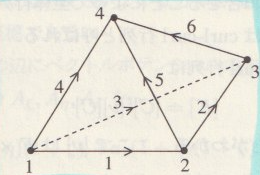

表A1.

| i, j（辺番号） | k   | l   | m   | n   |
|:--------------:|:---:|:---:|:---:|:---:|
| 1              | 1   | 2   | 3   | 4   |
| 2              | 2   | 3   | 1   | 4   |
| 3              | 1   | 3   | 4   | 2   |
| 4              | 1   | 4   | 2   | 3   |
| 5              | 2   | 4   | 3   | 1   |
| 6              | 3   | 4   | 1   | 2   |

式(6)を用いると、式(5)は次のようになります。

$$\sum_{j = 1}^{6}{\int_{\Omega_{e}}{\left\{ \left( \nabla \times \mathbf{w}_{i} \right) \cdot \left( \nabla \times \mathbf{w}_{j} \right) \right\} dV}\lbrack Al\rbrack_{j}} + \sum_{j = 1}^{6}{\int_{\Omega_{e}}{i\omega\mu\sigma\mathbf{w}_{i} \cdot \mathbf{w}_{j}dV}\lbrack Al\rbrack_{j}} = \mu\int_{\Omega_{e}}{\mathbf{w}_{i} \cdot \mathbf{i}_{s_{e}}dV},\  \cdot \cdot \cdot (7)$$

これを行列形式で書くと次のようになります。

$$\left\{ \left\lbrack M_{e} \right\rbrack + i\omega\mu\sigma_{e}\left\lbrack N_{e} \right\rbrack \right\}\left\lbrack \mathbf{Al}_{e} \right\rbrack = \mathbf{s}_{e} \cdot \cdot \cdot (8)$$

$$\left\lbrack \mathbf{Al}_{e} \right\rbrack = \left\lbrack {Al}_{1}\ {Al}_{2}\ {Al}_{3}\ {Al}_{4}\ {Al}_{5}\ {Al}_{6} \right\rbrack^{T} \cdot \cdot \cdot (9)$$

$$\left\lbrack M_{e} \right\rbrack_{ij} = \int_{\Omega_{e}}{\left\{ \left( \nabla \times \mathbf{w}_{i} \right) \cdot \left( \nabla \times \mathbf{w}_{j} \right) \right\} dV} = \frac{1}{3v}\mathbf{x}_{mn} \cdot \frac{1}{3v}\mathbf{x}_{m^{'}n^{'}} \times v = \frac{1}{9v}\mathbf{x}_{mn} \cdot \mathbf{x}_{m^{'}n^{'}} \cdot \cdot \cdot (10)$$

$$\left\lbrack N_{e} \right\rbrack_{ij} = \int_{\Omega_{e}}{\mathbf{w}_{i} \cdot \mathbf{w}_{j}dV} = \int_{\Omega_{e}}{\left( \lambda_{k}\nabla\lambda_{l} - \lambda_{l}\nabla\lambda_{k} \right) \cdot \left( \lambda_{k^{'}}\nabla\lambda_{l^{'}} - \lambda_{l^{'}}\nabla\lambda_{k^{'}} \right)dV}$$

$$= \int_{\Omega_{e}}{\left( \lambda_{k}\lambda_{k^{'}}\nabla\lambda_{l} \cdot \nabla\lambda_{l^{'}} - \lambda_{k}\lambda_{l^{'}}\nabla\lambda_{l} \cdot \nabla\lambda_{k^{'}} - \lambda_{l}\lambda_{k^{'}}\nabla\lambda_{k} \cdot \nabla\lambda_{l^{'}} + \lambda_{l}\lambda_{l^{'}}\nabla\lambda_{k} \cdot \nabla\lambda_{k^{'}} \right)dV}$$

$$= \nabla\lambda_{l} \cdot \nabla\lambda_{l^{'}}\int_{\Omega_{e}}{\lambda_{k}\lambda_{k^{'}}dV} - \nabla\lambda_{l} \cdot \nabla\lambda_{k^{'}}\int_{\Omega_{e}}{\lambda_{k}\lambda_{l^{'}}dV}$$

$$- \nabla\lambda_{k} \cdot \nabla\lambda_{l^{'}}\int_{\Omega_{e}}{\lambda_{l}\lambda_{k^{'}}dV} + \nabla\lambda_{k} \cdot \nabla\lambda_{k^{'}}\int_{\Omega_{e}}{\lambda_{l}\lambda_{l^{'}}dV} \cdot \cdot \cdot (11)$$

$$s_{i}^{e} = \mu\int_{\Omega_{e}}{\mathbf{w}_{i} \cdot \mathbf{i}_{s_{e}}dV} = \mu I_{s}\left( \frac{\mathbf{w}_{i}^{e}\left( r_{p1} \right) + \mathbf{w}_{i}^{e}\left( r_{p2} \right)}{2} \right) \cdot \overrightarrow{p_{1}p_{2}}\ \ (12)$$

$$= \frac{\mu I_{s}\left( \lambda_{k}\left( p_{1} \right)\nabla\lambda_{l} - \lambda_{l}\left( p_{1} \right)\nabla\lambda_{k} + \lambda_{k}\left( p_{2} \right)\nabla\lambda_{l} - \lambda_{l}\left( p_{2} \right)\nabla\lambda_{k} \right)}{2} \cdot \overrightarrow{p_{1}p_{2}}$$

$$= \frac{\mu I_{s}\left( (\lambda_{k}\left( p_{1} \right) + \lambda_{k}\left( p_{2} \right))\nabla\lambda_{l} - \left( \lambda_{l}\left( p_{1} \right) + \lambda_{l}\left( p_{2} \right) \right)\nabla\lambda_{k} \right)}{2} \cdot \overrightarrow{p_{1}p_{2}}$$

式(12)の導出では、下図のように、ヘヴィサイド関数で定義される直線電流が四面体を貫くとしています。

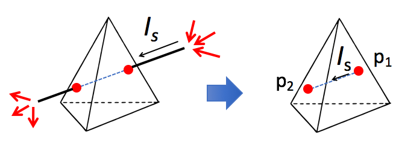

式(9)の導出では、次の関係を用いました。

$$\nabla \times \mathbf{w}_{j} = 2\nabla\lambda_{k} \times \nabla\lambda_{l} = \frac{1}{3v}\mathbf{x}_{mn}\  \cdot \cdot \cdot (13)$$

(k,l) と (m,n) の対応は表A1に示しています。

式(11)の計算では、次の関係を利用できます。

$$\nabla\lambda_{k} = \frac{1}{6v}\mathbf{x}_{ln} \times \mathbf{x}_{mn} \cdot \cdot \cdot (14)$$

$$\int_{\Omega_{e}}{\lambda_{k}\lambda_{l}dV} = \left\{ \begin{matrix}
6v\frac{1!1!}{(1 + 1 + 3)!} = \frac{v}{20}\ (k \neq l) \\
6v\frac{2!}{(2 + 3)!} = \frac{v}{10}\ \ \ \ \ \ \ \ (k = l)
\end{matrix} \right.\  \cdot \cdot \cdot (15)$$

なお、四面体における節点基底関数の積分には次の公式があります。

$$\int_{\Omega_{e}}{\lambda_{1}^{k}\lambda_{2}^{l}\lambda_{3}^{m}\lambda_{4}^{n}dV} = 6v\frac{k!l!m!n!}{(k + l + m + n + 3)!}\ \  \cdot \cdot \cdot (16)$$

## 付録B：ActFEM 計算のための支配方程式のスケーリング <a id="AppendixB"></a>
式(7)と式(12)を組み合わせた離散化形式

$$\sum_{j = 1}^{6}{\int_{\Omega_{e}}{\left\{ \left( \nabla \times \mathbf{w}_{i} \right) \cdot \left( \nabla \times \mathbf{w}_{j} \right) \right\} dV}\lbrack Al\rbrack_{j}} + \sum_{j = 1}^{6}{\int_{\Omega_{e}}{i\omega\mu\sigma\mathbf{w}_{i} \cdot \mathbf{w}_{j}dV}\lbrack Al\rbrack_{j}} = \mu I_{s}\left( \frac{\mathbf{w}_{i}^{e}\left( r_{p1} \right) + \mathbf{w}_{i}^{e}\left( r_{p2} \right)}{2} \right) \cdot \overrightarrow{p_{1}p_{2}}\  \cdot \cdot \cdot (17)$$

を解く際、ActFEM ではスケーリングを行っています。スケーリング長 $L$ を用い、ActFEM では $L$ = 1000 m としています。次の置き換えを用いて式(17)を書き直すことを考えます。

$$\nabla = \frac{1}{L}\nabla^{'},\quad \mathbf{w} = \frac{1}{L}\mathbf{w}^{'},\quad dV = L^{3}dV^{'},\quad \overrightarrow{p_{1}p_{2}} = L\overrightarrow{p_{1}p_{2}'},\quad Al\left\lbrack s \cdot V/m \cdot m \right\rbrack = \int \mathbf{A} \cdot d\mathbf{l} = \frac{1}{L}Al^{'},$$

ここで $Al^{'}$ の単位は $\left\lbrack s \cdot mV/km \cdot km \right\rbrack$、また $\mathbf{E} = i\omega\mathbf{A}$ です。これらの置き換えは、**$\mathbf{w}$ と $\nabla$ が、km 単位の座標系で $\mathbf{w}'$ および $\nabla'$ として構成されている**ことに対応します。

$$\sum_{j = 1}^{6}{\int_{\Omega_{e}}{\left\{ \left( \frac{1}{L}\nabla' \times \frac{1}{L}\mathbf{w}_{i}^{'} \right) \cdot \left( \frac{1}{L}\nabla^{'} \times \frac{1}{L}\mathbf{w}_{j}^{'} \right) \right\} L^{3}dV^{'}}\frac{1}{L}\ \left\lbrack Al^{'} \right\rbrack_{j}} + \sum_{j = 1}^{6}{\int_{\Omega_{e}}{i\omega\mu\sigma\frac{1}{L}\mathbf{w}_{i}^{'} \cdot \frac{1}{L}{\mathbf{w}^{'}}_{j}L^{3}dV'}\frac{1}{L}\left\lbrack Al^{'} \right\rbrack_{j}} = \mu I_{s}\frac{1}{L}\left( \frac{w'\left( r_{p1} \right) + w'\left( r_{p2} \right)}{2} \right) \cdot L\overrightarrow{p_{1}p_{2}'}$$

$$\Longleftrightarrow\sum_{j = 1}^{6}{\int_{\Omega_{e}}{\left\{ \left( \nabla^{'} \times \mathbf{w}_{i}^{'} \right) \cdot \left( \nabla^{'} \times \mathbf{w}_{j}^{'} \right) \right\} dV^{'}}\left\lbrack Al^{'} \right\rbrack_{j}} + \sum_{j = 1}^{6}{\int_{\Omega_{e}}{L^{2}i\omega\mu\sigma\mathbf{w}_{i}^{'} \cdot {\mathbf{w}^{'}}_{j}dV^{'}}\left\lbrack Al^{'} \right\rbrack_{j}} = \mu I_{s}L^{2}\left( \frac{w'\left( r_{p1} \right) + w'\left( r_{p2} \right)}{2} \right) \cdot \overrightarrow{p_{1}p_{2}'}$$

なお、送信源の電流 $I_{s}$ はスケーリングしておらず、単位は [A] のままです。
